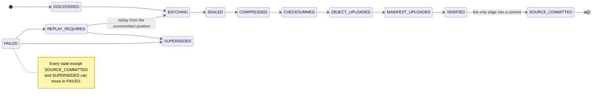
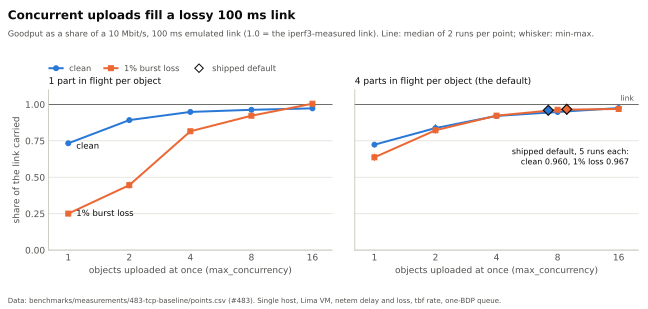
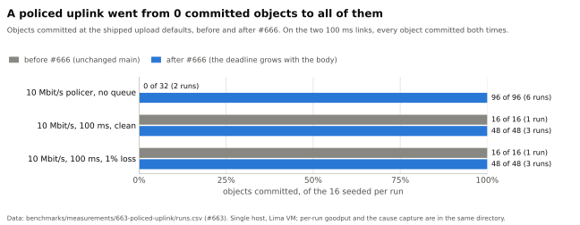
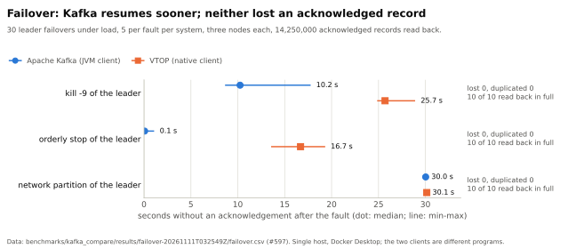
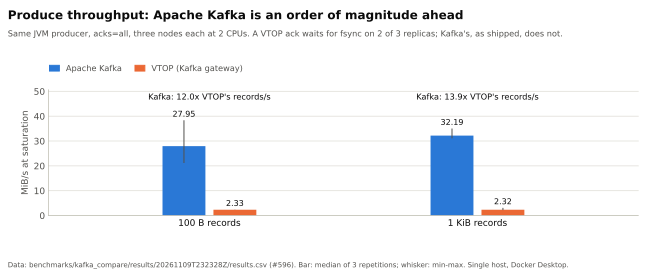
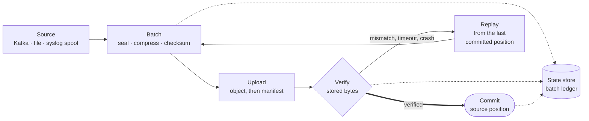

<div align="center">


# VTOP Engine

**Verified Telemetry Object Protocol Engine**

Moves telemetry from Kafka topics, append-only files and syslog spools into
object storage, and advances the source position only after the stored object
has been verified.

[](https://github.com/allamiro/vtop-engine/actions/workflows/ci.yml?query=branch%3Amain)
[](https://github.com/allamiro/vtop-engine/releases)
[](LICENSE)
[](https://www.rust-lang.org)
[](#status-and-limits)

[The rule](#the-one-rule) · [Evidence](#evidence) · [Quick start](#quick-start) · [How it works](#how-it-works) · [Documentation](#documentation)

</div>

---

<a name="core-rule"></a>

## The one rule

```text
SOURCE_COMMITTED is forbidden until VERIFIED is true.
```

A Kafka offset, a file byte offset or a syslog spool offset is committed only
after the batch's object and manifest are in object storage and the stored
bytes match the checksum. Until then the data stays at the source, so a crash,
a failed upload or a failed check leads to a replay, not a gap.



One function enforces the rule:
[`transition()` in `vtop-core`](crates/vtop-core/src/state_machine.rs). A
commit from any state other than `VERIFIED` returns `CommitBeforeVerified`,
and a unit test asserts that for each pipeline state before it. `SUPERSEDED` retires
a failed batch whose range the source has since committed past. The normative
text is [protocol §13](docs/VTOP_PROTOCOL_DRAFT.md#13-commit-rule).

---

## Evidence

[`benchmarks/readme_charts.py`](benchmarks/readme_charts.py) draws every chart
below from measurements committed in this repository. CI redraws them on every
change to the data or the script, and fails if an image differs. All runs are
on a single host, so they show behaviour and relative cost, not capacity.

### Upload throughput on a long, lossy link

<picture>
  <source media="(prefers-color-scheme: dark)" srcset="docs/assets/readme/egress-utilisation-dark.svg">
  
</picture>

With 1% burst loss, one upload at a time carries 0.25 of the link. The shipped
default (8 objects in flight, 4 parts each) carries **0.960** of a clean link
and **0.967** of a lossy one, the median of 5 runs each.
Data: [`483-tcp-baseline/points.csv`](benchmarks/measurements/483-tcp-baseline/points.csv).
Method and every condition: [EGRESS_TRANSPORT_RESEARCH.md](docs/EGRESS_TRANSPORT_RESEARCH.md).

### A policed uplink, before and after a fix

<picture>
  <source media="(prefers-color-scheme: dark)" srcset="docs/assets/readme/policed-uplink-dark.svg">
  
</picture>

On a 10 Mbit/s policed uplink, which drops what exceeds its rate instead of
queueing it, the shipped defaults committed
**0 of 32** objects. Every part upload hit a fixed 300 s deadline and was sent
again from its first byte, so every object ended `failed` and no source
position moved. Since [#666](https://github.com/allamiro/vtop-engine/pull/666),
a request's deadline grows with the size of its body, and the same link
committed **96 of 96**.
Data: [`663-policed-uplink/runs.csv`](benchmarks/measurements/663-policed-uplink/runs.csv).

### Leader failover, against Apache Kafka

<picture>
  <source media="(prefers-color-scheme: dark)" srcset="docs/assets/readme/kafka-failover-dark.svg">
  
</picture>

All 30 failovers, 15 per system, read back every acknowledged record:
**0 lost, 0 duplicated**, 14,250,000 records in all. Kafka's producer resumes
sooner after a `kill -9` of the leader (10.2 s, against 25.7 s for VTOP) and
after an orderly stop; a network partition costs both about 30 s. VTOP was
driven through its native client, because a Kafka client cannot yet follow a
VTOP failover.
Data and the full report: [kafka-failover.md](docs/benchmarks/kafka-failover.md).

### Produce throughput, against Apache Kafka

<picture>
  <source media="(prefers-color-scheme: dark)" srcset="docs/assets/readme/kafka-throughput-dark.svg">
  
</picture>

Through the same JVM producer, Kafka carries 12.0x to 13.9x the records per
second of VTOP's Kafka gateway. Each system ran as shipped: a Kafka `acks=all`
acknowledgement does not wait for an fsync, and a VTOP quorum acknowledgement
waits for two replicas to fsync.
Data, latency and consume results: [kafka-comparison.md](docs/benchmarks/kafka-comparison.md).

> [!NOTE]
> Both Kafka comparisons ran on one laptop (Apple M5 Max), each three-node
> cluster in turn in the same Docker Desktop VM, at 2 CPUs and 2 GiB per node.
> They are indicative, not a production benchmark.

---

## Quick start

The Docker lab runs Kafka, MinIO, seeded telemetry and the engine, with every
port bound to loopback:

```bash
docker compose up -d
docker compose logs -f vtop-engine
```

Each batch logs `format_detected`, `object_uploaded`, `manifest_uploaded`,
`verification_passed` and `source_committed`, in that order. The MinIO
console is at `http://localhost:9001`; the objects are in the `telemetry-data`
bucket.

To build it yourself, install the
[native prerequisites](docs/install/from-source.md) first:

```bash
cargo build --release --locked
./target/release/vtopctl validate --config examples/config.yaml
./target/release/vtopctl discover --config examples/config.yaml
```

| Next | |
|---|---|
| [Quick start in full](docs/getting-started/quickstart.md) | the lab's services and security, Kafka and file walkthroughs |
| [Building from source](docs/install/from-source.md) | prerequisites per platform, optional builds, troubleshooting |
| [Release binaries](docs/install/binaries.md) | downloads, run-time libraries, checking signatures |
| [The CLI](docs/reference/cli.md) | every `vtopctl` command, and how the engine stops |

---

## How it works



1. A source adapter reads records, and the engine seals them into a batch.
2. The batch is compressed and checksummed (SHA-256 or BLAKE3). A **manifest**
   records the source position, object URI, checksum, format and compression,
   with an optional keyed-BLAKE3 MAC.
3. The object is uploaded, then the manifest.
4. Verification checks what the store holds, not what was sent: a
   service-computed SHA-256, a streamed BLAKE3, or a download and re-hash. An
   ETag, a sidecar or uploader-written metadata never counts as proof.
5. Only a `VERIFIED` batch commits its source position. Every state change is
   written to the state store (SQLite or PostgreSQL), so after a crash the
   engine retries a pending commit or replays from the source.

| Crash point | Recovery |
|---|---|
| before or during upload | replay from the source |
| after upload, before verification | replay from the source |
| after verification, before the commit | retry the commit |
| after the commit | nothing to do |

The engine detects the format of each batch (CEF, LEEF, JSON, JSON Lines,
syslog, raw) unless the stream sets it. The manifest, verification levels,
recovery and metrics are in the
[archive path reference](docs/reference/archive-path.md), and the code layout
is in [ARCHITECTURE.md](docs/ARCHITECTURE.md).

---

## Sources and backends

| Source | Progress marker | What is committed, after verification |
|---|---|---|
| Kafka | topic, partition, offset range | consumer offsets; auto-commit is disabled |
| File | path, inode, byte range | the last safe byte offset; a partial trailing line never is. `whole_file` mode archives binary or pre-compressed files byte for byte |
| Syslog spool | spool ID, byte range | as for files; rsyslog or syslog-ng deliver into the spool |

| Upload backend | How the stored object is verified |
|---|---|
| native S3 (`s3_native`), for any S3-compatible store | service-computed SHA-256 or streamed BLAKE3 |
| LocalFS, for local or air-gapped storage | the stored file is streamed through the digest |
| AWS CLI, s3cmd, MinIO client (explicit opt-in) | downloaded and re-hashed |
| mock, for tests | the stored in-memory bytes are hashed |

The Kafka source is a Cargo feature: `cargo build -p vtop-cli --no-default-features`
builds without it. The same repository holds a native Rust broker and control
plane (Raft metadata, quorum replication, fenced range leadership), in which
Kafka is an optional edge adapter; see
[NATIVE_BROKER_ARCHITECTURE.md](docs/NATIVE_BROKER_ARCHITECTURE.md).

---

## Status and limits

> [!NOTE]
> VTOP Engine is a **prototype / reference implementation** of a proposed
> protocol and method. Releases are signed and attested; the 0.x series means
> the API may still change.
>
> This repository supports candidate-invention disclosure work. It is **not**
> patented or patent-pending; see
> [INVENTION_DISCLOSURE_DRAFT.md](docs/INVENTION_DISCLOSURE_DRAFT.md).

The limits that matter most when evaluating it:

- **A replay writes a new object key.** `batch_id` ends in a random suffix, so
  a replayed batch leaves a duplicate object (no data is lost). The protocol's
  deterministic naming rule ([§15.1](docs/VTOP_PROTOCOL_DRAFT.md#151-object-key))
  is not met yet.
- **Size-only verification is an opt-out, and it accepts same-size
  corruption.** Strong verification is the default; the opt-out is reported at
  startup, by `vtopctl validate`, and in the metrics.
- **The Kafka gateway is slower than Apache Kafka**, by 12.0x to 13.9x in
  records per second in the comparison above, and a Kafka client cannot yet
  follow a VTOP failover.
- **Not built yet:** manifest MAC key rotation, an S3 Object Lock profile,
  OpenTelemetry traces, and a million-file benchmark.

The full table, with what is done and what is planned, is in
[limitations.md](docs/reference/limitations.md). Per-release limits are in
[ROADMAP.md](docs/ROADMAP.md), and the engine's HA status is in
[PRODUCTION_HA.md](docs/PRODUCTION_HA.md).

---

## Documentation

| Document | What it covers |
|---|---|
| [docs/README.md](docs/README.md) | the documentation index and reading order |
| [VTOP_PROTOCOL_DRAFT.md](docs/VTOP_PROTOCOL_DRAFT.md) | the protocol: state machine, commit and replay rules, conformance profiles |
| [ARCHITECTURE.md](docs/ARCHITECTURE.md) | crates, the engine's runtime flow, recovery, implementation status |
| [Archive path reference](docs/reference/archive-path.md) | sources, formats, the manifest, verification, recovery, metrics |
| [PRODUCTION_HA.md](docs/PRODUCTION_HA.md) | engine HA: status, design and phased roadmap |
| [ROADMAP.md](docs/ROADMAP.md) | cluster-plane releases and per-release limitations |
| [SECURITY_MODEL.md](docs/SECURITY_MODEL.md) | the security model and its normative rules |
| [RELEASE_VERIFICATION.md](docs/RELEASE_VERIFICATION.md) | checking a release's signatures, SBOM and provenance |
| [LIVE_CHAOS_VALIDATION.md](docs/LIVE_CHAOS_VALIDATION.md) | the live-chaos suite: real processes, real TLS, injected faults |
| [benchmarks/README.md](benchmarks/README.md) | the benchmark harness, its scenarios and its calibration gate |
| [INVENTION_DISCLOSURE_DRAFT.md](docs/INVENTION_DISCLOSURE_DRAFT.md) | the candidate-invention disclosure draft |
| [PRIOR_ART_SEARCH_PLAN.md](docs/PRIOR_ART_SEARCH_PLAN.md) | the prior-art search plan |
| [CONTRIBUTING.md](CONTRIBUTING.md) | how changes get in, and the naming and claims rules |

---

## Citing VTOP Engine

If you use VTOP Engine in research, please cite it. GitHub's **Cite this repository** button (from CITATION.cff) gives APA and BibTeX.

```bibtex
@software{suliman_vtop_engine,
  author  = {Suliman, Tamir},
  title   = {{VTOP Engine: Verified Telemetry Object Protocol Engine}},
  year    = {2026},
  version = {0.8.0},
  url     = {https://github.com/allamiro/vtop-engine},
  license = {MIT}
}
```

---

## License

**[MIT](LICENSE) © 2026 Tamir Suliman** — and today that covers the entire
engine.

The repository is set up as **dual-licensed** so the boundary is written down
before there is anything on the other side of it: directories named `ee/`, and
files carrying the header `VTOP Engine Enterprise Edition`, fall under
[LICENSE-EE](LICENSE-EE) instead, which permits evaluation, development and
testing but requires a commercial subscription for production use. **No `ee/`
directory exists yet**, so nothing in this repository is currently under those
terms.

Three rules bound it, stated in [COMMERCIAL.md](COMMERCIAL.md): code that is
MIT stays MIT, the core must build and pass CI with `ee/` deleted, and anything
whose absence could lose or corrupt acknowledged data — durability, fencing,
replication, failover, verification — stays in the core. Paying is for
operating at scale, not for not losing data.
