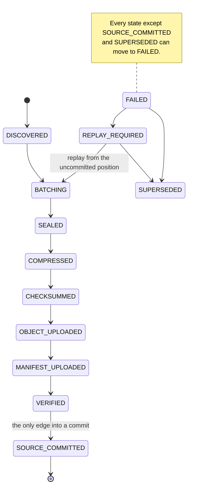
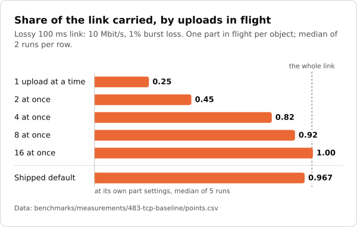
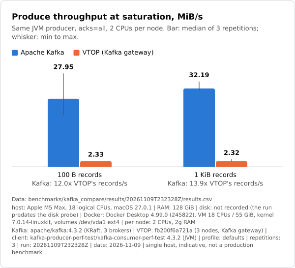
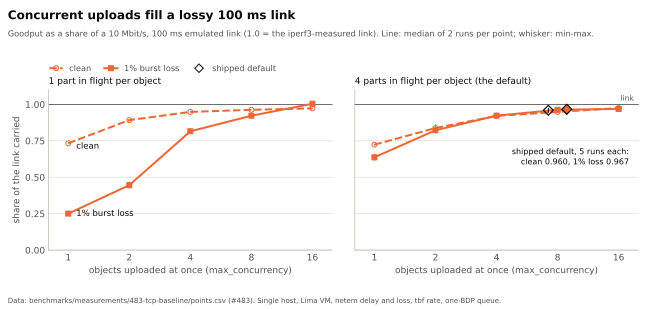
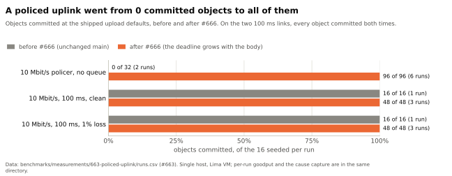
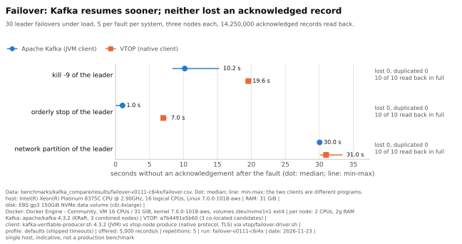
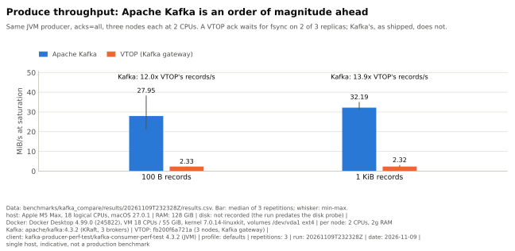
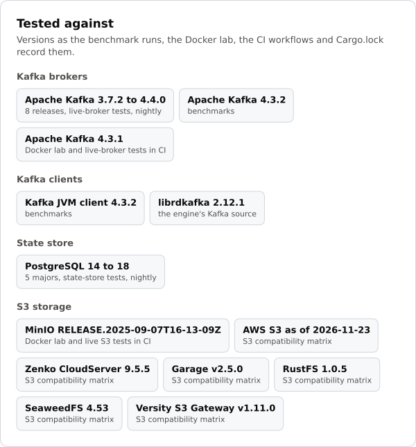
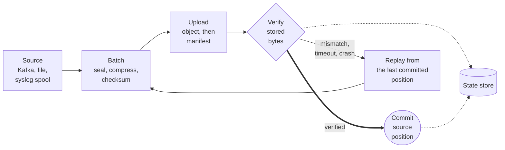

<div align="center">


# VTOP Engine

**Verified Telemetry Object Protocol Engine**

Moves telemetry from Kafka topics, append-only files and syslog spools into
object storage, and advances the source position only after the stored object
has been verified.

[](https://github.com/allamiro/vtop-engine/actions/workflows/ci.yml?query=branch%3Amain)
[](https://github.com/allamiro/vtop-engine/releases)
[](LICENSE)
[](https://www.rust-lang.org)
[](#status-and-limits)

<picture>
  <source media="(prefers-color-scheme: dark)" srcset="docs/assets/readme/card-hero-dark.svg">
  
</picture>

[Site](https://allamiro.github.io/vtop-engine/) · [The rule](#the-one-rule) · [Evidence](#evidence) · [Quick start](#quick-start) · [How it works](#how-it-works) · [Documentation](#documentation)

</div>

The documentation site is [allamiro.github.io/vtop-engine](https://allamiro.github.io/vtop-engine/).

---

<a name="core-rule"></a>

## The one rule

```text
SOURCE_COMMITTED is forbidden until VERIFIED is true.
```

A Kafka offset, a file byte offset or a syslog spool offset is committed only
after the batch's object and manifest are in object storage and the stored
bytes match the checksum. Until then the data stays at the source, so a crash,
a failed upload or a failed check leads to a replay, not a gap.



One function enforces the rule:
[`transition()` in `vtop-core`](crates/vtop-core/src/state_machine.rs). A
commit from any state other than `VERIFIED` returns `CommitBeforeVerified`,
and a unit test asserts that for each pipeline state before it. `SUPERSEDED` retires
a failed batch whose range the source has since committed past. The normative
text is [protocol §13](docs/VTOP_PROTOCOL_DRAFT.md#13-commit-rule).

---

## At a glance

On a long, lossy link, VTOP's uploads fill the link only when several run at
once; the shipped default does.

<picture>
  <source media="(prefers-color-scheme: dark)" srcset="docs/assets/readme/card-link-share-dark.svg">
  
</picture>

Where VTOP is behind: through the same producer, Apache Kafka carries an order
of magnitude more records per second than VTOP's Kafka gateway.

<picture>
  <source media="(prefers-color-scheme: dark)" srcset="docs/assets/readme/card-throughput-dark.svg">
  
</picture>

The cards above are drawn by
[`benchmarks/readme_cards.py`](benchmarks/readme_cards.py) from the same files
as the charts below, through
[`benchmarks/site_facts.py`](benchmarks/site_facts.py).

---

## Evidence

[`benchmarks/readme_charts.py`](benchmarks/readme_charts.py) draws every chart
below from measurements committed in this repository. CI redraws them on every
change to the data or the script, and fails if an image differs. All runs are
on a single host, so they show behaviour and relative cost, not capacity.

### Upload throughput on a long, lossy link

<picture>
  <source media="(prefers-color-scheme: dark)" srcset="docs/assets/readme/egress-utilisation-dark.svg">
  
</picture>

With 1% burst loss, one upload at a time carries 0.25 of the link. The shipped
default (8 objects in flight, 4 parts each) carries **0.960** of a clean link
and **0.967** of a lossy one, the median of 5 runs each.
Data: [`483-tcp-baseline/points.csv`](benchmarks/measurements/483-tcp-baseline/points.csv).
Method and every condition: [EGRESS_TRANSPORT_RESEARCH.md](docs/EGRESS_TRANSPORT_RESEARCH.md).

### A policed uplink, before and after a fix

<picture>
  <source media="(prefers-color-scheme: dark)" srcset="docs/assets/readme/policed-uplink-dark.svg">
  
</picture>

On a 10 Mbit/s policed uplink, which drops what exceeds its rate instead of
queueing it, a fixed 300 s request deadline committed **0 of 32** objects:
every part upload hit the deadline and was sent again from its first byte, so
no source position moved. With a deadline that grows with the size of the
request body, as shipped since v0.8.0, the same link committed **96 of 96**.
Data: [`663-policed-uplink/runs.csv`](benchmarks/measurements/663-policed-uplink/runs.csv).

### Leader failover, against Apache Kafka

<picture>
  <source media="(prefers-color-scheme: dark)" srcset="docs/assets/readme/kafka-failover-dark.svg">
  
</picture>

All 30 failovers, 15 per system, read back every acknowledged record:
**0 lost, 0 duplicated**, 14,250,000 records in all. Kafka's producer resumes
sooner after a `kill -9` of the leader (10.2 s, against 25.7 s for VTOP) and
after an orderly stop; a network partition costs both about 30 s. VTOP was
driven through its native client in that run, which predates #751: a Kafka
client could not follow a VTOP failover then.
A Kafka client now can, with no restart and no configuration change (#751):
live-chaos scenarios 27 and 28 killed the range leader under a stock
librdkafka producer and under the JVM client of Apache Kafka 4.4.0, and each
resumed 5.5 s to 6.6 s later (librdkafka 5.7 s to 6.6 s in four runs, the JVM
client 5.5 s to 5.8 s in eight), with every acknowledged record read back once
and in order. That is one host, debug binaries and a 6 s lease, against the
chart's 15 s default; it is not a comparison with Kafka's numbers above, and it
does not cover the co-located `vtop-node node` shape or a consumer group across
a failover ([details](docs/LIVE_CHAOS_VALIDATION.md#kafka-clients-and-a-failover-751)).
Data and the full report: [kafka-failover.md](docs/benchmarks/kafka-failover.md).

### Produce throughput, against Apache Kafka

<picture>
  <source media="(prefers-color-scheme: dark)" srcset="docs/assets/readme/kafka-throughput-dark.svg">
  
</picture>

Through the same JVM producer, Kafka carries 12.0x to 13.9x the records per
second of VTOP's Kafka gateway. Each system ran as shipped: a Kafka `acks=all`
acknowledgement does not wait for an fsync, and a VTOP quorum acknowledgement
waits for two replicas to fsync.
Data, latency and consume results: [kafka-comparison.md](docs/benchmarks/kafka-comparison.md).

> [!NOTE]
> Both Kafka comparisons ran on one laptop (Apple M5 Max), each three-node
> cluster in turn in the same Docker Desktop VM, at 2 CPUs and 2 GiB per node.
> They are indicative, not a production benchmark.

---

## Tested against

<picture>
  <source media="(prefers-color-scheme: dark)" srcset="docs/assets/readme/card-tested-dark.svg">
  
</picture>

---

## Quick start

The Docker lab runs Kafka, MinIO, seeded telemetry and the engine, with every
port bound to loopback:

```bash
docker compose up -d
docker compose logs -f vtop-engine
```

Each batch logs `format_detected`, `object_uploaded`, `manifest_uploaded`,
`verification_passed` and `source_committed`, in that order. The MinIO
console is at `http://localhost:9001`; the objects are in the `telemetry-data`
bucket.

To build it yourself, install the
[native prerequisites](docs/install/from-source.md) first:

```bash
cargo build --release --locked
./target/release/vtopctl validate --config examples/config.yaml
./target/release/vtopctl discover --config examples/config.yaml
```

| Next | |
|---|---|
| [Quick start in full](docs/getting-started/quickstart.md) | the lab's services and security, Kafka and file walkthroughs |
| [Building from source](docs/install/from-source.md) | prerequisites per platform, optional builds, troubleshooting |
| [Release binaries](docs/install/binaries.md) | downloads, run-time libraries, checking signatures |
| [The CLI](docs/reference/cli.md) | every `vtopctl` command, and how the engine stops |

The same quick start, on the documentation site:
[allamiro.github.io/vtop-engine/getting-started/quickstart](https://allamiro.github.io/vtop-engine/getting-started/quickstart/).

---

## How it works



1. A source adapter reads records, and the engine seals them into a batch.
2. The batch is compressed and checksummed (SHA-256 or BLAKE3). A **manifest**
   records the source position, object URI, checksum, format and compression,
   with an optional keyed-BLAKE3 MAC.
3. The object is uploaded, then the manifest.
4. Verification checks what the store holds, not what was sent: a
   service-computed SHA-256, a streamed BLAKE3, or a download and re-hash. An
   ETag, a sidecar or uploader-written metadata never counts as proof.
5. Only a `VERIFIED` batch commits its source position. Every state change is
   written to the state store (SQLite or PostgreSQL), so after a crash the
   engine retries a pending commit or replays from the source.

| Crash point | Recovery |
|---|---|
| before or during upload | replay from the source |
| after upload, before verification | replay from the source |
| after verification, before the commit | retry the commit |
| after the commit | nothing to do |

The engine detects the format of each batch (CEF, LEEF, JSON, JSON Lines,
syslog, raw) unless the stream sets it. The manifest, verification levels,
recovery and metrics are in the
[archive path reference](docs/reference/archive-path.md), and the code layout
is in [ARCHITECTURE.md](docs/ARCHITECTURE.md).

---

## Sources and backends

| Source | Progress marker | What is committed, after verification |
|---|---|---|
| Kafka | topic, partition, offset range | consumer offsets; auto-commit is disabled |
| File | path, inode, byte range | the last safe byte offset; a partial trailing line never is. `whole_file` mode archives binary or pre-compressed files byte for byte |
| Syslog spool | spool ID, byte range | as for files; rsyslog or syslog-ng deliver into the spool |

| Upload backend | How the stored object is verified |
|---|---|
| native S3 (`s3_native`), for any S3-compatible store | service-computed SHA-256 or streamed BLAKE3 |
| LocalFS, for local or air-gapped storage | the stored file is streamed through the digest |
| AWS CLI, s3cmd, MinIO client (explicit opt-in) | downloaded and re-hashed |
| mock, for tests | the stored in-memory bytes are hashed |

The Kafka source is a Cargo feature: `cargo build -p vtop-cli --no-default-features`
builds without it. The same repository holds a native Rust broker and control
plane (Raft metadata, quorum replication, fenced range leadership), in which
Kafka is an optional edge adapter; see
[NATIVE_BROKER_ARCHITECTURE.md](docs/NATIVE_BROKER_ARCHITECTURE.md).

---

## Status and limits

> [!NOTE]
> VTOP Engine is a **prototype / reference implementation** of a proposed
> protocol and method. Releases are signed and attested; the 0.x series means
> the API may still change.
>
> This repository supports candidate-invention disclosure work. It is **not**
> patented or patent-pending; see
> [INVENTION_DISCLOSURE_DRAFT.md](docs/INVENTION_DISCLOSURE_DRAFT.md).

The limits that matter most when evaluating it:

- **A replay reuses the stored object only when it produces the same bytes.**
  Objects are named by source, range and content digest, so a replay of
  the same bytes reuses what is stored and never overwrites anything, and a
  replay is rebuilt as first cut. A replay that cannot be rebuilt as cut (the
  source rewrote or dropped the range), a replay of a row from before v0.10.0 in a later hour under
  seal-time partitioning, with no checksum, or on a command backend still
  writes a second object (no data
  is lost), so the protocol's deterministic naming rule
  ([§15.1](docs/VTOP_PROTOCOL_DRAFT.md#151-object-key)) is narrowed, not met.
- **Size-only verification is an opt-out, and it accepts same-size
  corruption.** Strong verification is the default; the opt-out is reported at
  startup, by `vtopctl validate`, and in the metrics.
- **The Kafka gateway is slower than Apache Kafka**, by 12.0x to 13.9x in
  records per second in the comparison above. A Kafka client follows a VTOP
  failover without reconfiguration (#751), measured on one host with debug
  binaries and a 6 s lease; the chart's 15 s lease default, the co-located
  `vtop-node node` shape and a consumer group across a failover are not
  measured.
- **Not built yet:** public-key manifest signatures and a million-file
  benchmark.

Data-safety bugs were still being found as late as November 2026; each one is
in the [data-safety register](docs/reference/data-safety-register.md). Keep the
source data until a scrub of the archive passes.

Which parts are production, preview or experimental, and why, is in the
[component status table](docs/reference/component-status.md). The maintainer
confirmed its labels (#740). A label states what the evidence supports, not a
promise of support. Where each criterion of the 1.0 bar stands, with its
evidence and the date it was checked, is in the
[1.0 release gate](docs/reference/release-gate.md).

The full table, with what is done and what is planned, is in
[limitations.md](docs/reference/limitations.md). Per-release limits are in
[ROADMAP.md](docs/ROADMAP.md), and the engine's HA status is in
[PRODUCTION_HA.md](docs/PRODUCTION_HA.md).

---

## Documentation

Everything below is also on the documentation site,
[allamiro.github.io/vtop-engine](https://allamiro.github.io/vtop-engine/),
with search and a reading order.

| Document | What it covers |
|---|---|
| [docs/README.md](docs/README.md) | the documentation index and reading order |
| [VTOP_PROTOCOL_DRAFT.md](docs/VTOP_PROTOCOL_DRAFT.md) | the protocol: state machine, commit and replay rules, conformance profiles |
| [ARCHITECTURE.md](docs/ARCHITECTURE.md) | crates, the engine's runtime flow, recovery, implementation status |
| [Archive path reference](docs/reference/archive-path.md) | sources, formats, the manifest, verification, recovery, metrics |
| [PRODUCTION_HA.md](docs/PRODUCTION_HA.md) | engine HA: status, design and phased roadmap |
| [Component status](docs/reference/component-status.md) | production, preview or experimental for each component, with the evidence and the criteria still open |
| [1.0 release gate](docs/reference/release-gate.md) | every criterion of the 1.0 bar: met, partial or not met, its evidence and the date checked |
| [ROADMAP.md](docs/ROADMAP.md) | engine and cluster-plane releases, per-release limitations and upgrade notes |
| [Compatibility policy](docs/reference/compatibility.md) | what each format promises, upgrade and downgrade rules, deprecation |
| [SUPPORT.md](docs/SUPPORT.md) | versioning, which releases get fixes, and the 1.x support window |
| [SECURITY_MODEL.md](docs/SECURITY_MODEL.md) | the security model and its normative rules |
| [SECURITY.md](SECURITY.md) | reporting a vulnerability: the private channel, response times, supported versions |
| [RELEASE_VERIFICATION.md](docs/RELEASE_VERIFICATION.md) | checking a release's signatures, SBOM and provenance |
| [LIVE_CHAOS_VALIDATION.md](docs/LIVE_CHAOS_VALIDATION.md) | the live-chaos suite: real processes, real TLS, injected faults |
| [benchmarks/README.md](benchmarks/README.md) | the benchmark harness, its scenarios and its calibration gate |
| [INVENTION_DISCLOSURE_DRAFT.md](docs/INVENTION_DISCLOSURE_DRAFT.md) | the candidate-invention disclosure draft |
| [PRIOR_ART_SEARCH_PLAN.md](docs/PRIOR_ART_SEARCH_PLAN.md) | the prior-art search plan |
| [CONTRIBUTING.md](CONTRIBUTING.md) | how changes get in, and the naming and claims rules |

---

## Security

Report a vulnerability privately, through
[GitHub's private vulnerability reporting](https://github.com/allamiro/vtop-engine/security/advisories/new),
never in a public issue. [SECURITY.md](SECURITY.md) gives the response times,
the supported versions and the disclosure rule.

---

## Citing VTOP Engine

If you use VTOP Engine in research, please cite it. GitHub's **Cite this repository** button (from CITATION.cff) gives APA and BibTeX.

```bibtex
@software{suliman_vtop_engine,
  author  = {Suliman, Tamir},
  title   = {{VTOP Engine: Verified Telemetry Object Protocol Engine}},
  year    = {2026},
  version = {0.11.0},
  url     = {https://github.com/allamiro/vtop-engine},
  license = {MIT}
}
```

---

## License

VTOP Engine is open source under the **[MIT License](LICENSE)**, © 2026 Tamir
Suliman. All of the code in this repository is MIT.

| Edition | License | Use |
|---|---|---|
| **Core** (this repository) | [MIT](LICENSE) | Free for any use, including production and commercial use |
| **Enterprise Edition** (code under `ee/`, or marked `VTOP Engine Enterprise Edition`) | [LICENSE-EE](LICENSE-EE) | Free to evaluate, develop and test; production use needs a commercial subscription |

Data safety is never part of the paid edition. Durability, fencing,
replication, failover and verification stay in the MIT core, and the core
builds and passes CI on its own. [COMMERCIAL.md](COMMERCIAL.md) sets out these
rules and how to ask for commercial terms.
