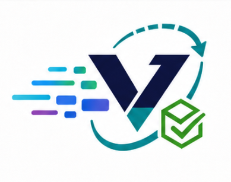
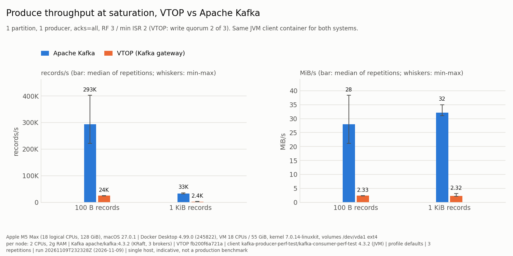
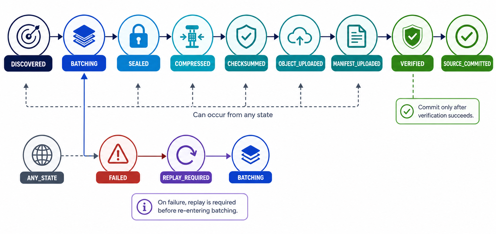
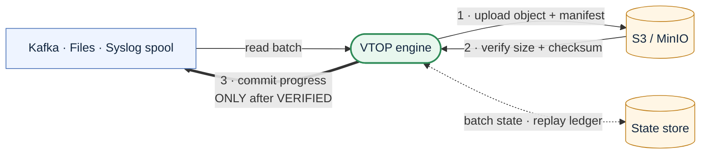

<div align="center">



# VTOP Engine

**Verified Telemetry Object Protocol Engine**

Replay-safe, manifest-driven telemetry transfer from Kafka, files, and syslog spools into object storage.

<br />

[](https://github.com/allamiro/vtop-engine/actions/workflows/ci.yml?query=branch%3Amain)
[](LICENSE)
[](https://www.rust-lang.org)
[](#status)
[](#upload-and-verification)
[](#core-rule)

</div>

---

## Overview

**VTOP Engine** moves telemetry into object storage while protecting the source commit point.

It ingests telemetry from:

- Kafka topics
- append-only log files
- syslog spool files

The longer-term cluster direction is a VTOP-owned native Rust broker and
control plane. Kafka remains supported as an optional edge/source adapter, not
as VTOP's coordinator or correctness dependency. See
[the native broker architecture](docs/NATIVE_BROKER_ARCHITECTURE.md).

For every batch, VTOP:

1. reads records from a source
2. forms a batch
3. compresses the batch
4. computes a checksum
5. creates a manifest
6. uploads the object and manifest
7. verifies the uploaded data
8. commits source progress only after verification succeeds

> [!IMPORTANT]
> VTOP does **not** commit Kafka offsets, file byte offsets, or syslog spool offsets until the destination object has been verified.

---

## Status

> [!NOTE]
> VTOP Engine is currently a **prototype / reference implementation** of a proposed protocol and proposed method.
>
> This repository is intended to support candidate-invention disclosure work. It is **not** patented or patent-pending.
>
> See [docs/INVENTION_DISCLOSURE_DRAFT.md](docs/INVENTION_DISCLOSURE_DRAFT.md).

---

## Measured against Apache Kafka

[](docs/benchmarks/kafka-comparison.md)

On one host (an Apple M5 Max laptop; each three-node cluster in turn in the same Docker Desktop VM, 2 CPUs
and `2g` of memory per node; profile `defaults`), the same JVM producer reached a higher saturation throughput against
Apache Kafka than against VTOP's Kafka gateway at both record sizes measured, where under `defaults` a Kafka
`acks=all` acknowledgement does not wait for an fsync and a VTOP quorum acknowledgement does. Indicative, not
a production benchmark: the method, the latency and consume results, the raw CSV and every condition are in
[docs/benchmarks/kafka-comparison.md](docs/benchmarks/kafka-comparison.md).

---

## Table of contents

- [Overview](#overview)
- [Status](#status)
- [Measured against Apache Kafka](#measured-against-apache-kafka)
- [Why VTOP exists](#why-vtop-exists)
- [Core rule](#core-rule)
- [How it works](#how-it-works)
- [State machine](#state-machine)
- [Supported source modes](#supported-source-modes)
- [Format detection](#format-detection)
- [Architecture](#architecture)
- [Quick start](#quick-start)
- [Build and test](#build-and-test)
- [CLI usage](#cli-usage)
- [Docker lab](#docker-lab)
- [Example manifest](#example-manifest)
- [Metrics](#metrics)
- [Upload and verification](#upload-and-verification)
- [Replay and recovery](#replay-and-recovery)
- [Known limitations](#known-limitations)
- [Roadmap](#roadmap)
- [Documentation](#documentation)
- [License](#license)

---

## Why VTOP exists

Most log-to-object-storage pipelines can move bytes into a bucket.

The harder problem is knowing when it is safe to advance the source position.

```text
Did the object land intact,
and is it safe to commit the source offset now?
```

VTOP addresses this with a source-agnostic safety model:

| Capability | Purpose |
|---|---|
| **Manifest-bound transfer** | Binds source progress, object URI, checksum, format, compression, and verification state. |
| **Verify before commit** | Prevents source progress from advancing before destination verification. |
| **Replay-safe state store** | Allows recovery without silently losing unverified data. |
| **Explicit state machine** | Makes unsafe transitions visible and testable. |
| **Pluggable sources and backends** | Applies the same safety model to Kafka, files, syslog spools, and object storage backends. |

---

## Core rule

The protocol's **commit rule** ([docs/VTOP_PROTOCOL_DRAFT.md §13](docs/VTOP_PROTOCOL_DRAFT.md#13-commit-rule)):

```text
SOURCE_COMMITTED is forbidden until VERIFIED is true.
```

A source progress marker is never committed until the batch completes this lifecycle:

```text
DISCOVERED
  → BATCHING
  → SEALED
  → COMPRESSED
  → CHECKSUMMED
  → OBJECT_UPLOADED
  → MANIFEST_UPLOADED
  → VERIFIED
  → SOURCE_COMMITTED
```

Failure can happen from any state:

```text
ANY_STATE
  → FAILED
  → REPLAY_REQUIRED
  → BATCHING
```

> [!CAUTION]
> Transitions such as `SEALED → SOURCE_COMMITTED` or `OBJECT_UPLOADED → SOURCE_COMMITTED` are invalid.

---

## How it works

At a high level, VTOP separates source progress from destination durability.

```text
Source records
  → batch
  → compressed object
  → checksum
  → manifest
  → upload object
  → upload manifest
  → verify object and manifest
  → commit source progress
```

The manifest acts as the transfer evidence record.

It links:

- source type
- source name
- source progress marker
- object URI
- object checksum
- compression type
- detected format
- batch metadata
- reproducible manifest self-hash and optional keyed-BLAKE3 authentication

---

## State machine



The state machine is the enforcement point for safe progress.

Only this final transition is valid:

```text
VERIFIED → SOURCE_COMMITTED
```

Invalid examples:

```text
SEALED → SOURCE_COMMITTED
COMPRESSED → SOURCE_COMMITTED
CHECKSUMMED → SOURCE_COMMITTED
OBJECT_UPLOADED → SOURCE_COMMITTED
MANIFEST_UPLOADED → SOURCE_COMMITTED
```

Relevant implementation:

- [crates/vtop-core/src/state_machine.rs](crates/vtop-core/src/state_machine.rs)
- [docs/VTOP_PROTOCOL_DRAFT.md §12](docs/VTOP_PROTOCOL_DRAFT.md#12-state-machine)

---

## Supported source modes

| Source mode | Progress marker | Behavior |
|---|---|---|
| **Kafka** | topic, partition, offset range | Uses a Kafka consumer with auto-commit disabled. Each batch contains records from one topic and one partition. Offsets are committed only after verification. |
| **File** | path, inode, byte range | Reads append-only files line-oriented, or whole-file for binary/compressed sources (`whole_file`). Partial trailing lines are not committed. Replay resumes from the last safe byte offset. |
| **Syslog spool** | spool ID, byte range | Treats rsyslog or syslog-ng spool files as append-only inputs. External collectors own syslog delivery; VTOP owns batching, upload, verification, replay, and commit safety. |

---

## Format detection

VTOP is not fixed to one telemetry format.

When a stream does not explicitly define a format in [examples/streams.yaml](examples/streams.yaml), the engine detects the format per batch.

Supported detected formats:

| Format | Example output extension |
|---|---|
| CEF | `.cef.gz` |
| LEEF | `.leef.gz` |
| JSON | `.json.gz` |
| JSON Lines | `.jsonl.gz` |
| Syslog | `.syslog.gz` |
| Raw | `.raw.gz` |

A single engine can process different formats across different streams.

For example:

```text
source A → CEF
source B → JSON Lines
source C → syslog
source D → mixed batches
```

The detected format is recorded in the manifest.

Relevant implementation:

- [crates/vtop-core/src/detect.rs](crates/vtop-core/src/detect.rs)

---

## Architecture

<div align="center">

&nbsp;&nbsp;&nbsp;
&nbsp;&nbsp;&nbsp;
&nbsp;&nbsp;&nbsp;
&nbsp;&nbsp;&nbsp;


</div>

The engine reads from a source, writes a **compressed object plus a manifest** to
object storage, **verifies** what it wrote, and only then advances the source
commit point. Verification failure means the source is never committed, so the
data stays replayable.



Steps **1 → 2 → 3** are the whole protocol: the thick arrow is the one rule that
must never break — see [Core rule](#core-rule).

### Workspace layout

VTOP is organized as a Rust workspace.

```text
crates/
  vtop-core/       protocol-independent logic:
                   state machine, batching, manifests,
                   checksums, compression, partitioning,
                   config, replay

  vtop-log/        Kafka-independent native broker storage:
                   framed records, active/sealed segments,
                   crash recovery, sparse indexes, manifests

  vtop-adapters/   source adapters:
                   Kafka, file, syslog spool

  vtop-upload/     upload backends:
                   native S3, s3cmd, awscli, MinIO, mock

  vtop-state/      durable SQLite / feature-gated PostgreSQL state store

  vtop-cli/        vtopctl CLI and engine runtime

examples/          example config and sample streams
docs/              protocol, architecture, security, invention notes
docker/            container build files and seed scripts
tests/             integration tests
benchmarks/        benchmark and performance test support
```

> [!TIP]
> Keep detailed internals in `docs/`. The README should stay focused on orientation, quick start, and key guarantees.

Full architecture documentation:

- [docs/ARCHITECTURE.md](docs/ARCHITECTURE.md)
- [docs/ROADMAP.md](docs/ROADMAP.md) — what each release does, and what it
  deliberately does not do yet

---

## Quick start

Run the full Docker lab:

```bash
docker compose up -d
docker compose logs -f vtop-engine
```

Or build and run locally (install the [native prerequisites](#native-prerequisites) first):

```bash
cargo build --release
cargo run -p vtop-cli -- discover --config examples/config.yaml
```

---

## Build and test

### Native prerequisites

The default build includes the Kafka source. Its `rdkafka` dependency compiles
librdkafka with CMake, and OpenSSL from source with Perl. OpenSSL is linked
into the binary, so the build never depends on the host's OpenSSL version, and
the binaries load no OpenSSL or SASL library at run time (#677). You need a
C/C++ toolchain, CMake, make and Perl, plus Rust from
[rustup](https://rustup.rs). The minimum Rust version is `rust-version` in
`Cargo.toml`.

| Platform | Install |
|---|---|
| Debian / Ubuntu | `sudo apt-get install -y build-essential cmake perl pkg-config libcurl4-openssl-dev zlib1g-dev` |
| RHEL, AlmaLinux, Rocky Linux 8, 9 and 10 | `sudo dnf install -y gcc gcc-c++ make cmake perl-core libcurl-devel zlib-devel` |
| Fedora | `sudo dnf install -y gcc gcc-c++ make cmake perl-core libcurl-devel zlib-devel` |
| macOS 11 or later, Apple silicon or Intel | `xcode-select --install`, then `brew install cmake` |

The `dnf` line was checked on AlmaLinux 8.10, 9.8 and 10.2, Rocky Linux 8.10
and 9.8, and Fedora 45. A full build was run on AlmaLinux 8 (OpenSSL 1.1.1
installed) and on Fedora 45 (OpenSSL 4 installed); neither touches the system
OpenSSL. RHEL takes the same packages from its BaseOS and AppStream
repositories. On a minimal image, `perl-core` matters: the OpenSSL build needs
Perl modules (`FindBin`, `IPC::Cmd`) that bare `perl` doesn't carry. The curl
package is needed for its header only. librdkafka includes `curl/curl.h` even
with curl support switched off (its config always defines
`WITH_OAUTHBEARER_OIDC`, and one file tests it with `#ifdef`). Nothing links
libcurl. The macOS SDK ships that header already.

Then build:

```bash
cargo build --release --locked
./target/release/vtopctl --version
```

On macOS, `.cargo/config.toml` sets `MACOSX_DEPLOYMENT_TARGET=11.0`, so a
binary built on any macOS release runs on macOS 11 and later. To target a
different minimum, export that variable yourself.

**Optional builds:**

- **Without the Kafka source.** `cargo build -p vtop-cli --no-default-features`
  skips librdkafka and OpenSSL entirely. The file, spool and native paths work
  the same.
- **Linking the system OpenSSL** instead of the built-in one. Packagers may want
  this to pick up distribution security updates. Install the OpenSSL
  development package (`libssl-dev`, `openssl-devel`, or Homebrew
  `openssl@3`), then:

  ```bash
  export OPENSSL_NO_VENDOR=1
  export OPENSSL_DIR="$(brew --prefix openssl@3)"   # macOS only
  ```

  Use OpenSSL 1.1.1 or 3.x. librdkafka calls the ENGINE API, which OpenSSL 4
  removed, so a system OpenSSL 4 (Fedora 45, Homebrew's default `openssl`)
  fails at the link step.
- **Kerberos (SASL GSSAPI)** for the Kafka source:
  `cargo build --release --features kafka-gssapi`. It links the system Cyrus
  SASL, so install `libsasl2-dev` (Debian/Ubuntu), `cyrus-sasl-devel`
  (RHEL family, Fedora) or Homebrew `cyrus-sasl`, and on macOS:

  ```bash
  export PKG_CONFIG_PATH="$(brew --prefix cyrus-sasl)/lib/pkgconfig:${PKG_CONFIG_PATH:-}"
  ```

  SASL PLAIN, SCRAM and OAUTHBEARER are built into librdkafka and need none of
  this.

**Running the release binaries.** From the release after v0.8.0, the Linux and
macOS binaries need no extra libraries. The v0.8.0 binaries and earlier still
link OpenSSL 3 and Cyrus SASL dynamically:

- **macOS:** `brew install openssl@3 cyrus-sasl`.
- **Debian/Ubuntu:** `sudo apt-get install -y libssl3 libsasl2-2`.
- **RHEL family and Fedora:** `sudo dnf install -y openssl-libs cyrus-sasl-lib`.

The container image always carries what it needs.

**Troubleshooting:**

| Symptom | Cause and fix |
|---|---|
| `Library not loaded: .../libsasl2.3.dylib` or `libssl.3.dylib` (macOS) | A v0.8.0 or earlier binary. Run `brew install openssl@3 cyrus-sasl`, or build from source. |
| `error while loading shared libraries: libsasl2.so.3` or `libssl.so.3` (Linux) | A v0.8.0 or earlier binary. Install the run-time packages listed above. |
| `Can't locate FindBin.pm` or `IPC/Cmd.pm` during the build | The OpenSSL build needs those Perl modules. Install `perl-core` (RHEL family, Fedora) or `perl` (Debian/Ubuntu). |
| `failed to run custom build command for rdkafka-sys` mentioning `cmake` | Install CMake (see the table). |
| `fatal error: curl/curl.h: No such file or directory` (Linux) | Install `libcurl4-openssl-dev` or `libcurl-devel` (header only; see above). |
| Undefined `_ENGINE_*` symbols, or the link line names `openssl@4` | `OPENSSL_NO_VENDOR` is set and found OpenSSL 4. Unset it, or point `OPENSSL_DIR` at an OpenSSL 3. |
| `No provider for SASL mechanism GSSAPI` when the engine starts | The binary was built without Kerberos. Rebuild with `--features kafka-gssapi`. |
| `ld: warning: ... was built for newer 'macOS' version` | Something set `MACOSX_DEPLOYMENT_TARGET` higher than the build defaults. Unset it, or set it to the oldest macOS you want to support. |
| A fix above changed nothing | Cargo cached the old build of the C libraries. Run `cargo clean -p openssl-sys -p rdkafka-sys` and build again. |

### Checks

```bash
cargo fmt --all --check
cargo clippy --workspace --all-targets -- -D warnings
cargo test --workspace
cargo build --release
```

CI runs formatting, linting, tests, and release build on push and pull request.

Kafka is enabled by default for compatibility with existing deployments, but
it is a feature-gated adapter. A native/file/syslog-only CLI build does not
compile or link `rdkafka`:

```bash
cargo build -p vtop-cli --no-default-features
```

Workflow file:

```text
.github/workflows/ci.yml
```

---

## CLI usage

The CLI binary is `vtopctl`.

```bash
# Check a config without contacting anything. Exits non-zero only for an
# invalid config; a risky opt-out is printed as a WARNING and still passes.
cargo run -p vtop-cli -- validate \
  --config examples/config.yaml

cargo run -p vtop-cli -- run \
  --config examples/config.yaml

cargo run -p vtop-cli -- discover \
  --config examples/config.yaml

cargo run -p vtop-cli -- process-once \
  --source kafka \
  --config examples/config.yaml

cargo run -p vtop-cli -- process-once \
  --source file \
  --config examples/config.yaml

cargo run -p vtop-cli -- replay \
  --batch-id <batch_id> \
  --config examples/config.yaml

cargo run -p vtop-cli -- status \
  --config examples/config.yaml

cargo run -p vtop-cli -- list-batches \
  --config examples/config.yaml \
  --json

cargo run -p vtop-cli -- verify-manifest \
  --manifest s3://telemetry-data/.../batch.manifest.json \
  --config examples/config.yaml

# PostgreSQL only: run once with the privileged migration secret before the
# engine starts with its DML-only runtime secret.
cargo run -p vtop-cli --features postgres -- migrate \
  --config examples/config.yaml
```

Common CLI behavior:

| Option | Purpose |
|---|---|
| `--json` | machine-readable output |
| `--log-level` | runtime log level |
| non-zero exit | command failure |
| secret-safe output | commands should not print credentials |

Stopping `vtopctl run`: on Unix, SIGINT (Ctrl-C) and SIGTERM (`docker stop`,
a Kubernetes pod termination, `systemctl stop`) are both orderly stops; on
Windows the orderly stop is Ctrl-C (SIGTERM is not handled there). The
engine finishes the source pass in progress (it never cuts a batch off
mid-way, and skips the rest of that cycle), force-flushes every buffered batch
through upload, verification and source commit, logs
`shutdown flush complete`, and exits 0. If the flush cannot archive what the
engine had buffered (a batch fails verification, or a source pass fails), it
still tries every source type, then logs `shutdown flush incomplete` and
exits 1. A source that cannot be read during the flush does not count: its unread
data was never taken from the source, and the next start reads it, like data
that arrives after the flush. Send the signal once and wait: a
SECOND signal while that flush runs abandons it and exits 1. That is the way
out of a flush stuck on an unreachable object store, and it is no worse than
SIGKILL — source progress is only committed after a batch verifies, so the
next start recovers or re-reads whatever the flush did not finish. Only a
signal sent after the flush begins counts as the second: any signals already
queued when the engine observes the first, of either kind, count as that one
stop. A signal that arrives during startup recovery is honoured before any
processing starts. Give the engine's termination grace period enough time for
one source pass plus one flush.

PostgreSQL schema changes are never run by normal engine startup. Use a
separate migration identity for `vtopctl migrate`, then give the runtime role
only schema `USAGE` and `SELECT, INSERT, UPDATE` on `batches`. See
[PostgreSQL deployment](docs/POSTGRES_DEPLOYMENT.md).

---

## Docker lab

The Docker lab provides Kafka, MinIO, seeded telemetry, and the VTOP engine.

**Local-only by default (issue #81):** every published port — the lab's, the
observability stack's, and the benchmark backend's — binds to `127.0.0.1`, so
none of it is reachable from the network. The credentials below are lab-grade
public defaults — the loopback bind, not the password, is the security
boundary. To deliberately re-expose the lab on a trusted network:
`VTOP_BIND_ADDR=0.0.0.0 docker compose up -d`. All lab credentials are
overridable via `.env` (`MINIO_ROOT_USER` / `MINIO_ROOT_PASSWORD`,
`GRAFANA_ADMIN_USER` / `GRAFANA_ADMIN_PASSWORD` — see `.env.example`).

Every container also runs against a hardening baseline: all capabilities
dropped, `no-new-privileges`, PID and memory limits, a read-only root
filesystem wherever the image tolerates one (the exceptions state their
reason in the compose file), and role-segmented networks — the broker plane,
the storage plane, and the observability plane are separate, and only the
services whose job spans planes join more than one. The optional
observability stack's Alloy mounts the host Docker socket read-only; treat
that as a privileged handle — it can read every container's logs, which is
why that stack stays lab-only.

| Service | Purpose |
|---|---|
| `kafka` | test Kafka broker |
| `kafka-ui` | browser UI at `http://localhost:8080` |
| `minio` | S3-compatible object storage (built locally, see below) |
| `minio-init` | bucket initialization |
| `kafka-init` | seeded test events |
| `vtop-engine` | VTOP runtime |
| `rsyslog` | optional syslog collector profile |

MinIO no longer publishes container images (they were withdrawn from Docker
Hub and then quay.io), so the lab builds the pinned release from MinIO's
source (`docker/minio/Dockerfile`, checked out by commit). The first
`docker compose up` compiles it, which takes a minute or two. The upstream
repository is archived and receives no security fixes: this is a lab endpoint
on loopback-bound ports, never a store for real data. The image is built once
and reused; after changing `docker/minio/Dockerfile`, rebuild it with
`docker compose build minio`.

It runs as an unprivileged user, so a MinIO volume left by the older root-run
image is root-owned and the server cannot write to it. Recreate it once:
`docker compose down -v` for the lab stack, and
`docker compose -f benchmarks/docker-compose.benchmark.yml down -v` for the
benchmark stack. **`down -v` deletes the stack's volumes and everything in
them** (MinIO's objects included); copy out anything you still need first
(`mc mirror`).

MinIO endpoints (loopback only):

```text
API:     http://localhost:9000
Console: http://localhost:9001
Bucket:  telemetry-data
```

Host-side Kafka clients cannot use `127.0.0.1:9092`: the broker advertises its
in-network name `kafka:9092`. Run producers/consumers inside the compose
network (as `scripts/e2e-smoke.sh` does).

Start the lab:

```bash
docker compose up -d
docker compose logs -f vtop-engine
```

---

## Kafka to MinIO example

Start Kafka, MinIO, and seed data:

```bash
docker compose up -d kafka minio minio-init kafka-init
```

Start the engine:

```bash
docker compose up -d vtop-engine
docker compose logs -f vtop-engine
```

Expected lifecycle events:

```text
format_detected
object_uploaded
manifest_uploaded
verification_passed
source_committed
```

Open the MinIO console:

```text
http://localhost:9001
```

Then inspect the `telemetry-data` bucket.

---

## File to MinIO example

Generate test input files:

```bash
docker/seed-events.sh cef    200 > ./data/input/auth.cef.log
docker/seed-events.sh json   200 > ./data/input/app.json.log
docker/seed-events.sh syslog 200 > ./data/input/sys.syslog.log
docker/seed-events.sh mixed  500 > ./data/input/mixed.log
```

Run the engine:

```bash
docker compose up -d vtop-engine
docker compose logs -f vtop-engine
```

Generate additional test data at any time:

```bash
docker/seed-events.sh <cef|json|jsonl|syslog|mixed> [count]
```

Infrastructure-free file-flow test:

```text
tests/integration_file_to_minio.rs
```

---

## Example manifest

```json
{
  "protocol": "VTOP",
  "version": "0.3",
  "batch_id": "vtop-20260618T150000Z-app_events-p0-481000-482499-1a2b3c4d",
  "tenant": "default",
  "source_type": "kafka",
  "source_name": "app_events",
  "format": "cef",
  "compression": "gzip",
  "record_count": 1500,
  "source_progress": {
    "source_type": "kafka",
    "topic": "app_events",
    "partition": 0,
    "start_offset": 481000,
    "end_offset": 482499,
    "consumer_group": "vtop-engine"
  },
  "object": {
    "uri": "s3://telemetry-data/tenant=default/source=app_events/format=cef/year=2026/month=06/day=18/hour=15/vtop-....cef.gz",
    "size_bytes": 924822,
    "checksum_algorithm": "sha256",
    "checksum": "abc123..."
  },
  "manifest": {
    "uri": "s3://telemetry-data/.../vtop-....manifest.json",
    "sha256": "def456...",
    "mac": "0123abcd..."
  },
  "partitioning": {
    "path_template": "tenant={tenant}/source={source}/format={format}/year={yyyy}/month={mm}/day={dd}/hour={hh}",
    "resolved_prefix": "tenant=default/source=app_events/format=cef/year=2026/month=06/day=18/hour=15"
  },
  "upload_backend": "s3_native",
  "state": "manifest_uploaded",
  "verification_status": "not_verified",
  "created_at": "2026-06-18T15:00:02Z"
}
```

> [!NOTE]
> The manifest is written at `MANIFEST_UPLOADED`, before storage-side verification.
>
> The object is named by its engine, source, range and content digest (`vtop-<engine>-<source>-<range>[-i<inode>]-<digest>`), so a replay that produces the same bytes resolves to the object already stored, and is never written over an object that does not verify (#626). The manifest is named by the per-attempt `batch_id`, whose trailing token is a random suffix. A replay with different batch boundaries (a source that grew since), a later seal-time hour, no checksum, or a command backend (`awscli`, `minio`, `s3cmd`) still writes a second object: see [docs/ARCHITECTURE.md §13](docs/ARCHITECTURE.md) and the deterministic-naming rule of [docs/VTOP_PROTOCOL_DRAFT.md §15.1](docs/VTOP_PROTOCOL_DRAFT.md#151-object-key).
>
> The authoritative post-verification state lives in the state store and can be queried with `vtopctl status` or `vtopctl list-batches --json`.

The manifest self-hash is reproducible and detects accidental changes, but an
attacker able to rewrite the manifest can recompute it. Set
`manifest_mac_key_env` to the name of an environment variable containing a
32-byte hex key to add `manifest.mac`, a keyed BLAKE3 authenticator. Both
embedded values are blanked for canonicalization. The key itself is never
serialized. Enabling a key intentionally rejects older unsigned manifests;
verify the backlog before cutover. Key rotation is not implemented yet.

---

## Metrics

VTOP emits structured per-batch metrics.

Example:

```text
3 records, 114 B->80 B (1.43x, 29.8% saved) in 6 ms | 500 rec/s, 0.00 MiB/s up |
stages: compress=0ms checksum=0ms put_obj=0ms put_manifest=0ms verify=0ms commit=0ms
```

Each batch records:

| Metric area | Examples |
|---|---|
| **Size and transfer** | uncompressed bytes, compressed bytes, compression ratio, percentage saved |
| **Latency** | compression, checksum, object upload, manifest upload, verification, commit |
| **Throughput** | records/sec, uncompressed MiB/sec, effective upload MiB/sec |

`vtopctl process-once --json` includes the full metrics object per batch.

Prometheus metrics are exported by the engine at `/metrics` when `VTOP_METRICS_ADDR` is set. See [observability/](observability/) for the optional Grafana LGTM stack (Alloy + Mimir/Loki/Tempo) and dashboards.

Relevant implementation:

- [crates/vtop-core/src/metrics.rs](crates/vtop-core/src/metrics.rs)

---

## Upload and verification

VTOP supports multiple upload backends.

| Backend | Purpose | Verification level |
|---|---|---|
| native S3 | primary S3-compatible backend | service-computed SHA-256 or streamed BLAKE3 |
| AWS CLI | command-based backend | downloads and hashes stored content |
| s3cmd | command-based backend | downloads and hashes stored content |
| MinIO client | command-based backend | downloads and hashes stored content |
| LocalFS | local/air-gapped backend | streams stored files through the configured digest |
| mock | tests and local integration flow | hashes stored in-memory content |

> [!IMPORTANT]
> Strong verification is the default. A sidecar, ETag, or uploader-written user
> metadata is never accepted as proof of stored content.

The `awscli`, `s3cmd`, and `minio` compatibility backends are an explicit
opt-in. They require `upload.command_binary` to be an absolute path, verify the
tool's `--version` identity at startup, clear the child environment, and apply
wall-clock and captured-output limits. Add only the exact runtime variable
names the selected tool needs to `upload.command_env_allowlist`; values are
resolved at startup and are never serialized. Native `s3_native` does not
spawn an external process and does not use these settings.

---

## Replay and recovery

VTOP recovery is designed around one rule:

```text
Unverified data must remain replayable.
```

Recovery behavior:

| Crash point | Recovery action |
|---|---|
| before object upload | replay from source |
| after object upload but before verification | replay from source |
| after verification but before source commit | retry source commit |
| after source commit | batch is complete |

If verification fails:

```text
batch → FAILED
source progress → not committed
```

If commit fails after verification:

```text
batch → VERIFIED
recovery → retries source commit
```

Relevant tests:

```text
tests/integration_replay.rs
tests/integration_state_recovery.rs
```

---

## Known limitations

VTOP is currently a prototype. The following limits are known and intentional.

| Area | Current behavior | Planned direction |
|---|---|---|
| Deterministic object naming | partly — objects are keyed by source, range and content digest, so a replay of the same bytes reuses the stored object (#626); a replay with other boundaries, a later seal-time hour, no checksum or a command backend still writes a second object, and manifests stay per attempt ([protocol §15.1](docs/VTOP_PROTOCOL_DRAFT.md#151-object-key)/§16) | reproducible batch boundaries, per-range manifests ([PRODUCTION_HA.md Phase 4](docs/PRODUCTION_HA.md)) |
| Verification classes | strong (default) / backend-limited / disabled (size-only), per [protocol §17](docs/VTOP_PROTOCOL_DRAFT.md#17-verification-semantics); non-strong commit requires explicit opt-out | — |
| Large objects | native S3 + mock support resumable multipart with persisted sessions (`vtopctl tier copy --multipart-state-dir`); compatibility backends still single-shot `put_object` | wire remaining backends / streaming rehydrate |
| Large records / whole files | `max_bytes` is a hard per-source/per-batch ceiling; an oversized record is rejected without advancing source progress | raise the explicit budget only when the deployment has matching memory headroom |
| Partial upload recovery | replays from source instead of resuming half-written local objects | add resumable local staging |
| Command backend verification cost | `aws`, `s3cmd`, and `mc` download each stored object to hash it | prefer native S3 SHA-256 when read-back bandwidth is costly |
| Syslog timestamps | `received_time_*` is not yet extracted into the spool marker | add timestamp extraction |
| Manifest integrity | self-hash plus optional keyed-BLAKE3 authentication; key rotation not implemented | add multi-key rotation and public-key signatures if required |
| Object immutability | manifest version pinning + bucket-versioning validation implemented (hardened profile, `upload.require_object_versioning`); Object Lock retention itself is deployment policy | document an Object Lock deployment profile |
| Metrics export | **Prometheus `/metrics` implemented** (opt-in via `VTOP_METRICS_ADDR`); OpenTelemetry trace export not yet | add OTLP span export |
| Kafka integration test | requires live broker and is ignored by default | add optional CI service profile |
| Binary / pre-compressed inputs | **supported** via the file source `whole_file` mode (archived verbatim, byte-exact) | streaming for very large files |
| Local filesystem backend | **available** (`backend: localfs`, objects under `local_path/<bucket>/<key>`; sidecars are inventory hints only) | — |
| Checksums | **SHA-256 and BLAKE3**, or disabled (size-only); strong verification defaults on and `require_strong_verification: false` is an explicit weak-mode opt-out | — |
| Size-only verification | `upload.require_strong_verification: false` **accepts same-size corruption**: a corrupted or replaced object of the recorded size is committed as verified. It is announced, not refused: one WARN at engine startup and a `vtopctl validate` warning naming the key, `vtop_verification_mode{mode="size_only"} 1` from startup (exported by `vtopctl run` with `VTOP_METRICS_ADDR`), and a WARN with the batch id for every size-only verification, counted in `vtop_verification_backend_limited_total` where `vtop_verified_total` counts it: at VERIFIED in the running engine, at the commit in recovery (#629) | — |

---

## Roadmap

Completed:

- [x] local filesystem upload backend (`backend: localfs`)
- [x] BLAKE3 checksum strategy (and checksum-disabled mode)
- [x] binary / pre-compressed input framing (file source `whole_file` mode)
- [x] strong-verification gate (`require_strong_verification`)
- [x] **Prometheus metrics exporter** — the engine serves `/metrics` (`/healthz`,
      `/readyz`) behind `VTOP_METRICS_ADDR`; see [observability/](observability/)
      for the optional Grafana LGTM stack and dashboards
- [x] **end-to-end smoke + live-broker Kafka CI** over the full compose lab
- [x] Kafka is isolated behind the optional `kafka` Cargo feature
- [x] first Kafka-independent native segment-log storage kernel
- [x] bounded native produce/fetch wire codec and TLS-1.3 mTLS local-broker
      library with durable producer-epoch fencing and committed-only fetch
- [x] bounded file/syslog/whole-file reads, pre-clone Kafka record checks, and
      streaming local compression; `max_bytes` is enforced before source
      progress advances
- [x] multipart resumable upload (native S3 + mock; persisted sessions, fencing, abandoned cleanup)
- [x] optional keyed-BLAKE3 manifest authentication via a named secret env var
- [x] **native three-node metadata/control plane** — an embedded Raft group
      with linearizable reads, membership change, and an mTLS admin endpoint
      whose commands are authorized by verified caller identity
- [x] **leader→follower quorum replication** — persistent mTLS streams,
      pipelined batches, per-follower flow control and memory budgets, and a
      committed high-water mark that fetch never reads past
- [x] **lease-driven range leadership with fencing epochs** — metadata grants
      the range, a grant always mints `epoch + 1`, and both leaders and
      followers refuse anything carrying an older one
- [x] **verified promotion** — a new leader establishes its committed boundary
      from a quorum of *fenced* replicas before serving, and refuses rather
      than guessing when a quorum cannot be reached
- [x] **epoch-qualified recovery (v0.2.0)** — each replica records which
      fencing epoch wrote each stretch of its log (KIP-101 style), reconciles
      against the new leader while fenced, and truncates a diverged tail
      instead of being stranded — bounded so it can never discard
      acknowledged records
- [x] **15-scenario live-chaos suite in CI** — real processes over real TLS:
      SIGKILL durability, disk-full and fsync failure, metadata partition,
      clock skew, membership change under load, and range-leader failover
- [x] **signed, attested releases** — multi-arch image and per-target binaries
      with keyless Sigstore signatures, SBOM, and provenance attestations

Not implemented yet:

- [ ] manifest MAC key rotation / optional public-key signatures
- [ ] S3 Object Lock profile
- [ ] OpenTelemetry trace export (the metrics endpoint exists; spans do not yet)
- [ ] million-file benchmark suite

---

## Documentation

| Document | Purpose |
|---|---|
| [docs/README.md](docs/README.md) | documentation index and reading order |
| [docs/VTOP_PROTOCOL_DRAFT.md](docs/VTOP_PROTOCOL_DRAFT.md) | protocol draft and conformance profiles |
| [docs/ARCHITECTURE.md](docs/ARCHITECTURE.md) | architecture, runtime flow, implementation status |
| [docs/PRODUCTION_HA.md](docs/PRODUCTION_HA.md) | engine HA: status, design, and phased roadmap |
| [docs/ROADMAP.md](docs/ROADMAP.md) | cluster-plane releases and per-release limitations |
| [docs/SECURITY_MODEL.md](docs/SECURITY_MODEL.md) | security model and normative rules |
| [docs/INVENTION_DISCLOSURE_DRAFT.md](docs/INVENTION_DISCLOSURE_DRAFT.md) | candidate-invention disclosure draft |
| [docs/PRIOR_ART_SEARCH_PLAN.md](docs/PRIOR_ART_SEARCH_PLAN.md) | prior-art search plan |


---

## License

**[MIT](LICENSE) © 2026 Tamir Suliman** — and today that covers the entire
engine.

The repository is set up as **dual-licensed** so the boundary is written down
before there is anything on the other side of it: directories named `ee/`, and
files carrying the header `VTOP Engine Enterprise Edition`, fall under
[LICENSE-EE](LICENSE-EE) instead, which permits evaluation, development and
testing but requires a commercial subscription for production use. **No `ee/`
directory exists yet**, so nothing in this repository is currently under those
terms.

Three rules bound it, stated in [COMMERCIAL.md](COMMERCIAL.md): code that is
MIT stays MIT, the core must build and pass CI with `ee/` deleted, and anything
whose absence could lose or corrupt acknowledged data — durability, fencing,
replication, failover, verification — stays in the core. Paying is for
operating at scale, not for not losing data.
