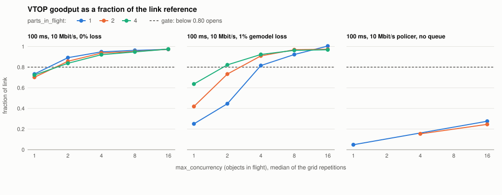
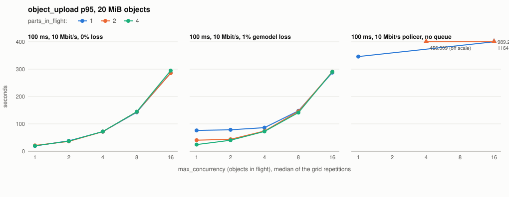

# Egress transport research

**Not demonstrated here: any result for a datagram transport (none exists in
this tree), any number taken on a real wide-area link, and any absolute
throughput. Every figure below compares configurations of this project's own
TCP path, on an emulated link, inside virtual machines on one shared host.**

The measurement record for the egress-transport milestone (#475): what each
transport actually does on links that bite, recorded under conditions stated
completely enough that every number can be re-taken. The lab this document
reports from is built by the milestone's Phase 1 issues (#476–#478). The rows
below are the tuned-TCP baseline (#483); the only transport measured is TCP,
because it is the only one there is.

This document is linted (`scripts/check-egress-claims.sh`, run in CI): a
measurement row missing any required condition fails the build naming the
missing column. The rules the whole document is written under are in the
standing section at the end — read them before adding a row or a sentence.

## Measurements

Every row carries all of: the hardware it ran on; the round-trip time; the
loss rate AND the loss model (random, burst, policer-induced — they behave
nothing alike); the bottleneck rate; the bottleneck buffer depth; the
competitor state (whether a competing flow shared the link, and what kind);
the transport under test; what actually limited throughput; and the date.
A number without its conditions is not a measurement, it is a rumor.

The rows below are the tuned-TCP baseline sweep (#483). They are generated
from `benchmarks/measurements/483-tcp-baseline/points.csv` by
`benchmarks/egress_baseline.py report`, one row per link profile, configuration
and phase (grid, confirmation, contended), with the repetitions folded into a
median and range. The goodput is committed object bytes over the engine's
busy time; "Of link reference" divides it by that run's iperf3 calibration on
the 100 ms profiles and by the token rate on the policed one; the verify
column is the read-back alone, kept apart from `object_upload`.

| Hardware | RTT | Loss rate | Loss model | Bottleneck rate | Buffer depth | Competitor state | Transport | Bottleneck | Date | Configuration | Runs | Goodput, Mbit/s: median (min-max) | Of link reference (100 ms: this run's iperf3 C; policed: 10 Mbit/s token rate) | object_upload p95 | Verify mean | CPU-s per GiB | Competitor with / without VTOP, Mbit/s |
|---|---|---|---|---|---|---|---|---|---|---|---|---|---|---|---|---|---|
| Apple M5 Max host; Lima vz VM, 6 vCPU, 8 GiB, Linux 6.8 (host shared) | < 1 ms (no delay qdisc) | 0% | none | none (unshaped) | n/a (no qdisc) | none | tcp_tls (s3_native; plain HTTP to the lab MinIO) | store I/O (no CPU saturated) | 2026-11-10 | max_concurrency 1, parts_in_flight 1, 5 MiB parts | 2 | 525.72 (518.72-532.72) | n/a | 0.3 s | 0.03 s | 7.9 | n/a |
| Apple M5 Max host; Lima vz VM, 6 vCPU, 8 GiB, Linux 6.8 (host shared) | < 1 ms (no delay qdisc) | 0% | none | none (unshaped) | n/a (no qdisc) | none | tcp_tls (s3_native; plain HTTP to the lab MinIO) | store I/O (no CPU saturated) | 2026-11-10 | max_concurrency 1, parts_in_flight 2, 5 MiB parts | 2 | 1028.52 (781.36-1275.68) | n/a | 0.2 s | 0.02 s | 5.9 | n/a |
| Apple M5 Max host; Lima vz VM, 6 vCPU, 8 GiB, Linux 6.8 (host shared) | < 1 ms (no delay qdisc) | 0% | none | none (unshaped) | n/a (no qdisc) | none | tcp_tls (s3_native; plain HTTP to the lab MinIO) | store I/O (no CPU saturated) | 2026-11-10 | max_concurrency 1, parts_in_flight 4, 5 MiB parts | 2 | 1095.85 (977.20-1214.50) | n/a | 0.1 s | 0.02 s | 6.5 | n/a |
| Apple M5 Max host; Lima vz VM, 6 vCPU, 8 GiB, Linux 6.8 (host shared) | < 1 ms (no delay qdisc) | 0% | none | none (unshaped) | n/a (no qdisc) | none | tcp_tls (s3_native; plain HTTP to the lab MinIO) | store I/O (no CPU saturated) | 2026-11-10 | max_concurrency 2, parts_in_flight 1, 5 MiB parts | 2 | 1106.44 (708.83-1504.05) | n/a | 0.3 s | 0.05 s | 6.6 | n/a |
| Apple M5 Max host; Lima vz VM, 6 vCPU, 8 GiB, Linux 6.8 (host shared) | < 1 ms (no delay qdisc) | 0% | none | none (unshaped) | n/a (no qdisc) | none | tcp_tls (s3_native; plain HTTP to the lab MinIO) | store I/O (no CPU saturated) | 2026-11-10 | max_concurrency 2, parts_in_flight 2, 5 MiB parts | 2 | 647.26 (634.90-659.63) | n/a | 0.3 s | 0.10 s | 8.8 | n/a |
| Apple M5 Max host; Lima vz VM, 6 vCPU, 8 GiB, Linux 6.8 (host shared) | < 1 ms (no delay qdisc) | 0% | none | none (unshaped) | n/a (no qdisc) | none | tcp_tls (s3_native; plain HTTP to the lab MinIO) | store I/O (no CPU saturated) | 2026-11-10 | max_concurrency 2, parts_in_flight 4, 5 MiB parts | 2 | 1397.20 (1176.83-1617.57) | n/a | 0.1 s | 0.03 s | 6.8 | n/a |
| Apple M5 Max host; Lima vz VM, 6 vCPU, 8 GiB, Linux 6.8 (host shared) | < 1 ms (no delay qdisc) | 0% | none | none (unshaped) | n/a (no qdisc) | none | tcp_tls (s3_native; plain HTTP to the lab MinIO) | store I/O (no CPU saturated) | 2026-11-10 | max_concurrency 4, parts_in_flight 1, 5 MiB parts | 2 | 1038.97 (884.10-1193.84) | n/a | 0.5 s | 0.11 s | 8.3 | n/a |
| Apple M5 Max host; Lima vz VM, 6 vCPU, 8 GiB, Linux 6.8 (host shared) | < 1 ms (no delay qdisc) | 0% | none | none (unshaped) | n/a (no qdisc) | none | tcp_tls (s3_native; plain HTTP to the lab MinIO) | store I/O (no CPU saturated) | 2026-11-10 | max_concurrency 4, parts_in_flight 2, 5 MiB parts | 2 | 1100.46 (919.61-1281.31) | n/a | 0.4 s | 0.10 s | 7.4 | n/a |
| Apple M5 Max host; Lima vz VM, 6 vCPU, 8 GiB, Linux 6.8 (host shared) | < 1 ms (no delay qdisc) | 0% | none | none (unshaped) | n/a (no qdisc) | none | tcp_tls (s3_native; plain HTTP to the lab MinIO) | store I/O (no CPU saturated) | 2026-11-10 | max_concurrency 4, parts_in_flight 4, 5 MiB parts | 2 | 1303.77 (1031.06-1576.48) | n/a | 0.3 s | 0.09 s | 7.4 | n/a |
| Apple M5 Max host; Lima vz VM, 6 vCPU, 8 GiB, Linux 6.8 (host shared) | < 1 ms (no delay qdisc) | 0% | none | none (unshaped) | n/a (no qdisc) | none | tcp_tls (s3_native; plain HTTP to the lab MinIO) | store I/O (no CPU saturated) | 2026-11-10 | max_concurrency 8, parts_in_flight 1, 5 MiB parts | 2 | 1005.21 (978.17-1032.25) | n/a | 0.6 s | 0.23 s | 8.8 | n/a |
| Apple M5 Max host; Lima vz VM, 6 vCPU, 8 GiB, Linux 6.8 (host shared) | < 1 ms (no delay qdisc) | 0% | none | none (unshaped) | n/a (no qdisc) | none | tcp_tls (s3_native; plain HTTP to the lab MinIO) | store I/O (no CPU saturated) | 2026-11-10 | max_concurrency 8, parts_in_flight 2, 5 MiB parts | 2 | 1614.78 (1512.95-1716.61) | n/a | 0.4 s | 0.12 s | 6.3 | n/a |
| Apple M5 Max host; Lima vz VM, 6 vCPU, 8 GiB, Linux 6.8 (host shared) | < 1 ms (no delay qdisc) | 0% | none | none (unshaped) | n/a (no qdisc) | none | tcp_tls (s3_native; plain HTTP to the lab MinIO) | store I/O (no CPU saturated) | 2026-11-10 | max_concurrency 8, parts_in_flight 4, 5 MiB parts | 2 | 1215.73 (963.00-1468.47) | n/a | 0.7 s | 0.22 s | 7.2 | n/a |
| Apple M5 Max host; Lima vz VM, 6 vCPU, 8 GiB, Linux 6.8 (host shared) | < 1 ms (no delay qdisc) | 0% | none | none (unshaped) | n/a (no qdisc) | none | tcp_tls (s3_native; plain HTTP to the lab MinIO) | store I/O (no CPU saturated) | 2026-11-10 | max_concurrency 16, parts_in_flight 1, 5 MiB parts | 2 | 1248.83 (1040.75-1456.91) | n/a | 0.9 s | 0.28 s | 7.9 | n/a |
| Apple M5 Max host; Lima vz VM, 6 vCPU, 8 GiB, Linux 6.8 (host shared) | < 1 ms (no delay qdisc) | 0% | none | none (unshaped) | n/a (no qdisc) | none | tcp_tls (s3_native; plain HTTP to the lab MinIO) | store I/O (no CPU saturated) | 2026-11-10 | max_concurrency 16, parts_in_flight 2, 5 MiB parts | 2 | 1460.07 (1059.23-1860.90) | n/a | 1.1 s | 0.25 s | 7.2 | n/a |
| Apple M5 Max host; Lima vz VM, 6 vCPU, 8 GiB, Linux 6.8 (host shared) | < 1 ms (no delay qdisc) | 0% | none | none (unshaped) | n/a (no qdisc) | none | tcp_tls (s3_native; plain HTTP to the lab MinIO) | store I/O (no CPU saturated) | 2026-11-10 | max_concurrency 16, parts_in_flight 4, 5 MiB parts | 2 | 1795.86 (1574.17-2017.55) | n/a | 0.8 s | 0.16 s | 5.9 | n/a |
| Apple M5 Max host; Lima vz VM, 6 vCPU, 8 GiB, Linux 6.8 (host shared) | < 1 ms (no delay qdisc) | 0% | none | none (unshaped) | n/a (no qdisc) | none | tcp_tls (s3_native; plain HTTP to the lab MinIO) | store I/O (no CPU saturated) | 2026-11-10 | default (8 in flight, 8 MiB parts, 4 parts in flight) | 2 | 875.69 (796.01-955.37) | n/a | 0.8 s | 0.35 s | 9.7 | n/a |
| Apple M5 Max host; Lima vz VM, 6 vCPU, 8 GiB, Linux 6.8 (host shared) | 100 ms | 0% | none | 10 Mbit/s (tbf) | 1 BDP (125 KB) | none | tcp_tls (s3_native; plain HTTP to the lab MinIO) | link (per-flow window) | 2026-11-10 | max_concurrency 1, parts_in_flight 1, 5 MiB parts | 2 | 7.01 (7.00-7.02) | 0.733 | 19.4 s | 4.91 s | 9.4 | n/a |
| Apple M5 Max host; Lima vz VM, 6 vCPU, 8 GiB, Linux 6.8 (host shared) | 100 ms | 0% | none | 10 Mbit/s (tbf) | 1 BDP (125 KB) | none | tcp_tls (s3_native; plain HTTP to the lab MinIO) | link (per-flow window) | 2026-11-11 | max_concurrency 1, parts_in_flight 2, 5 MiB parts | 2 | 6.64 (6.54-6.74) | 0.702 | 21.3 s | 4.99 s | 15.6 | n/a |
| Apple M5 Max host; Lima vz VM, 6 vCPU, 8 GiB, Linux 6.8 (host shared) | 100 ms | 0% | none | 10 Mbit/s (tbf) | 1 BDP (125 KB) | none | tcp_tls (s3_native; plain HTTP to the lab MinIO) | link (per-flow window) | 2026-11-10 to 2026-11-11 | max_concurrency 1, parts_in_flight 4, 5 MiB parts | 2 | 6.89 (6.86-6.93) | 0.724 | 19.8 s | 5.02 s | 10.3 | n/a |
| Apple M5 Max host; Lima vz VM, 6 vCPU, 8 GiB, Linux 6.8 (host shared) | 100 ms | 0% | none | 10 Mbit/s (tbf) | 1 BDP (125 KB) | none | tcp_tls (s3_native; plain HTTP to the lab MinIO) | link (per-flow window) | 2026-11-11 | max_concurrency 2, parts_in_flight 1, 5 MiB parts | 2 | 8.45 (8.35-8.56) | 0.892 | 38.0 s | 5.11 s | 11.3 | n/a |
| Apple M5 Max host; Lima vz VM, 6 vCPU, 8 GiB, Linux 6.8 (host shared) | 100 ms | 0% | none | 10 Mbit/s (tbf) | 1 BDP (125 KB) | none | tcp_tls (s3_native; plain HTTP to the lab MinIO) | link (per-flow window) | 2026-11-10 to 2026-11-11 | max_concurrency 2, parts_in_flight 2, 5 MiB parts | 2 | 8.15 (8.08-8.21) | 0.857 | 36.1 s | 6.09 s | 16.9 | n/a |
| Apple M5 Max host; Lima vz VM, 6 vCPU, 8 GiB, Linux 6.8 (host shared) | 100 ms | 0% | none | 10 Mbit/s (tbf) | 1 BDP (125 KB) | none | tcp_tls (s3_native; plain HTTP to the lab MinIO) | link (per-flow window) | 2026-11-10 to 2026-11-11 | max_concurrency 2, parts_in_flight 4, 5 MiB parts | 2 | 8.01 (7.75-8.27) | 0.838 | 37.1 s | 5.54 s | 10.4 | n/a |
| Apple M5 Max host; Lima vz VM, 6 vCPU, 8 GiB, Linux 6.8 (host shared) | 100 ms | 0% | none | 10 Mbit/s (tbf) | 1 BDP (125 KB) | none | tcp_tls (s3_native; plain HTTP to the lab MinIO) | link (rate) | 2026-11-10 to 2026-11-11 | max_concurrency 4, parts_in_flight 1, 5 MiB parts | 2 | 9.08 (9.03-9.12) | 0.948 | 71.7 s | 7.11 s | 7.7 | n/a |
| Apple M5 Max host; Lima vz VM, 6 vCPU, 8 GiB, Linux 6.8 (host shared) | 100 ms | 0% | none | 10 Mbit/s (tbf) | 1 BDP (125 KB) | none | tcp_tls (s3_native; plain HTTP to the lab MinIO) | link (rate) | 2026-11-10 | max_concurrency 4, parts_in_flight 2, 5 MiB parts | 2 | 8.97 (8.92-9.01) | 0.937 | 71.7 s | 7.54 s | 8.4 | n/a |
| Apple M5 Max host; Lima vz VM, 6 vCPU, 8 GiB, Linux 6.8 (host shared) | 100 ms | 0% | none | 10 Mbit/s (tbf) | 1 BDP (125 KB) | none | tcp_tls (s3_native; plain HTTP to the lab MinIO) | link (rate) | 2026-11-11 | max_concurrency 4, parts_in_flight 4, 5 MiB parts | 2 | 8.68 (8.64-8.72) | 0.921 | 72.0 s | 5.59 s | 12.3 | n/a |
| Apple M5 Max host; Lima vz VM, 6 vCPU, 8 GiB, Linux 6.8 (host shared) | 100 ms | 0% | none | 10 Mbit/s (tbf) | 1 BDP (125 KB) | none | tcp_tls (s3_native; plain HTTP to the lab MinIO) | link (rate) | 2026-11-10 | max_concurrency 8, parts_in_flight 1, 5 MiB parts | 2 | 9.21 (9.18-9.24) | 0.963 | 142.4 s | 8.11 s | 8.4 | n/a |
| Apple M5 Max host; Lima vz VM, 6 vCPU, 8 GiB, Linux 6.8 (host shared) | 100 ms | 0% | none | 10 Mbit/s (tbf) | 1 BDP (125 KB) | none | tcp_tls (s3_native; plain HTTP to the lab MinIO) | link (rate) | 2026-11-11 | max_concurrency 8, parts_in_flight 2, 5 MiB parts | 2 | 9.11 (9.07-9.15) | 0.952 | 144.0 s | 6.67 s | 14.5 | n/a |
| Apple M5 Max host; Lima vz VM, 6 vCPU, 8 GiB, Linux 6.8 (host shared) | 100 ms | 0% | none | 10 Mbit/s (tbf) | 1 BDP (125 KB) | none | tcp_tls (s3_native; plain HTTP to the lab MinIO) | link (rate) | 2026-11-10 to 2026-11-11 | max_concurrency 8, parts_in_flight 4, 5 MiB parts | 2 | 9.07 (9.00-9.14) | 0.948 | 144.3 s | 6.08 s | 13.6 | n/a |
| Apple M5 Max host; Lima vz VM, 6 vCPU, 8 GiB, Linux 6.8 (host shared) | 100 ms | 0% | none | 10 Mbit/s (tbf) | 1 BDP (125 KB) | none | tcp_tls (s3_native; plain HTTP to the lab MinIO) | link (rate) | 2026-11-10 to 2026-11-11 | max_concurrency 16, parts_in_flight 1, 5 MiB parts | 2 | 9.31 (9.28-9.34) | 0.973 | 286.2 s | 10.97 s | 15.2 | n/a |
| Apple M5 Max host; Lima vz VM, 6 vCPU, 8 GiB, Linux 6.8 (host shared) | 100 ms | 0% | none | 10 Mbit/s (tbf) | 1 BDP (125 KB) | none | tcp_tls (s3_native; plain HTTP to the lab MinIO) | link (rate) | 2026-11-10 to 2026-11-11 | max_concurrency 16, parts_in_flight 2, 5 MiB parts | 2 | 9.32 (9.23-9.41) | 0.974 | 285.5 s | 9.66 s | 14.2 | n/a |
| Apple M5 Max host; Lima vz VM, 6 vCPU, 8 GiB, Linux 6.8 (host shared) | 100 ms | 0% | none | 10 Mbit/s (tbf) | 1 BDP (125 KB) | none | tcp_tls (s3_native; plain HTTP to the lab MinIO) | link (rate) | 2026-11-10 | max_concurrency 16, parts_in_flight 4, 5 MiB parts | 2 | 9.34 (9.29-9.38) | 0.975 | 294.7 s | 10.53 s | 11.7 | n/a |
| Apple M5 Max host; Lima vz VM, 6 vCPU, 8 GiB, Linux 6.8 (host shared) | 100 ms | 1% | gemodel (bursty, mean burst 2 packets), upload only | 10 Mbit/s (tbf) | 1 BDP (125 KB) | none | tcp_tls (s3_native; plain HTTP to the lab MinIO) | link (per-flow window) | 2026-11-10 | max_concurrency 1, parts_in_flight 1, 5 MiB parts | 2 | 2.35 (2.32-2.37) | 0.250 | 76.0 s | 5.64 s | 16.4 | n/a |
| Apple M5 Max host; Lima vz VM, 6 vCPU, 8 GiB, Linux 6.8 (host shared) | 100 ms | 1% | gemodel (bursty, mean burst 2 packets), upload only | 10 Mbit/s (tbf) | 1 BDP (125 KB) | none | tcp_tls (s3_native; plain HTTP to the lab MinIO) | link (per-flow window) | 2026-11-10 to 2026-11-11 | max_concurrency 1, parts_in_flight 2, 5 MiB parts | 2 | 3.99 (3.91-4.06) | 0.419 | 40.4 s | 5.00 s | 12.9 | n/a |
| Apple M5 Max host; Lima vz VM, 6 vCPU, 8 GiB, Linux 6.8 (host shared) | 100 ms | 1% | gemodel (bursty, mean burst 2 packets), upload only | 10 Mbit/s (tbf) | 1 BDP (125 KB) | none | tcp_tls (s3_native; plain HTTP to the lab MinIO) | link (per-flow window) | 2026-11-10 | max_concurrency 1, parts_in_flight 4, 5 MiB parts | 2 | 6.09 (5.86-6.33) | 0.637 | 24.3 s | 4.98 s | 10.7 | n/a |
| Apple M5 Max host; Lima vz VM, 6 vCPU, 8 GiB, Linux 6.8 (host shared) | 100 ms | 1% | gemodel (bursty, mean burst 2 packets), upload only | 10 Mbit/s (tbf) | 1 BDP (125 KB) | none | tcp_tls (s3_native; plain HTTP to the lab MinIO) | link (per-flow window) | 2026-11-11 | max_concurrency 2, parts_in_flight 1, 5 MiB parts | 2 | 4.24 (4.03-4.45) | 0.446 | 78.3 s | 5.03 s | 12.5 | n/a |
| Apple M5 Max host; Lima vz VM, 6 vCPU, 8 GiB, Linux 6.8 (host shared) | 100 ms | 1% | gemodel (bursty, mean burst 2 packets), upload only | 10 Mbit/s (tbf) | 1 BDP (125 KB) | none | tcp_tls (s3_native; plain HTTP to the lab MinIO) | link (per-flow window) | 2026-11-11 | max_concurrency 2, parts_in_flight 2, 5 MiB parts | 2 | 7.02 (6.90-7.14) | 0.733 | 43.6 s | 4.97 s | 13.6 | n/a |
| Apple M5 Max host; Lima vz VM, 6 vCPU, 8 GiB, Linux 6.8 (host shared) | 100 ms | 1% | gemodel (bursty, mean burst 2 packets), upload only | 10 Mbit/s (tbf) | 1 BDP (125 KB) | none | tcp_tls (s3_native; plain HTTP to the lab MinIO) | link (per-flow window) | 2026-11-10 to 2026-11-11 | max_concurrency 2, parts_in_flight 4, 5 MiB parts | 2 | 7.90 (7.66-8.14) | 0.823 | 40.1 s | 4.99 s | 13.5 | n/a |
| Apple M5 Max host; Lima vz VM, 6 vCPU, 8 GiB, Linux 6.8 (host shared) | 100 ms | 1% | gemodel (bursty, mean burst 2 packets), upload only | 10 Mbit/s (tbf) | 1 BDP (125 KB) | none | tcp_tls (s3_native; plain HTTP to the lab MinIO) | link (per-flow window) | 2026-11-10 | max_concurrency 4, parts_in_flight 1, 5 MiB parts | 2 | 7.80 (7.64-7.96) | 0.816 | 86.1 s | 4.96 s | 8.3 | n/a |
| Apple M5 Max host; Lima vz VM, 6 vCPU, 8 GiB, Linux 6.8 (host shared) | 100 ms | 1% | gemodel (bursty, mean burst 2 packets), upload only | 10 Mbit/s (tbf) | 1 BDP (125 KB) | none | tcp_tls (s3_native; plain HTTP to the lab MinIO) | link (rate) | 2026-11-10 | max_concurrency 4, parts_in_flight 2, 5 MiB parts | 2 | 8.70 (8.65-8.75) | 0.909 | 73.8 s | 5.34 s | 10.4 | n/a |
| Apple M5 Max host; Lima vz VM, 6 vCPU, 8 GiB, Linux 6.8 (host shared) | 100 ms | 1% | gemodel (bursty, mean burst 2 packets), upload only | 10 Mbit/s (tbf) | 1 BDP (125 KB) | none | tcp_tls (s3_native; plain HTTP to the lab MinIO) | link (rate) | 2026-11-10 to 2026-11-11 | max_concurrency 4, parts_in_flight 4, 5 MiB parts | 2 | 8.83 (8.82-8.85) | 0.923 | 72.3 s | 5.94 s | 12.2 | n/a |
| Apple M5 Max host; Lima vz VM, 6 vCPU, 8 GiB, Linux 6.8 (host shared) | 100 ms | 1% | gemodel (bursty, mean burst 2 packets), upload only | 10 Mbit/s (tbf) | 1 BDP (125 KB) | none | tcp_tls (s3_native; plain HTTP to the lab MinIO) | link (rate) | 2026-11-10 to 2026-11-11 | max_concurrency 8, parts_in_flight 1, 5 MiB parts | 2 | 8.82 (8.68-8.97) | 0.922 | 147.6 s | 7.22 s | 12.8 | n/a |
| Apple M5 Max host; Lima vz VM, 6 vCPU, 8 GiB, Linux 6.8 (host shared) | 100 ms | 1% | gemodel (bursty, mean burst 2 packets), upload only | 10 Mbit/s (tbf) | 1 BDP (125 KB) | none | tcp_tls (s3_native; plain HTTP to the lab MinIO) | link (rate) | 2026-11-10 | max_concurrency 8, parts_in_flight 2, 5 MiB parts | 2 | 9.02 (8.86-9.19) | 0.969 | 145.8 s | 7.10 s | 13.9 | n/a |
| Apple M5 Max host; Lima vz VM, 6 vCPU, 8 GiB, Linux 6.8 (host shared) | 100 ms | 1% | gemodel (bursty, mean burst 2 packets), upload only | 10 Mbit/s (tbf) | 1 BDP (125 KB) | none | tcp_tls (s3_native; plain HTTP to the lab MinIO) | link (rate) | 2026-11-10 | max_concurrency 8, parts_in_flight 4, 5 MiB parts | 2 | 9.22 (9.21-9.22) | 0.963 | 141.3 s | 5.87 s | 7.7 | n/a |
| Apple M5 Max host; Lima vz VM, 6 vCPU, 8 GiB, Linux 6.8 (host shared) | 100 ms | 1% | gemodel (bursty, mean burst 2 packets), upload only | 10 Mbit/s (tbf) | 1 BDP (125 KB) | none | tcp_tls (s3_native; plain HTTP to the lab MinIO) | link (rate) | 2026-11-10 to 2026-11-11 | max_concurrency 16, parts_in_flight 1, 5 MiB parts | 2 | 9.28 (9.19-9.36) | 1.005 | 287.4 s | 9.13 s | 13.9 | n/a |
| Apple M5 Max host; Lima vz VM, 6 vCPU, 8 GiB, Linux 6.8 (host shared) | 100 ms | 1% | gemodel (bursty, mean burst 2 packets), upload only | 10 Mbit/s (tbf) | 1 BDP (125 KB) | none | tcp_tls (s3_native; plain HTTP to the lab MinIO) | link (rate) | 2026-11-10 to 2026-11-11 | max_concurrency 16, parts_in_flight 2, 5 MiB parts | 2 | 9.26 (9.23-9.29) | 0.974 | 290.2 s | 9.89 s | 17.8 | n/a |
| Apple M5 Max host; Lima vz VM, 6 vCPU, 8 GiB, Linux 6.8 (host shared) | 100 ms | 1% | gemodel (bursty, mean burst 2 packets), upload only | 10 Mbit/s (tbf) | 1 BDP (125 KB) | none | tcp_tls (s3_native; plain HTTP to the lab MinIO) | link (rate) | 2026-11-11 | max_concurrency 16, parts_in_flight 4, 5 MiB parts | 2 | 9.26 (9.25-9.27) | 0.969 | 290.3 s | 9.36 s | 15.3 | n/a |
| Apple M5 Max host; Lima vz VM, 6 vCPU, 8 GiB, Linux 6.8 (host shared) | 100 ms | 0% configured | policer-induced | 10 Mbit/s policer, 5000 B bucket | none (policer, no queue) | none | tcp_tls (s3_native; plain HTTP to the lab MinIO) | link (per-flow window) | 2026-11-11 | max_concurrency 1, parts_in_flight 1, 5 MiB parts | 1 | 0.48 (0.48-0.48) | 0.048 | 346.1 s | 6.58 s | 46.4 | n/a |
| Apple M5 Max host; Lima vz VM, 6 vCPU, 8 GiB, Linux 6.8 (host shared) | 100 ms | 0% configured | policer-induced | 10 Mbit/s policer, 5000 B bucket | none (policer, no queue) | none | tcp_tls (s3_native; plain HTTP to the lab MinIO) | link (per-flow window) | 2026-11-11 | max_concurrency 4, parts_in_flight 2, 5 MiB parts | 1 | 1.53 (1.53-1.53) | 0.153 | 456.0 s | 4.97 s | 24.5 | n/a |
| Apple M5 Max host; Lima vz VM, 6 vCPU, 8 GiB, Linux 6.8 (host shared) | 100 ms | 0% configured | policer-induced | 10 Mbit/s policer, 5000 B bucket | none (policer, no queue) | none | tcp_tls (s3_native; plain HTTP to the lab MinIO) | link (per-flow window) | 2026-11-11 | max_concurrency 16, parts_in_flight 1, 5 MiB parts; 1 of 1 runs overlapped another session's benchmark on the host | 1 | 2.76 (2.76-2.76) | 0.276 | 989.2 s | 4.99 s | 23.7 | n/a |
| Apple M5 Max host; Lima vz VM, 6 vCPU, 8 GiB, Linux 6.8 (host shared) | 100 ms | 0% configured | policer-induced | 10 Mbit/s policer, 5000 B bucket | none (policer, no queue) | none | tcp_tls (s3_native; plain HTTP to the lab MinIO) | link (per-flow window) | 2026-11-10 | max_concurrency 16, parts_in_flight 2, 5 MiB parts | 1 | 2.46 (2.46-2.46); 1 object(s) failed | 0.246 | 1164.1 s | 5.02 s | 17.3 | n/a |
| Apple M5 Max host; Lima vz VM, 6 vCPU, 8 GiB, Linux 6.8 (host shared) | 100 ms | 0% configured | policer-induced | 10 Mbit/s policer, 5000 B bucket | none (policer, no queue) | none | tcp_tls (s3_native; plain HTTP to the lab MinIO) | none named: no object committed | 2026-11-10 to 2026-11-11 | default (8 in flight, 8 MiB parts, 4 parts in flight); 2 of 3 runs overlapped another session's benchmark on the host | 3 | no object committed; 48 object(s) failed (tracked in #663) | n/a | n/a | n/a | n/a | n/a |
| Apple M5 Max host; Lima vz VM, 6 vCPU, 8 GiB, Linux 6.8 (host shared) | 100 ms | 0% | none | 10 Mbit/s (tbf) | 1 BDP (125 KB) | none | tcp_tls (s3_native; plain HTTP to the lab MinIO) | link (rate) | 2026-11-11 | max_concurrency 8, parts_in_flight 1, 5 MiB parts, confirmation runs; 5 of 5 runs overlapped another session's benchmark on the host | 5 | 9.09 (8.89-9.12) | 0.962 | 147.0 s | 8.98 s | 18.4 | n/a |
| Apple M5 Max host; Lima vz VM, 6 vCPU, 8 GiB, Linux 6.8 (host shared) | 100 ms | 0% | none | 10 Mbit/s (tbf) | 1 BDP (125 KB) | none | tcp_tls (s3_native; plain HTTP to the lab MinIO) | link (rate) | 2026-11-11 | max_concurrency 16, parts_in_flight 1, 5 MiB parts, confirmation runs; 5 of 5 runs overlapped another session's benchmark on the host | 5 | 9.34 (9.08-9.38) | 0.980 | 296.6 s | 11.07 s | 20.9 | n/a |
| Apple M5 Max host; Lima vz VM, 6 vCPU, 8 GiB, Linux 6.8 (host shared) | 100 ms | 0% | none | 10 Mbit/s (tbf) | 1 BDP (125 KB) | none | tcp_tls (s3_native; plain HTTP to the lab MinIO) | link (rate) | 2026-11-10 to 2026-11-11 | default (8 in flight, 8 MiB parts, 4 parts in flight), confirmation runs | 5 | 9.19 (9.00-9.25) | 0.960 | 143.0 s | 7.74 s | 11.8 | n/a |
| Apple M5 Max host; Lima vz VM, 6 vCPU, 8 GiB, Linux 6.8 (host shared) | 100 ms | 1% | gemodel (bursty, mean burst 2 packets), upload only | 10 Mbit/s (tbf) | 1 BDP (125 KB) | none | tcp_tls (s3_native; plain HTTP to the lab MinIO) | link (rate) | 2026-11-11 | max_concurrency 16, parts_in_flight 1, 5 MiB parts, confirmation runs; 5 of 5 runs overlapped another session's benchmark on the host | 5 | 9.34 (9.24-9.35) | 0.976 | 289.5 s | 9.39 s | 12.0 | n/a |
| Apple M5 Max host; Lima vz VM, 6 vCPU, 8 GiB, Linux 6.8 (host shared) | 100 ms | 1% | gemodel (bursty, mean burst 2 packets), upload only | 10 Mbit/s (tbf) | 1 BDP (125 KB) | none | tcp_tls (s3_native; plain HTTP to the lab MinIO) | link (rate) | 2026-11-11 | default (8 in flight, 8 MiB parts, 4 parts in flight), confirmation runs | 5 | 9.04 (8.75-9.14) | 0.967 | 146.1 s | 6.71 s | 11.9 | n/a |
| Apple M5 Max host; Lima vz VM, 6 vCPU, 8 GiB, Linux 6.8 (host shared) | 100 ms | 0% | none | 10 Mbit/s (tbf) | 1 BDP (125 KB) | bulk TCP flow (iperf3), same queue | tcp_tls (s3_native; plain HTTP to the lab MinIO) | link (per-flow window) | 2026-11-11 | max_concurrency 8, parts_in_flight 1, 5 MiB parts, scenario 18 workload; 1 of 1 runs overlapped another session's benchmark on the host | 1 | 0.56 (0.56-0.56) | 0.059 | 0.3 s | 0.24 s | 2640.6 | 8.25 / 9.41 |
| Apple M5 Max host; Lima vz VM, 6 vCPU, 8 GiB, Linux 6.8 (host shared) | 100 ms | 0% | none | 10 Mbit/s (tbf) | 1 BDP (125 KB) | bulk TCP flow (iperf3), same queue | tcp_tls (s3_native; plain HTTP to the lab MinIO) | link (per-flow window) | 2026-11-11 | max_concurrency 16, parts_in_flight 1, 5 MiB parts, scenario 18 workload; 1 of 1 runs overlapped another session's benchmark on the host | 1 | 1.24 (1.24-1.24) | 0.129 | 0.3 s | 0.22 s | 1825.8 | 6.89 / 9.37 |
| Apple M5 Max host; Lima vz VM, 6 vCPU, 8 GiB, Linux 6.8 (host shared) | 100 ms | 0% | none | 10 Mbit/s (tbf) | 1 BDP (125 KB) | bulk TCP flow (iperf3), same queue | tcp_tls (s3_native; plain HTTP to the lab MinIO) | link (per-flow window) | 2026-11-11 | default (8 in flight, 8 MiB parts, 4 parts in flight), scenario 18 workload; 1 of 1 runs overlapped another session's benchmark on the host | 1 | 0.59 (0.59-0.59) | 0.062 | 0.3 s | 0.24 s | 2374.1 | 7.83 / 9.52 |

## The tuned-TCP baseline, and the gate (#483)

### The gate, fixed before the sweep was read

This subsection was committed before any sweep run was read, and the results
below are judged against it unchanged. The commit that introduced it is the
evidence of the order.

**Definitions.**

- **VTOP goodput `G`** (Mbit/s): the committed object bytes of a run × 8,
  divided by the wall time of the engine cycles that committed them
  (`cycle_metrics.csv`, one row per `process-once`). Object bytes only:
  manifests, HTTP framing and retransmissions are excluded, so `G` understates
  the wire.
- **Link goodput `C`** (Mbit/s): the same run's `emulator_validation_mbps` —
  one iperf3 TCP flow through the shape's impairment-free twin (same rate,
  buffer and mean delay; no loss), measured by the harness immediately before
  that run. On the lossy profile `C` is therefore the link's goodput without
  the loss, which is the ceiling a loss-tolerant transport is being asked to
  approach.
- **Unused fraction `U`** = 1 − `G`/`C`.
- **Best-tuned configuration, per profile**: the grid point (below) with the
  highest median `G`/`C` across its repetitions on that profile. Ties within
  two percentage points go to the configuration with fewer connections
  (`max_concurrency` × `parts_in_flight`), because it costs a neighbour less.
- **Confirmation runs.** The best-tuned point is selected on the grid's
  repetitions and then re-measured; the gate is evaluated on the confirmation
  runs alone, so the configuration that won by noise is not also the one
  whose noise is reported.

**The thresholds.** Two single numbers. The datagram issues (#485, #486
and #488) open if **either** is crossed; if neither is, they do not open, and
that is recorded here as the outcome.

1. **Goodput: `U` > 0.20** — the best-tuned TCP configuration leaves more than
   20% of the link's goodput unused, by the median of its confirmation runs, on
   **either** 100 ms profile (10 Mbit/s with 0% loss, or 10 Mbit/s with 1%
   `gemodel` loss).
2. **Tail: `R` > 2.0** — where `R` is `object_upload` p95 on the 1% `gemodel`
   profile divided by `object_upload` p95 on the 0% profile, both at the
   configuration that is best-tuned on the 1% profile, each p95 taken over
   every object of that profile's confirmation runs pooled.

**Noise rule, also fixed now.** A verdict is stated on the medians. If a
threshold lies inside the range (minimum to maximum) of the repetitions that
decide it, the verdict is reported as within noise, and the document says the
gate should be re-measured before #485 is scheduled either way.

**Not part of the gate.** The clean-LAN profile (no RTT to speak of) and the
policed-uplink row. The policed row has no calibrated `C` — a policer has no
queue for a single flow to fill, and the harness's probe deliberately runs on
the twin without it — so it is reported against the policer's configured
token rate and read as a finding, not as a threshold.

### The sweep

- **Grid.** `upload.transports.tcp_tls.max_concurrency` ∈ {1, 2, 4, 8, 16}
  (with `batching.max_concurrent_batches` set to the same value, since the
  engine takes the minimum of the two) × `parts_in_flight` ∈ {1, 2, 4}, with
  `part_size_bytes` 5 MiB — the smallest part S3 and MinIO accept, so that a
  20 MiB object is four parts and every `parts_in_flight` value is
  distinguishable.
- **Untuned default**, for comparison and never as the baseline: no tuning
  block, so the shipped values — eight concurrent batches, 8 MiB parts, four
  parts in flight.
- **Profiles.** Clean LAN (the middlebox in the path, no qdisc); 100 ms RTT at
  10 Mbit/s, one BDP of buffer, 0% loss; the same with 1% `gemodel` loss
  (bursty, mean burst two packets) on the upload direction; and a policed
  uplink — a 10 Mbit/s policer and no queue, at 100 ms.
- **Workload.** Per run, a fixed backlog of `max(4, 2 × max_concurrency)`
  objects of 20 MiB each (JSONL, `compression: none`, so wire payload equals
  object size; SHA-256 checksums; `s3_native` to the lab MinIO), drained by
  `process-once`.
- **Repetitions.** At least two per grid point; the default and the
  best-tuned configuration re-measured to at least five on each 100 ms
  profile.

### The verdict

**The tuned TCP path closes the gap on both 100 ms profiles. By the gate fixed
above, the datagram issues (#485, #486, #488) do not open.**

| Gate input | Best-tuned configuration | Confirmation runs | Measured, median (range) | Threshold | Opens |
|---|---|---|---|---|---|
| Unused goodput `U`, 100 ms, 10 Mbit/s, 0% loss | `max_concurrency` 8, `parts_in_flight` 1 | 5 | **0.039** (0.008–0.049) | > 0.20 | no |
| Unused goodput `U`, 100 ms, 10 Mbit/s, 1% `gemodel` | `max_concurrency` 16, `parts_in_flight` 1 | 5 | **0.024** (0.019–0.034) | > 0.20 | no |
| `object_upload` p95 ratio `R`, 1% over 0% | `max_concurrency` 16, `parts_in_flight` 1 | 5 + 5 (160 objects each) | **0.98** (0.95–1.02 across all 25 run pairs) | > 2.0 | no |

Neither threshold falls inside the range of the repetitions that decide it, so
by the noise rule the verdict is not within noise. The ratio's range is taken
over every pairing of a lossy confirmation run with a clean one (5 × 5): the
runs are independent, on different VMs at different times, and their
repetition numbers share nothing that would make one pairing the right one.

**Per profile, does the tuned TCP path close the gap?**

- 100 ms, 10 Mbit/s, 0% loss: **yes** — 0.961 of the link at eight in flight.
- 100 ms, 10 Mbit/s, 1% `gemodel` loss: **yes** — 0.976 at sixteen in flight.
- 100 ms, 10 Mbit/s policer, no queue: **no** — at best 0.276 of the token
  rate (outside the gate; see below).
- Clean LAN: not judged — it has no link reference, and the gate does not
  cover it.

**The comparison baseline for anything that follows is the best-measured TCP
configuration, not the shipping default:** `max_concurrency` 8,
`parts_in_flight` 1 (5 MiB parts) on a clean 100 ms link, and
`max_concurrency` 16, `parts_in_flight` 1 on a lossy one. A datagram path, if
one is ever built, is compared against those on the same link. The numbers come from
`benchmarks/measurements/483-tcp-baseline/gate.json`, which
`egress_baseline.py report` computes from the raw CSVs beside it.

What this does and does not say:

- **It is a statement about goodput and tail latency on these two links,
  with a backlog of whole 20 MiB objects.** The tuned path closes the gap by
  running many TCP connections at once — eight objects on the clean link,
  sixteen on the lossy one. What that costs a flow sharing the link is
  reported in [The flow beside it](#the-flow-beside-it), and the gate does not
  weigh it.
- **The shipped default is already in the same band.** Eight objects in
  flight with 8 MiB parts reached 0.960 (0.941–0.976) of the link on the clean
  profile and 0.967 (0.930–0.975) on the lossy one, five runs each. The
  best-tuned points' confirmation medians are 0.961 and 0.976. On these two
  links, with this backlog, the sweep found no tuning that moves goodput by
  more than its own noise; the gap is closed by the width the engine ships
  with.
- **The gap is real when few objects are in flight.** One object at a time
  used 0.733 of the clean link and 0.250 of the lossy one (grid medians), so a
  deployment whose backlog rarely holds more than one or two objects is in
  the regime where TCP leaves most of a lossy link unused. How often a real
  edge site is in that regime is not measured here.
- **`R` is close to 1 because both profiles are saturated at sixteen in
  flight**, where an object's upload time is set by sharing the link with
  fifteen others rather than by loss. At one object in flight the same ratio
  is 3.9 (76.0 s over 19.4 s, grid p95s). The gate fixed the ratio at the
  best-tuned configuration and is judged there; the single-flow ratio is
  derived context, not the gate.
- **Outside the gate, the policed uplink leaves most of its rate unused, and
  the shipped default committed nothing there** (#663) — see below. The gate was fixed on the two queue-backed profiles before any
  number was read, and it is not moved now that one has been.

### The grid

Fraction of the link reference `C`, median of two runs (minimum–maximum).
A fraction above 1.0 is possible: `C` is one iperf3 flow measured once before
the run, and several flows together can deliver slightly more than one did.

100 ms, 10 Mbit/s, 0% loss:

| `max_concurrency` | `parts_in_flight` 1 | `parts_in_flight` 2 | `parts_in_flight` 4 |
|---|---|---|---|
| 1 | 0.733 (0.732–0.734) | 0.702 (0.700–0.704) | 0.724 (0.717–0.730) |
| 2 | 0.892 (0.890–0.894) | 0.857 (0.856–0.858) | 0.838 (0.811–0.864) |
| 4 | 0.948 (0.943–0.954) | 0.937 (0.932–0.941) | 0.921 (0.912–0.930) |
| 8 | 0.963 (0.960–0.966) | 0.952 (0.948–0.956) | 0.948 (0.941–0.955) |
| 16 | 0.973 (0.970–0.976) | 0.974 (0.965–0.983) | 0.975 (0.971–0.980) |

100 ms, 10 Mbit/s, 1% `gemodel` loss:

| `max_concurrency` | `parts_in_flight` 1 | `parts_in_flight` 2 | `parts_in_flight` 4 |
|---|---|---|---|
| 1 | 0.250 (0.248–0.253) | 0.419 (0.414–0.424) | 0.637 (0.612–0.662) |
| 2 | 0.446 (0.421–0.470) | 0.733 (0.721–0.745) | 0.823 (0.800–0.845) |
| 4 | 0.816 (0.799–0.832) | 0.909 (0.904–0.915) | 0.923 (0.922–0.924) |
| 8 | 0.922 (0.908–0.937) | 0.969 (0.961–0.978) | 0.963 (0.963–0.964) |
| 16 | 1.005 (0.996–1.013) | 0.974 (0.966–0.982) | 0.969 (0.968–0.969) |

Clean LAN, goodput in Mbit/s (no link reference; not part of the gate):

| `max_concurrency` | `parts_in_flight` 1 | `parts_in_flight` 2 | `parts_in_flight` 4 |
|---|---|---|---|
| 1 | 526 (519–533) | 1029 (781–1276) | 1096 (977–1215) |
| 2 | 1106 (709–1504) | 647 (635–660) | 1397 (1177–1618) |
| 4 | 1039 (884–1194) | 1100 (920–1281) | 1304 (1031–1576) |
| 8 | 1005 (978–1032) | 1615 (1513–1717) | 1216 (963–1468) |
| 16 | 1249 (1041–1457) | 1460 (1059–1861) | 1796 (1574–2018) |

Read from the grid, not beyond it:

- On the clean 100 ms link, connections are what matter and parts do not: up
  to eight in flight, every `parts_in_flight` value above 1 measured at or
  slightly below `parts_in_flight` 1 at the same width; at sixteen the three
  medians are within 0.002 of one another, inside their repetitions' spread.
- On the lossy link, parts in flight substitute for objects in flight — at one
  object, four parts raised the fraction from 0.250 to 0.637 — because each
  part is its own TCP connection with its own loss response.
- The clean-LAN numbers spread widely between repetitions (a factor of two at
  some points) and do not order cleanly; they say the LAN path moves roughly
  0.5–2 Gbit/s in this VM and not more than that.

### What limited each row, verification, and CPU

The `Bottleneck` column is named by a fixed rule in
`egress_baseline.py` (`name_bottleneck`), not by eye: a shaped row at 90% of its
link reference or more is the link's rate; below that it is verification if the
read-back takes a quarter of a batch's time, and otherwise the link's per-flow
window — too few TCP flows for the round trip and the loss. A LAN row is CPU
only if the engine or the store kept 80% of the VM's six vCPUs busy; none did
(the engine peaked at about 1.2 cores, the store at about 1.0), so every LAN
row is named the store's I/O path, which this sweep does not separate further.

- **Verification never limited a row.** The verify stage reads each 20 MiB
  object back. Pooled per profile it took 2.5–2.9% of batch time; per row
  (`verify_share_of_batch` in `points.csv`, grid and confirmation rows that
  committed anything) it ranged 2.3–9.9% on the clean 100 ms profile, 2.1–7.9%
  on the lossy one, 0.3–0.8% on the policed one and 0.3–6.2% on the LAN — no
  row near the 25% the rule names verification at. Per object it took a median
  of 8.7 s on the clean 100 ms link, 7.0 s on the lossy one and 0.09 s on the
  LAN (p95 13.7 s, 13.0 s and 0.4 s).
- **Where verification is and is not counted.** It is recorded per object
  (`objects.csv`, `verify_ms`) and per row in the table below, apart from
  `object_upload`, so the `object_upload` figures and the `R` ratio do not
  absorb it. Goodput `G` does: by the definition fixed above, `G` divides by
  the engine's whole cycle time, which contains every stage — verification,
  manifests and checksums included. That is deliberate (it is what the TCP
  path delivers end to end, and no change of wire removes a read-back), and it
  means `G` and `U` carry the verify stage's few percent rather than isolate
  the wire. In container mode each cycle's time also includes the
  `docker compose exec` that launches it (about 0.1–0.2 s per cycle, one or two
  cycles per run against cycles of 75–600 s on the 100 ms profiles).
- **CPU never limited a shaped row.** In grid and confirmation runs the engine
  container used at most 0.03 cores on the 100 ms profiles; the contended rows,
  scenario 18's gzip-compressed small batches, used 0.16–0.26. Engine
  CPU-seconds per GiB committed (from the container's cgroup counter around
  each run) had a median of 12.8 on the clean 100 ms profile (7.3–24.8), 12.2
  on the lossy one (7.5–29.3) and 7.9 on the LAN (4.4–10.9), grid and
  confirmation runs together. These are not on a pinned core: the VM's vCPUs
  float over the host's cores, and the hypervisor does not expose pinning.

### The policed uplink: outside the gate, and a finding

A 10 Mbit/s policer with no queue, at 100 ms, with the lab's bucket of
5000 bytes (`lib/netem.py`: the rate over 250, about 4 ms of line rate). One
run per configuration except the default:

| Configuration | Runs | Goodput, Mbit/s | Of the 10 Mbit/s token rate | Objects failed |
|---|---|---|---|---|
| default (8 in flight, 8 MiB parts, 4 parts in flight) | 3 | none committed (#663) | 0 | 48 of 48 |
| `max_concurrency` 1, `parts_in_flight` 1 | 1 | 0.48 | 0.048 | 0 |
| `max_concurrency` 4, `parts_in_flight` 2 | 1 | 1.53 | 0.153 | 0 |
| `max_concurrency` 16, `parts_in_flight` 1 | 1 | 2.76 | 0.276 | 0 |
| `max_concurrency` 16, `parts_in_flight` 2 | 1 | 2.46 | 0.246 | 1 of 32 |

- **The shipped default committed nothing** in three runs: every one of its 16
  objects ended `failed` after the cycle had run about half an hour. This
  failure is tracked in #663. The per-batch record the harness keeps does not
  carry the engine's error text, so the cause is not established here; it is
  consistent with, and not shown to be, the per-request deadline
  (`upload.request_timeout_seconds`, 300 s) at the share of the policer each of
  32 part connections was getting.
- **The best measured configuration left 72% of the token rate unused.** The
  policer drops whatever exceeds a 5000-byte bucket and holds nothing, so a
  loss-based flow on a 100 ms round trip spends most of its time recovering;
  more connections help only up to the point shown.
- **What this is not.** It rests on one run per configuration, one bucket
  depth, and one round trip. A policer with a deeper bucket was not measured,
  and the result is a property of this one as much as of TCP. Whether kernel
  pacing or the engine's own egress cap (#481, merged after these runs'
  engine was built) recovers it is not measured either.

The gate was fixed on the two queue-backed profiles, and this row does not
change its verdict. It is recorded so that whether a policed-link gate is
wanted is decided with it in view.

### The flow beside it

The neighbour's cost, from scenario 18's workload (150 small JSONL files per
cycle, gzip, batches of up to 5000 records, 150 s) on the clean 100 ms link,
with a plain-TCP bulk flow in the same one-BDP queue (`bulk:60`). One run per
configuration:

| Configuration | Competitor alone, Mbit/s | Competitor beside VTOP, Mbit/s | VTOP beside it, Mbit/s | Jain's index |
|---|---|---|---|---|
| default (8 in flight) | 9.52 | 7.83 | 0.48 | 0.56 |
| `max_concurrency` 8, `parts_in_flight` 1 | 9.41 | 8.25 | 0.53 | 0.56 |
| `max_concurrency` 16, `parts_in_flight` 1 | 9.37 | 6.89 | 1.04 | 0.65 |

- On this workload VTOP is round-trip-bound, not link-bound: its batches are
  small, so most of a cycle is per-batch round trips, and it takes a small
  share of the link. Sixteen in flight took twice the share of eight and left
  the neighbour 74% of its solo rate, against 82% and 88% at eight.
- These rows say what a small-batch engine costs a neighbour. They do not say
  what the sweep's full-width drain of 20 MiB objects costs one — at sixteen
  in flight that drain holds sixteen connections against the link for minutes
  — because no competitor window can contain one of its cycles whole (see the
  deviations below). The issue that adds a knob is where that has to be
  measured.
- The sixteen-in-flight row ran on the harness before #531 merged; the other
  two after, with its fix to where the competitor's window is placed. 24
  contended attempts were refused in all — by the window-placement checks
  before that fix, and by the calibration gate or a hole at the start of the
  competitor's stream after it — and every refusal is in `sweep_index.csv`.
  All three rows overlapped the other benchmark on the host.

### Measured and derived

**Measured** (each a column of the committed CSVs, per run or per object):
committed object bytes; each `process-once` cycle's duration; per-object
`object_upload`, manifest, verify and checksum milliseconds; the link reference
`C` (iperf3, per run); engine and store CPU-seconds (cgroup counters, per run);
the competitor's goodput alone and beside VTOP (iperf3 receiver totals, per
contended run).

**Derived** (computed by `egress_baseline.py` from the measured columns, so
re-running `report` reproduces them byte for byte): goodput `G` (bytes × 8 over
the committing cycles' time); the fraction `G`/`C` and `U`; medians and ranges
over repetitions; the pooled p95s and `R`; CPU-seconds per GiB; the bottleneck
name; the best-tuned selection; the gate verdict; the charts.

**Not measured:** the wire itself (headers, retransmissions, manifests —
`G` counts committed object bytes only, so it understates the wire); a policer
with a deeper bucket; any backlog shape other than "a full queue of 20 MiB
objects"; any RTT other than 100 ms and the LAN; anything on a real WAN.

### The lab, and its limits

- **Where it ran.** Four Lima VMs (vz, 6 vCPU, 8 GiB each, Ubuntu 24.04.5,
  kernel 6.8.0-142, Docker 29.9.3) on one Apple M5 Max (18 cores, 128 GiB),
  each with its own copy of the lab (`netem` and `containerized` compose
  profiles), two to four of them measuring at once. The engine was one
  binary, built from `3564edc` with `--no-default-features` (the lab image
  lacks the Kafka adapter's `libsasl2`) and copied to every VM (sha256
  `57f020a6…53600`). The harness was this branch's; the last two contended
  rows ran after it merged `main` at `7472b64` (#531), for that change's fix to
  the competitor's window placement — Python only, the engine binary unchanged. The full record is `environment.json` beside the data.
- **The middlebox ran as `lib/netem.py` builds it.** The VMs' kernel has the
  `ifb` module, so the upload impairment and bottleneck sit on the `ifb` behind
  the ingress hook exactly as on a Linux lab host. Docker Desktop's kernel on
  this Mac has no `ifb`; no egress-shaping substitute was used, and none of
  these numbers comes from Docker Desktop.
- **Comparisons, never absolutes.** This is an emulated link on one host:
  netem's accuracy is bounded by timer granularity and its rate limiter
  releases traffic in bursts a real link would space out, the middlebox, the
  engine and the store share a CPU and a clock, and this project has not
  established netem's accuracy at any rate. No number here may be quoted as
  what the engine does on a real 10 Mbit/s, 100 ms link. Every shaped run was
  gated on its own iperf3 calibration within ±10% of 10 Mbit/s; two attempts
  (8.70 and 8.69 Mbit/s) were refused by that gate and re-run, and the refusals
  stay in `sweep_index.csv`.
- **The host was noisy, and that is recorded rather than removed.** Other
  work ran on the same Mac throughout — Docker Desktop with about ten unrelated
  containers, and other sessions' work in it — and was not stopped. Over the
  sweep the host's one-minute load average had a mean of 18.5 and a maximum of
  60 on 18 cores (`host_noise.csv`, sampled every 30–35 s, median 31 s, 22:44Z
  to 02:29Z). The CPU was 45.5% idle on average over 403 samples; 29 further
  samples read exactly 0.0% idle, several at a load average of 7–10, which
  looks like the sampler failing to parse `top` rather than saturation, so they
  are left out of that mean (42.5% with them). The sampler's
  `rustc_procs`/`cargo_procs` columns read 0 throughout: they count macOS
  processes, and other sessions' builds ran inside Docker Desktop's VM where the
  sampler cannot see them, so those columns show nothing either way. From
  01:06:58Z on 2026-11-11 (the containers' creation time, from `docker ps`) to
  past the last run, another session's Kafka/MinIO benchmark ran on the same
  host (`rq4_presence.csv`; a `docker ps` every 30 s from 01:09:30Z, whose first
  look at 01:09:16Z showed the containers up for two minutes, so the opening
  152 s are their uptime rather than sampled); every run whose wall-clock span overlapped it carries
  that label in `runs.csv` (`host_contention`) and the table rows say how many
  of their runs did. All 15 tuned confirmation runs, three policed runs and all
  three contended rows overlapped it; no 100 ms or LAN grid run and none of the
  default's ten confirmation runs did.
  The overlapped runs agree with the ones that did not — the clean-link point
  at eight in flight measured 0.963 in the grid and 0.961 in confirmation —
  which is expected of rows that are link-bound and use a fiftieth of a core,
  so they were kept, labelled, and not re-run.

### Deviations from the plan fixed above

- **The policed row is four grid points with one run each, plus the default
  three times**, not a grid with two repetitions. A policed run of 32 objects
  took over half an hour; the profile is outside the gate; and the plan never
  fixed its repetitions.
- **The clean LAN drains 64 objects per run, not `max(4, 2 ×
  max_concurrency)`**: two waves of 20 MiB objects finish in well under a
  second there, and a cycle that short cannot be timed.
- **The contended rows run scenario 18's workload**, with only the width
  replaced (`egress_baseline.py`, `contended_yaml`), because a drain of 20 MiB
  objects is one engine cycle longer than any competitor window, and the
  competitor's share of VTOP is charged only to cycles its window wholly
  contains. Scenario 18's objects are below the multipart threshold, so
  `parts_in_flight` is not exercised in those rows.
- **The p95 ratio's 0% side was measured as confirmation runs of the 1%
  profile's best configuration** (sixteen in flight), as the definition above
  requires, in addition to the 0% profile's own best (eight in flight).

## Counterparty survey: which S3-compatible endpoints serve HTTP/3 (#484)

A transport needs something on the other end. The datagram path this
milestone contemplates is HTTP/3 over QUIC to an S3-compatible endpoint, so
before any transport code is written one fact has to be established and
written down: does anything reachable actually answer it?

**Method.** Each endpoint was sent an anonymous `HEAD /` over HTTPS and its
response headers read for `Alt-Svc` advertising `h3`. `Alt-Svc` is the
mechanism by which an origin tells a client it also serves HTTP/3, and it is
how a client discovers the option in the first place — a server that does not
advertise it is a server no ordinary client will reach over HTTP/3. No
credentials were sent and no object was read or written; the request line and
the response status are the whole interaction. This is an ADVERTISEMENT check,
not a completed HTTP/3 handshake: it establishes which endpoints offer the
protocol, not that a particular client library succeeds against them. Proving
negotiation end to end is the lab target's job, below.

**Date.** 2026-09-14. This is a moving surface and the result should be
re-taken before it is relied on again; the method above is cheap to repeat.

| Endpoint | HTTP status | Advertises HTTP/3 |
|---|---|---|
| `storage.googleapis.com` | 400 | **yes** — `alt-svc: h3=":443"; ma=2592000,h3-29=":443"; ma=2592000` |
| `s3.amazonaws.com` | 405 | no |
| `s3.us-east-1.amazonaws.com` | 405 | no |
| `s3.wasabisys.com` | 303 | no |
| `nyc3.digitaloceanspaces.com` | 200 | no |
| `s3.us-west-004.backblazeb2.com` | 405 | no |
| `s3.fr-par.scw.cloud` | 200 | no |
| `us-east-1.linodeobjects.com` | 200 | no |
| `play.min.io` | 400 | no |

The status column is recorded because it shows the endpoint answered: a `405`
or `400` to an anonymous `HEAD /` is a live S3-compatible service declining
that particular request, not an unreachable host. No endpoint in the list
failed to respond.

**What this decides.** One endpoint of nine advertises HTTP/3, so the
counterparty question does not close the datagram phase — a real target
exists. But the shape of the answer matters as much as the answer: the
protocol is not broadly available across S3-compatible storage, and it is
absent from the endpoint most deployments of this engine would point at. A
datagram path would therefore be usable by a minority of deployments, and any
decision to build it should be made in that knowledge rather than in the
expectation that the protocol is generally available. The measured value of
the path, if it is built, is still gated on the tuned-TCP baseline (#483).

This survey records what the probe found. It is not a recommendation of any
endpoint or vendor, it makes no comparative claim about any of them, and the
absence of `Alt-Svc` says only that the endpoint did not advertise HTTP/3 to
this probe on this date — not that the service is deficient.

### The lab's HTTP/3 target, and what the proxy hop costs

A counterparty that exists somewhere on the public internet is not a counterparty
this project can measure against. The lab therefore carries its own
HTTP/3-terminating target on the `h3` compose profile: an nginx reverse proxy
serving HTTP/3 over QUIC on 9443 and forwarding to the lab's MinIO.

**HTTP/3 is verified, not assumed** (`benchmarks/verify-h3.sh`). The check has
four parts, because a downgrade here would make every later measurement a
measurement of TCP under a different name: a QUIC client that offers only `h3`
as ALPN and reads the negotiated protocol off the handshake; the proxy's own
access log, which a client cannot make lie; a plain-TCP control through the same
proxy, which logs `HTTP/2.0` and so proves the log field discriminates; and the
same probe aimed at a port with no QUIC listener, which must fail — so the check
is known to be capable of failing rather than merely observed to pass.

**The topology confound, and the number for it.** A proxy in front of the store
changes the path, so a later transport comparison must be made against the TCP
path *through the same proxy*, not against the direct one. Scenario 17 is that
control. Measured on 2026-09-14, on one host over loopback with no shaping, the
matched TCP scenarios give:

| | direct to MinIO (scenario 12) | through the proxy (scenario 17) |
|---|---|---|
| `object_upload` p95 | 21.0 ms | 23.0 ms |
| `object_upload` p50 | 11.0 ms | 11.0 ms |
| objects committed | 15498 | 3321 |
| wall time | 92.6 s | 75.8 s |

**Only the per-object latency pair is a usable comparison, and the difference it
shows is +10% at p95.** The aggregate throughput figures from this pair are NOT
comparable and must not be quoted: the two runs did not process comparable
volumes in comparable wall time (both are backpressure soaks that drain by
cycle, and they completed different numbers of cycles), and the proxied run
recorded one error. A throughput price for the hop needs a matched-volume run
and is not established here.

Two further things this pair does not isolate, both inherent rather than
incidental: scenario 12 reaches MinIO over plaintext HTTP/1.1, while a proxy
that can serve HTTP/3 cannot be plaintext, so scenario 17 also pays TLS
termination and an ALPN change — the SDK negotiated HTTP/2 through it. That is
precisely why the datagram comparison, if it is ever made, belongs against
scenario 17 and not against scenario 12: both sides of that pair cross the same
proxy, and the wire is then the only difference.

## What may and may not be said

This section is standing policy for this document, the README, release
notes, and any surface that describes this project — not guidance, policy.
The naming half is enforced by `scripts/check-naming.sh` against the term
list in `scripts/naming-denylist.txt`; the substantiation half is enforced
on this document by `scripts/check-egress-claims.sh`; the rest is enforced
by review, under CONTRIBUTING.md's "Naming and claims".

**May be said:**

- Any number in the table above, quoted WITH its row's conditions.
- That the project offers two first-class egress transports, selected by
  configuration, with the TCP path as the default — once that is true and
  tested, and not a day before.
- That the datagram path is HTTP/3 over QUIC using a published, standardised
  protocol stack — a statement about protocols, not products — ONCE that
  path exists in the tree and is tested. Today no QUIC or HTTP/3
  implementation or dependency ships, and until the milestone's Phase 4
  lands, no sentence may say or imply the project has such a path; the
  permitted present-tense statement is that one is planned, behind the
  gate the umbrella (#475) defines.
- Comparisons between this project's own two paths, on the same link, same
  tuning effort, same table.

**May not be said:**

- No compatibility, equivalence, interoperability or performance-parity
  claim about any commercial product. A parity claim about a product with no
  public specification is unverifiable by construction, so it cannot be
  substantiated — and making one frames independent work as an attempted
  reproduction. Neither half of that is worth it.
- No commercial transport product's name anywhere the product describes
  itself: not in a crate, module, feature flag, config key, CLI flag, metric
  label, transport variant, scenario name, branch name, or document outside
  the two exempt prior-art files. Internal shorthand counts, because
  internal shorthand leaks into READMEs.
- No throughput claim without its conditions. If the sentence cannot carry
  the row, the sentence does not ship.
- No multiplier against an untuned baseline. The baseline is the TUNED TCP
  path (#483 defines it); "N× faster than defaults nobody would run" is an
  advertisement, not a result.
- No claim that anything here is a congestion control algorithm. What ships
  is rate and concurrency policy over transports that bring their own
  congestion control.
- No claim about a system we have not measured, and no restating another
  party's numbers as if they were ours.

## Relationship to the prior-art record

Published and commercial systems are cited by name where citing them is the
job: `docs/PRIOR_ART_SEARCH_PLAN.md` (and the disclosure draft it feeds).
Those two files are the explicit, complete exemption to the naming rule.
This document cites protocols and standards, never products.
