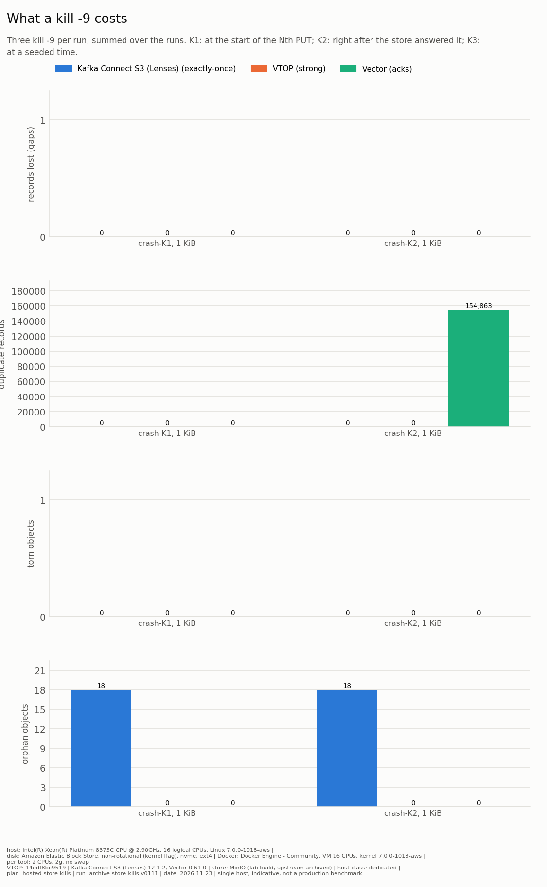

<!-- Generated by benchmarks/compare_common/report.py from ../../benchmarks/archive_compare/results/archive-store-kills-v0111/archive.csv. Do not edit; regenerate. -->
# Kafka topic to object storage: VTOP, Vector and Kafka Connect S3

One Kafka topic (Apache Kafka 4.3.2, one KRaft node, 3 partitions), the same lab MinIO, each tool in 2 CPUs and 2 GiB, output normalised to one JSON line per record, gzip, about 32 MiB or 60 s per object (#746). Every gap and duplicate is counted by an independent checker against the seeded record ids, never from a tool's own metadata. Each tool's "committed" means something different, so time to store-visible and time to source-committed are two clocks, never one "time to durable".

Run `archive-store-kills-v0111`, host class `dedicated`, plan `hosted-store-kills`. Data: [archive.csv](../../benchmarks/archive_compare/results/archive-store-kills-v0111/archive.csv), [environment.json](../../benchmarks/archive_compare/results/archive-store-kills-v0111/environment.json).

Not run in this plan, so not drawn: Drain throughput, What draining costs, Store requests per GiB archived, Time to store-visible and time to source-committed, Objects written, A corrupted read-back.

## Where VTOP is behind, level and ahead

Generated from the scoreboard below; "level" is within 5% of the best other system.

- VTOP is behind on no metric.
- VTOP is level on: records lost (gaps), crash-K1, 1 KiB (0 against Kafka Connect S3 (Lenses)'s 0); records lost (gaps), crash-K2, 1 KiB (0 against Kafka Connect S3 (Lenses)'s 0); duplicate records, crash-K1, 1 KiB (0 against Kafka Connect S3 (Lenses)'s 0); duplicate records, crash-K2, 1 KiB (0 against Kafka Connect S3 (Lenses)'s 0); torn objects, crash-K1, 1 KiB (0 against Kafka Connect S3 (Lenses)'s 0); torn objects, crash-K2, 1 KiB (0 against Kafka Connect S3 (Lenses)'s 0); orphan objects, crash-K1, 1 KiB (0 against Vector's 0); orphan objects, crash-K2, 1 KiB (0 against Vector's 0).
- VTOP is ahead on no metric.

## Scoreboard

Each system in its primary profile: Kafka Connect S3 (Lenses) `exactly-once`, VTOP `strong`, Vector `acks`. Other profiles (Vector `disk-buffer`) are in the tables as secondary columns and in the CSV, and are not charted or ranked.

| metric | cell | best | best value | VTOP | VTOP / best | VTOP is |
|---|---|---|---|---|---|---|
| records lost (gaps) | crash-K1, 1 KiB | Kafka Connect S3 (Lenses) | 0 | 0 |  | level |
| records lost (gaps) | crash-K2, 1 KiB | Kafka Connect S3 (Lenses) | 0 | 0 |  | level |
| duplicate records | crash-K1, 1 KiB | Kafka Connect S3 (Lenses) | 0 | 0 |  | level |
| duplicate records | crash-K2, 1 KiB | Kafka Connect S3 (Lenses) | 0 | 0 |  | level |
| torn objects | crash-K1, 1 KiB | Kafka Connect S3 (Lenses) | 0 | 0 |  | level |
| torn objects | crash-K2, 1 KiB | Kafka Connect S3 (Lenses) | 0 | 0 |  | level |
| orphan objects | crash-K1, 1 KiB | Vector | 0 | 0 |  | level |
| orphan objects | crash-K2, 1 KiB | Vector | 0 | 0 |  | level |

## What a kill -9 costs

Three kill -9 per run, summed over the runs. K1: at the start of the Nth PUT; K2: right after the store answered it; K3: at a seeded time.



**records lost (gaps)** (sum over the repetitions)

| cell | Kafka Connect S3 (Lenses) | VTOP | Vector | Vector disk-buffer (secondary) |
|---|---|---|---|---|
| crash-K1, 1 KiB | 0 | 0 | 0 | 0 |
| crash-K2, 1 KiB | 0 | 0 | 0 | 934 |

**duplicate records** (sum over the repetitions)

| cell | Kafka Connect S3 (Lenses) | VTOP | Vector | Vector disk-buffer (secondary) |
|---|---|---|---|---|
| crash-K1, 1 KiB | 0 | 0 | 0 | 104,128 |
| crash-K2, 1 KiB | 0 | 0 | 154,863 | 128,605 |

**torn objects** (sum over the repetitions)

| cell | Kafka Connect S3 (Lenses) | VTOP | Vector | Vector disk-buffer (secondary) |
|---|---|---|---|---|
| crash-K1, 1 KiB | 0 | 0 | 0 | 0 |
| crash-K2, 1 KiB | 0 | 0 | 0 | 0 |

**orphan objects** (sum over the repetitions)

| cell | Kafka Connect S3 (Lenses) | VTOP | Vector | Vector disk-buffer (secondary) |
|---|---|---|---|---|
| crash-K1, 1 KiB | 18 | 0 | 0 | 0 |
| crash-K2, 1 KiB | 18 | 0 | 0 | 0 |

## Reading this

Not ranked: compression ratio (codec levels differ), JVM warm-up (excluded and recorded), each tool's exactly-once claim (the measured duplicates are the result). VTOP's `verify-off` profile is a deliberate weakening that isolates the cost of verification; it is in the CSV and the tables, never a second orange bar.

## Deviations recorded by the run (rule 15)

- The record is one JSON object per Kafka value. VTOP and Vector store the value as it came, newline-framed; Connect (Lenses) parses it with its JSON converter and writes it again, so its bytes may differ and its content may not. The smoke counts byte-exact and JSON-equal records separately; the checker reads the id token in either form, and MiB/s is of source bytes (the value as produced), so the framing does not change it (rule 15).
- Object size is set by each tool's documented threshold nearest to 'about 32 MiB uncompressed or 60 s': VTOP \`batching.max\_bytes\` and Vector \`batch.max\_bytes\` count uncompressed payload; Connect (Lenses) \`flush.size\` counts the staged file. The measured object sizes (p50 and p99) are reported.
- Connect's \`.temp-upload/\` objects (the staging step of its exactly-once commit) and \`.indexes/\` entries (its commit-chain bookkeeping) are counted as orphan objects and listed by name, as #746 specifies; the \`.indexes/\` entries are permanent by design, so Connect's orphan count has a floor.
- Connect's offsets are committed by its worker at \`offset.flush.interval.ms\` (the 60 s default), so its time to source-committed includes up to that interval; Vector commits every 5 s by default; VTOP after VERIFIED.
- The producer is \`kafka-console-producer.sh\` (acks=all, linger.ms=5) fed by the seeded generator; the produce time of a record is the generator's write time, up to 5 ms before the send. Partitions come from the key's murmur2 hash, the broker's default partitioner, checked against the partition end offsets before a tool starts.
- Time to store-visible (MinIO's LastModified, ms), time to source-committed (the broker's stamp on the group's offset commit) and the producer's write time share the Docker VM's clock; the window start and the kill times are the harness host's clock, which is the same clock on a Linux host.
- Connect runs in standalone mode (one worker, no internal topics); its sink tasks' offsets are committed to the consumer group, as in distributed mode (#746 open question 2).

## Environment

```
host: Intel(R) Xeon(R) Platinum 8375C CPU @ 2.90GHz, 16 logical CPUs, Linux 7.0.0-1018-aws | disk: Amazon Elastic Block Store, non-rotational (kernel flag), nvme, ext4 | Docker: Docker Engine - Community, VM 16 CPUs, kernel 7.0.0-1018-aws | per tool: 2 CPUs, 2g, no swap
VTOP: 14edf8bc9519 | Kafka Connect S3 (Lenses) 12.1.2, Vector 0.61.0 | store: MinIO (lab build, upstream archived) | host class: dedicated | plan: hosted-store-kills | run: archive-store-kills-v0111 | date: 2026-11-23 | single host, indicative, not a production benchmark
```
