<!-- Generated by benchmarks/compare_common/summary.py from the committed runs under benchmarks/<kind>_compare/results/. Do not edit; regenerate. -->
# VTOP against other telemetry and archive products

How does VTOP's actual job, archiving telemetry to object storage under the commit rule (a source's progress moves only after the object is stored and verified), compare with the other products people use for it, per use case? Every figure on this page is generated from a committed run's CSV, and where VTOP is behind the page says so from the scoreboard rows, not from prose. VTOP's licence is MIT; each comparand's licence, version and the evidence it may be published under are in the [products table](#products-versions-and-licences).

## What is measured yet

| comparison | use cases | run | host class | plan | date | page |
|---|---|---|---|---|---|---|
| archive | (a), (d), (e) | `archive-store-kills-v0111` | dedicated | hosted-store-kills | 2026-11-23 | [full report](archive-comparison-store-kills.md) |
| spool | (b), (d) | `spool-hosted-crash-v0111` | dedicated | hosted-crash | 2026-11-23 | [full report](spool-comparison-crash.md) |
| link | (c) | `link-hosted-v0111` | hosted | hosted | 2026-11-23 | [full report](link-comparison.md) |

## Where VTOP is behind, level and ahead

Generated from the scoreboards below; "level" is within 5% of the best other system.

- **(a) Kafka topic to object storage**
    - archive: VTOP is behind on no metric.
    - archive: VTOP is level on no metric.
    - archive: VTOP is ahead on no metric.
- **(b) Files and a syslog spool to object storage**
    - spool: VTOP is behind on no metric.
    - spool: VTOP is level on no metric.
    - spool: VTOP is ahead on no metric.
- **(c) Upload over a long, lossy or policed link**
    - link: VTOP is behind on no metric.
    - link: VTOP is level on: objects committed, wan100-policed (48 against aws-cli's 48).
    - link: VTOP is ahead on no metric.
- **(d) Crash safety**
    - archive: VTOP is behind on no metric.
    - archive: VTOP is level on: records lost (gaps), crash-K1, 1 KiB (0 against Kafka Connect S3 (Lenses)'s 0); records lost (gaps), crash-K2, 1 KiB (0 against Kafka Connect S3 (Lenses)'s 0); duplicate records, crash-K1, 1 KiB (0 against Kafka Connect S3 (Lenses)'s 0); duplicate records, crash-K2, 1 KiB (0 against Kafka Connect S3 (Lenses)'s 0).
    - archive: VTOP is ahead on no metric.
    - spool: VTOP is behind on no metric.
    - spool: VTOP is level on: lines lost (gaps), crash-K1, file, rename (0 against Vector's 0); lines lost (gaps), crash-K3, file, rename (0 against Vector's 0); duplicate lines, crash-K3, file, rename (0 against Vector's 0).
    - spool: VTOP is ahead on: duplicate lines, crash-K1, file, rename (0).
    - spool: No comparison (a system had no usable value): lines lost (gaps), crash-K2, file, rename; duplicate lines, crash-K2, file, rename.
- **(e) Verification**
    - archive: VTOP is behind on no metric.
    - archive: VTOP is level on no metric.
    - archive: VTOP is ahead on no metric.

## (a) Kafka topic to object storage

How fast, and at what cost in CPU and store requests, does each tool move one pre-loaded Kafka topic into the same bucket? Each tool's "committed" means something different, so only the work done is compared.

### (a) Drain throughput

Records and bytes of the source that are in the store when the backlog is drained.

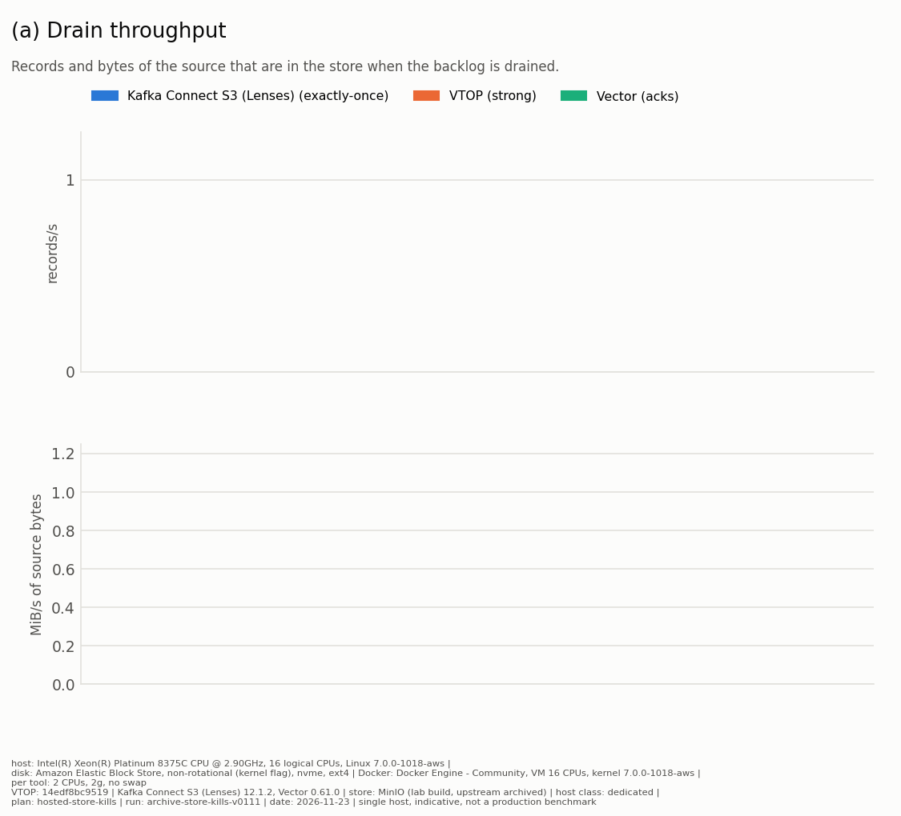

Source: `archive-store-kills-v0111` ([archive.csv](../../benchmarks/archive_compare/results/archive-store-kills-v0111/archive.csv)), the `archive` kind, plan `hosted-store-kills`, host class `dedicated`, 2026-11-23, VTOP `14edf8bc9519`.

**records/s** (median, min-max of the repetitions)

| cell | Kafka Connect S3 (Lenses) | VTOP | Vector | Vector disk-buffer (secondary) |
|---|---|---|---|---|

**MiB/s of source bytes** (median, min-max of the repetitions)

| cell | Kafka Connect S3 (Lenses) | VTOP | Vector | Vector disk-buffer (secondary) |
|---|---|---|---|---|

Scoreboard (each system in its primary profile; VTOP's row is always present):

| metric | cell | best | best value | VTOP | VTOP / best | VTOP is |
|---|---|---|---|---|---|---|

### (a) CPU and store requests per GiB archived

CPU-seconds from the tool container's cgroup counters; PUT and GET from the store's own request counters. VTOP reads objects back by design.

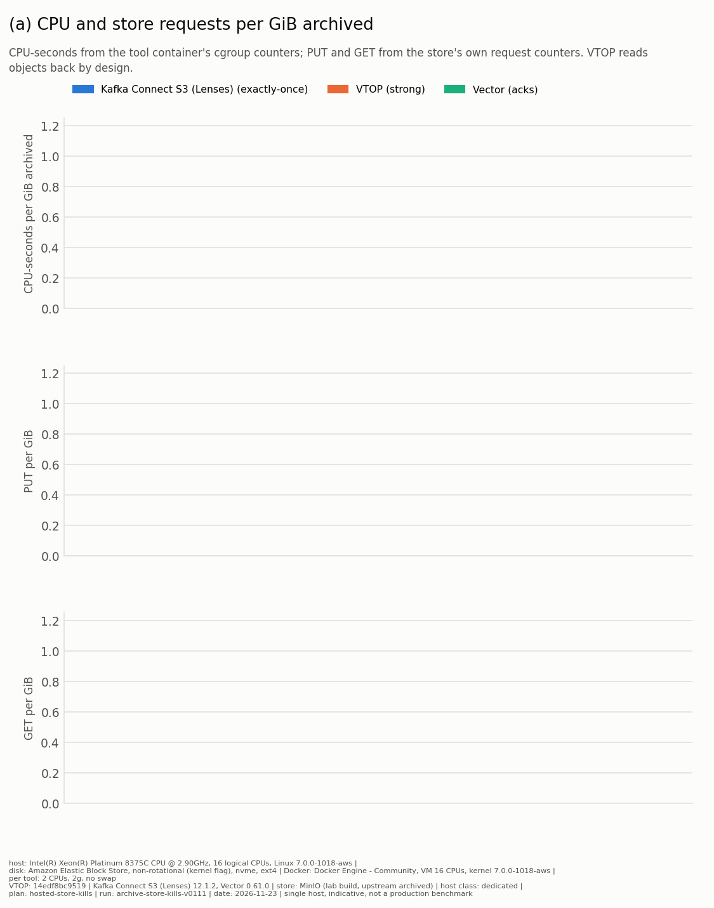

Source: `archive-store-kills-v0111` ([archive.csv](../../benchmarks/archive_compare/results/archive-store-kills-v0111/archive.csv)), the `archive` kind, plan `hosted-store-kills`, host class `dedicated`, 2026-11-23, VTOP `14edf8bc9519`.

**CPU-seconds per GiB archived** (median, min-max of the repetitions)

| cell | Kafka Connect S3 (Lenses) | VTOP | Vector | Vector disk-buffer (secondary) |
|---|---|---|---|---|

**PUT per GiB** (median, min-max of the repetitions)

| cell | Kafka Connect S3 (Lenses) | VTOP | Vector | Vector disk-buffer (secondary) |
|---|---|---|---|---|

**GET per GiB** (median, min-max of the repetitions)

| cell | Kafka Connect S3 (Lenses) | VTOP | Vector | Vector disk-buffer (secondary) |
|---|---|---|---|---|

Scoreboard (each system in its primary profile; VTOP's row is always present):

| metric | cell | best | best value | VTOP | VTOP / best | VTOP is |
|---|---|---|---|---|---|---|

## (b) Files and a syslog spool to object storage

How fast, and at what cost, does each tool drain a backlog of rotated, seeded RFC 5424 files into the same bucket?

### (b) Drain throughput

A pre-written backlog across rotated files, drained to quiescence.

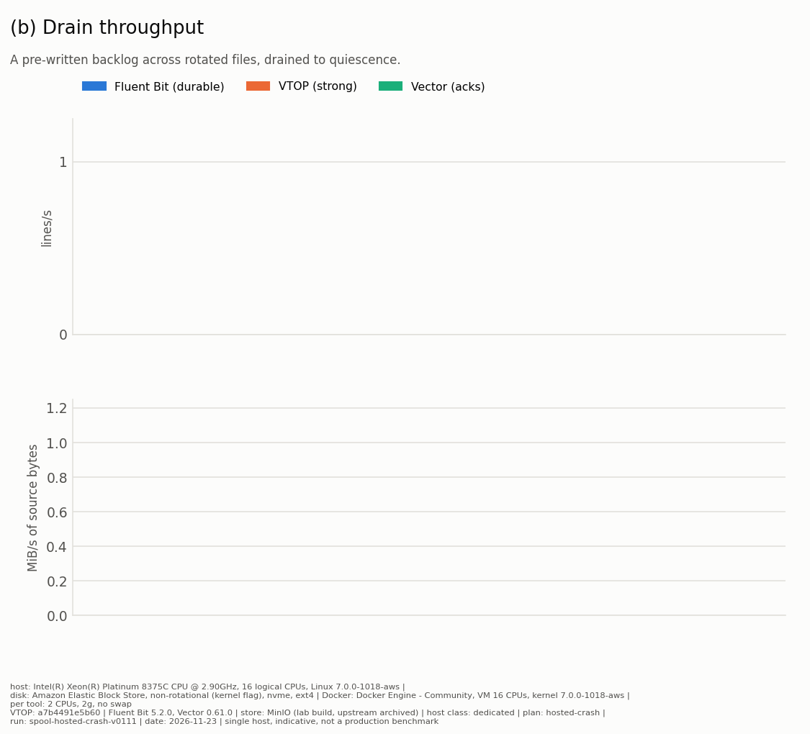

Source: `spool-hosted-crash-v0111` ([spool.csv](../../benchmarks/spool_compare/results/spool-hosted-crash-v0111/spool.csv)), the `spool` kind, plan `hosted-crash`, host class `dedicated`, 2026-11-23, VTOP `a7b4491e5b60`.

**lines/s** (median, min-max of the repetitions)

| cell | Fluent Bit | VTOP | Vector | Vector disk-buffer (secondary) |
|---|---|---|---|---|

**MiB/s of source bytes** (median, min-max of the repetitions)

| cell | Fluent Bit | VTOP | Vector | Vector disk-buffer (secondary) |
|---|---|---|---|---|

Scoreboard (each system in its primary profile; VTOP's row is always present):

| metric | cell | best | best value | VTOP | VTOP / best | VTOP is |
|---|---|---|---|---|---|---|

### (b) CPU and memory

The tool container's cgroup counters over the drain window; RSS is the sampled peak.

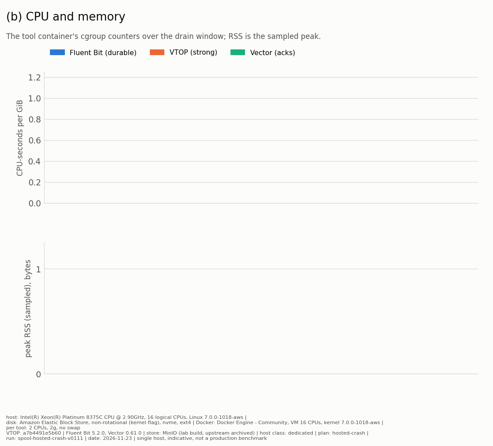

Source: `spool-hosted-crash-v0111` ([spool.csv](../../benchmarks/spool_compare/results/spool-hosted-crash-v0111/spool.csv)), the `spool` kind, plan `hosted-crash`, host class `dedicated`, 2026-11-23, VTOP `a7b4491e5b60`.

**CPU-seconds per GiB** (median, min-max of the repetitions)

| cell | Fluent Bit | VTOP | Vector | Vector disk-buffer (secondary) |
|---|---|---|---|---|

**peak RSS (sampled), bytes** (median, min-max of the repetitions)

| cell | Fluent Bit | VTOP | Vector | Vector disk-buffer (secondary) |
|---|---|---|---|---|

Scoreboard (each system in its primary profile; VTOP's row is always present):

| metric | cell | best | best value | VTOP | VTOP / best | VTOP is |
|---|---|---|---|---|---|---|

## (c) Upload over a long, lossy or policed link

How much of a 100 ms, 10 Mbit/s, lossy or policed link does each tool use, how many objects does it get committed, and what does it cost on the wire and in CPU? VTOP's goodput includes its read-back.

### (c) Goodput at documented defaults

Fraction of the link reference, end to end.

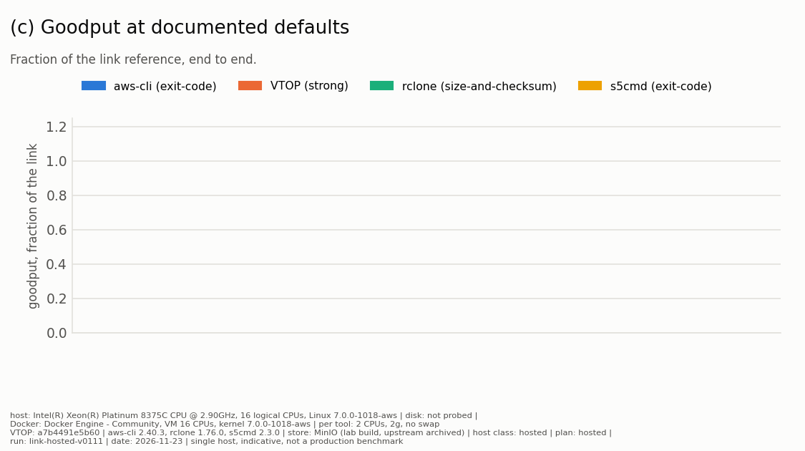

Source: `link-hosted-v0111` ([link.csv](../../benchmarks/link_compare/results/link-hosted-v0111/link.csv)), the `link` kind, plan `hosted`, host class `hosted`, 2026-11-23, VTOP `a7b4491e5b60`.

**goodput, fraction of the link** (median, min-max of the repetitions)

| cell | aws-cli | VTOP | rclone | s5cmd |
|---|---|---|---|---|

Scoreboard (each system in its primary profile; VTOP's row is always present):

| metric | cell | best | best value | VTOP | VTOP / best | VTOP is |
|---|---|---|---|---|---|---|

### (c) Objects committed of N

Judged by the harness's read-back and sha256, never a tool's exit code.

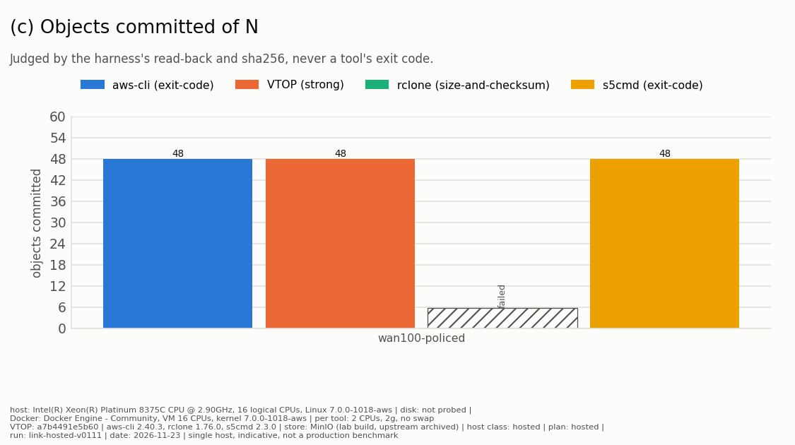

Source: `link-hosted-v0111` ([link.csv](../../benchmarks/link_compare/results/link-hosted-v0111/link.csv)), the `link` kind, plan `hosted`, host class `hosted`, 2026-11-23, VTOP `a7b4491e5b60`.

**objects committed** (median, min-max of the repetitions)

| cell | aws-cli | VTOP | rclone | s5cmd |
|---|---|---|---|---|
| wan100-policed | 48 | 48 | failed | 48 |

Scoreboard (each system in its primary profile; VTOP's row is always present):

| metric | cell | best | best value | VTOP | VTOP / best | VTOP is |
|---|---|---|---|---|---|---|
| objects committed | wan100-policed | aws-cli | 48 | 48 | 1.00 | level |

### (c) Bytes on the wire and CPU

Wire bytes from the middlebox's interface counters; CPU from the tool container's cgroup.

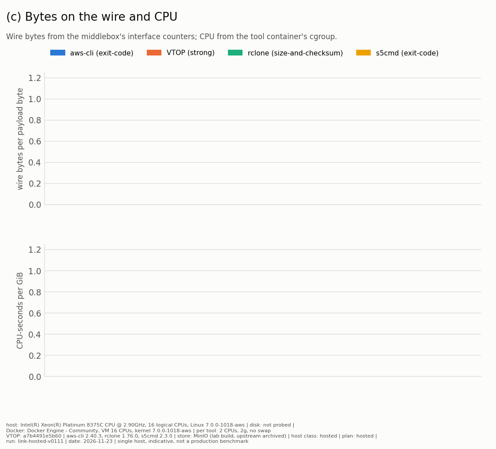

Source: `link-hosted-v0111` ([link.csv](../../benchmarks/link_compare/results/link-hosted-v0111/link.csv)), the `link` kind, plan `hosted`, host class `hosted`, 2026-11-23, VTOP `a7b4491e5b60`.

**wire bytes per payload byte** (median, min-max of the repetitions)

| cell | aws-cli | VTOP | rclone | s5cmd |
|---|---|---|---|---|

**CPU-seconds per GiB** (median, min-max of the repetitions)

| cell | aws-cli | VTOP | rclone | s5cmd |
|---|---|---|---|---|

Scoreboard (each system in its primary profile; VTOP's row is always present):

| metric | cell | best | best value | VTOP | VTOP / best | VTOP is |
|---|---|---|---|---|---|---|

## (d) Crash safety

After a kill -9, run to quiescence, what is missing from the bucket (gaps) and what is there twice (duplicates)? The same kill kinds and counts for every tool.

### (d) Kafka to object storage: what a kill -9 costs

Summed over the runs; K1 at the start of a PUT, K2 right after the store answered it, K3 at a seeded time.

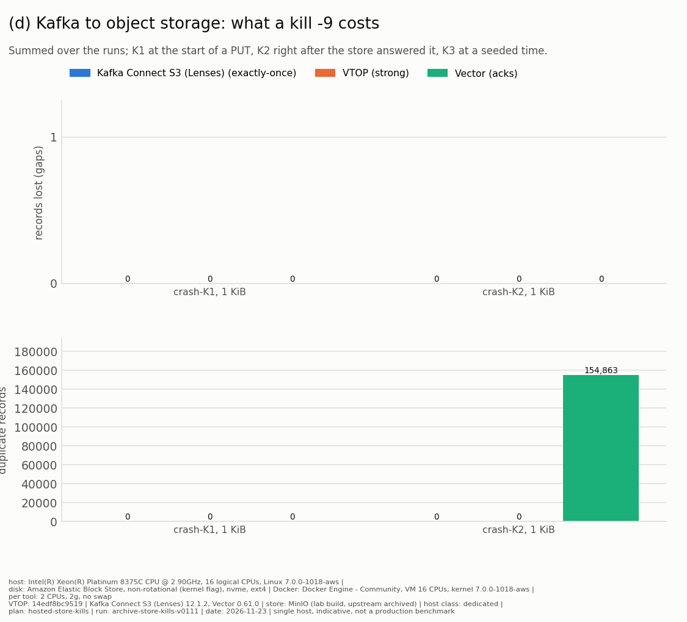

Source: `archive-store-kills-v0111` ([archive.csv](../../benchmarks/archive_compare/results/archive-store-kills-v0111/archive.csv)), the `archive` kind, plan `hosted-store-kills`, host class `dedicated`, 2026-11-23, VTOP `14edf8bc9519`.

**records lost (gaps)** (sum over the repetitions)

| cell | Kafka Connect S3 (Lenses) | VTOP | Vector | Vector disk-buffer (secondary) |
|---|---|---|---|---|
| crash-K1, 1 KiB | 0 | 0 | 0 | 0 |
| crash-K2, 1 KiB | 0 | 0 | 0 | 934 |

**duplicate records** (sum over the repetitions)

| cell | Kafka Connect S3 (Lenses) | VTOP | Vector | Vector disk-buffer (secondary) |
|---|---|---|---|---|
| crash-K1, 1 KiB | 0 | 0 | 0 | 104,128 |
| crash-K2, 1 KiB | 0 | 0 | 154,863 | 128,605 |

Scoreboard (each system in its primary profile; VTOP's row is always present):

| metric | cell | best | best value | VTOP | VTOP / best | VTOP is |
|---|---|---|---|---|---|---|
| records lost (gaps) | crash-K1, 1 KiB | Kafka Connect S3 (Lenses) | 0 | 0 |  | level |
| records lost (gaps) | crash-K2, 1 KiB | Kafka Connect S3 (Lenses) | 0 | 0 |  | level |
| duplicate records | crash-K1, 1 KiB | Kafka Connect S3 (Lenses) | 0 | 0 |  | level |
| duplicate records | crash-K2, 1 KiB | Kafka Connect S3 (Lenses) | 0 | 0 |  | level |

### (d) Spool to object storage: what a kill -9 and a rotation cost

Summed over the runs; K1 to K3 as above, K4 inside a seeded window after a rotation.

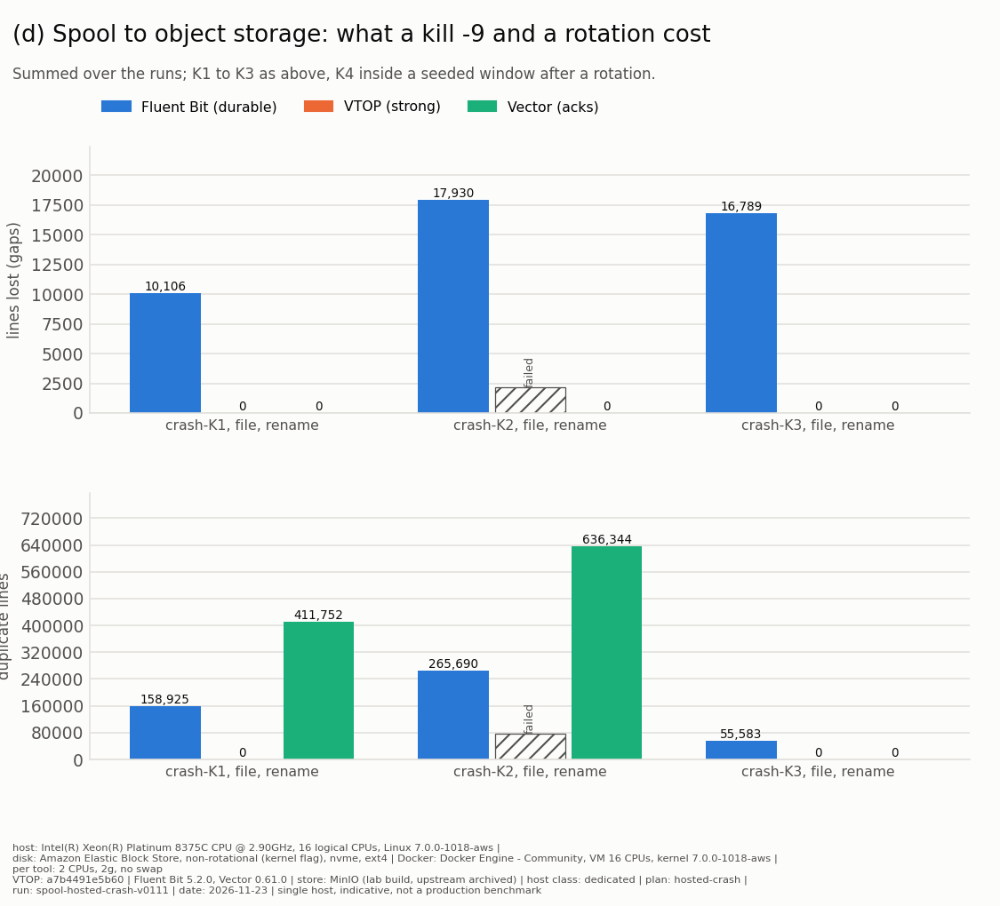

Source: `spool-hosted-crash-v0111` ([spool.csv](../../benchmarks/spool_compare/results/spool-hosted-crash-v0111/spool.csv)), the `spool` kind, plan `hosted-crash`, host class `dedicated`, 2026-11-23, VTOP `a7b4491e5b60`.

**lines lost (gaps)** (sum over the repetitions)

| cell | Fluent Bit | VTOP | Vector | Vector disk-buffer (secondary) |
|---|---|---|---|---|
| crash-K1, file, rename | 10,106 | 0 | 0 | 0 |
| crash-K2, file, rename | 17,930 | failed | 0 | 0 |
| crash-K3, file, rename | 16,789 | 0 | 0 | 0 |

**duplicate lines** (sum over the repetitions)

| cell | Fluent Bit | VTOP | Vector | Vector disk-buffer (secondary) |
|---|---|---|---|---|
| crash-K1, file, rename | 158,925 | 0 | 411,752 | 1,305,872 |
| crash-K2, file, rename | 265,690 | failed | 636,344 | 1,517,281 |
| crash-K3, file, rename | 55,583 | 0 | 0 | 837 |

Scoreboard (each system in its primary profile; VTOP's row is always present):

| metric | cell | best | best value | VTOP | VTOP / best | VTOP is |
|---|---|---|---|---|---|---|
| lines lost (gaps) | crash-K1, file, rename | Vector | 0 | 0 |  | level |
| lines lost (gaps) | crash-K2, file, rename | Vector | 0 | failed |  | no comparison |
| lines lost (gaps) | crash-K3, file, rename | Vector | 0 | 0 |  | level |
| duplicate lines | crash-K1, file, rename | VTOP | 0 | 0 |  | ahead |
| duplicate lines | crash-K2, file, rename | Fluent Bit | 265,690 | failed |  | no comparison |
| duplicate lines | crash-K3, file, rename | Vector | 0 | 0 |  | level |

## (e) Verification

What does each tool establish about a stored object before it moves its source cursor, what does that cost, and what happens when a read-back is corrupted? The fault test measures a design choice, not speed: a tool that never reads back cannot notice a read-path corruption, and no ranking of speed is drawn from it.

### (e) A corrupted read-back

The tap flips one bit in one read-back in ten. Corrupt objects the source cursor moved past; zero means every one was noticed first.

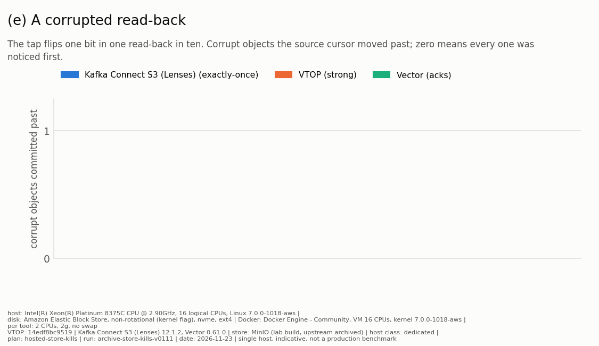

Source: `archive-store-kills-v0111` ([archive.csv](../../benchmarks/archive_compare/results/archive-store-kills-v0111/archive.csv)), the `archive` kind, plan `hosted-store-kills`, host class `dedicated`, 2026-11-23, VTOP `14edf8bc9519`.

**corrupt objects committed past** (sum over the repetitions)

| cell | Kafka Connect S3 (Lenses) | VTOP | Vector | Vector disk-buffer (secondary) |
|---|---|---|---|---|

Scoreboard (each system in its primary profile; VTOP's row is always present):

| metric | cell | best | best value | VTOP | VTOP / best | VTOP is |
|---|---|---|---|---|---|---|

### (e) What reading back costs

GET requests per GiB archived: the extra requests of a tool that reads objects back.

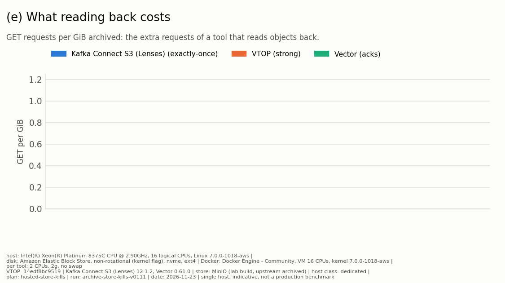

Source: `archive-store-kills-v0111` ([archive.csv](../../benchmarks/archive_compare/results/archive-store-kills-v0111/archive.csv)), the `archive` kind, plan `hosted-store-kills`, host class `dedicated`, 2026-11-23, VTOP `14edf8bc9519`.

**GET per GiB** (median, min-max of the repetitions)

| cell | Kafka Connect S3 (Lenses) | VTOP | Vector | Vector disk-buffer (secondary) |
|---|---|---|---|---|

Scoreboard (each system in its primary profile; VTOP's row is always present):

| metric | cell | best | best value | VTOP | VTOP / best | VTOP is |
|---|---|---|---|---|---|---|

## Products, versions and licences

| product | role | licence | version | profile drawn (what its commit means) | use cases | evidence |
|---|---|---|---|---|---|---|
| Kafka Connect S3 (Lenses) | comparand | Apache-2.0 | 12.1.2 | `exactly-once` | (a), (d), (e) | [licence](https://github.com/lensesio/stream-reactor/blob/master/LICENSE), read 2026-11-14; publish_ok true |
| VTOP | subject | MIT | commit 14edf8bc9519, commit a7b4491e5b60 | `strong` | (a), (b), (c), (d), (e) | [licence](https://github.com/allamiro/vtop-engine/blob/main/LICENSE), read 2026-11-22; publish_ok true |
| Vector | comparand | MPL-2.0 | 0.61.0 | `acks` | (a), (b), (d), (e) | [licence](https://github.com/vectordotdev/vector/blob/master/LICENSE), read 2026-11-14; publish_ok true |
| Fluent Bit | comparand | Apache-2.0 | 5.2.0 | `durable` | (b), (d) | [licence](https://github.com/fluent/fluent-bit/blob/master/LICENSE), read 2026-11-14; publish_ok true |
| OpenTelemetry Collector | comparand | Apache-2.0 | 0.165.0 (pinned, not run yet) |  | (b), (d) | [licence](https://github.com/open-telemetry/opentelemetry-collector-contrib/blob/main/LICENSE), read 2026-11-14; publish_ok true |
| aws-cli | comparand | Apache-2.0 | 2.40.3 | `exit-code` | (c) | [licence](https://github.com/aws/aws-cli/blob/v2/LICENSE.txt), read 2026-11-14; publish_ok true |
| rclone | comparand | MIT | 1.76.0 | `size-and-checksum` | (c) | [licence](https://github.com/rclone/rclone/blob/master/COPYING), read 2026-11-14; publish_ok true |
| s5cmd | comparand | MIT | 2.3.0 | `exit-code` | (c) | [licence](https://github.com/peak/s5cmd/blob/master/LICENSE), read 2026-11-14; publish_ok true |
| Apache Kafka (the source) | source | Apache-2.0 | 4.3.2 (pinned, not run yet) |  | (a) | [licence](https://github.com/apache/kafka/blob/trunk/LICENSE), read 2026-11-14; publish_ok true |

## Fairness rules

Rules 1 to 10 are the Kafka comparison's (#595) with "Kafka" read as "every other product"; rules 11 to 21 are this comparison's (#744). Each run's report records how it kept them.

1. Same machine, same limits: every tool runs on the same host or VM with identical CPU and memory limits and the same disk type.
2. Same client: one client binary and version drives every tool where a client is involved.
3. Same contract at the source: one Kafka node, RF=1, `acks=all`, constant across tools.
4. Durability parity is stated, never implied: every row names the durability profile it ran.
5. Timeouts that decide failover are reported, with the profile that sets them.
6. Open-loop latency: latency comes from fixed offered rates, never a closed loop at saturation.
7. Repetition: warm-up excluded, at least three repetitions, the median with the min-max spread, never a best run.
8. Pinned and recorded: versions, image digests, the commit, the host and every config value are written into each result.
9. No hand-entered numbers: every figure on this page comes from a committed CSV through a script; a missing or partial run fails the generator instead of producing a chart.
10. Gaps are listed, not worked around silently: where a tool cannot do what a cell needs, the report says so.
11. Licence gate: a product charts only with `publish_ok`, its evidence and a date in the registry.
12. Same host, same limits, per limit class: 2 CPUs and 2 GiB per tool container, the same disk type, the same MinIO; a JVM tool's heap is set inside the limit and recorded.
13. Documented best configuration, committed: each tool's configuration is a reviewed file whose sha256 is in the CSV.
14. Defaults and tuned, same budget: results are reported at the documented configuration; a tuned profile gives every tool the same grid size, and the chart names it.
15. Same output shape: one JSON line per record, gzip, the same size and age thresholds; any deviation a tool cannot avoid is listed in its report.
16. One independent checker: gaps, duplicates, torn and orphan objects are computed from the seeded ids, never from a tool's own metadata.
17. Crash kinds are shared: the same kill kinds and counts for every tool; the S3 tap is used only in crash and fault cells, never in a performance cell.
18. Tool failure modes are reported as measured: a failed tool's row says `failed` with its own error and is never quietly retried.
19. Telemetry off, recorded: each tool's usage reporting is disabled and the setting is written to the environment block.
20. Right of reply: the configuration files and the method are posted for the maintainers of each open-source tool to review before a report is published.
21. Host class on every row: `laptop`, `hosted` or `dedicated`; a run mixing host classes is refused, and a performance row from a hosted host is refused.

## Limits of this evidence

- **One host.** Every run is on a single machine (its CPU, disk and kernel are in each chart's footer), with every tool in its own container of 2 CPUs and 2 GiB. It is an indicative comparison of the tools as configured here, not a production benchmark and not a statement about any other hardware.
- **One object store: MinIO.** Every tool writes to the same lab MinIO. A different store, a real S3 region or a different network would change request latency, request counts and the link results; MinIO's upstream is archived, so the store build is recorded with each run.
- **One plan per run.** A run's plan (cells, record sizes, repetitions, host class) is named beside its results; a smaller plan has fewer cells and fewer repetitions, and its host class decides which metrics are valid at all (a hosted runner's performance rows are refused).
- **Defaults and documented best configurations only.** A tool configured differently, or tuned beyond the documented grid, may do better or worse.
- **Products that are not run.** A product whose terms forbid publishing benchmark results, restrict testing it for competitive purposes, or leave that unclear is never run for a published chart (rule 11).
- **Power-cut survival, other brokers, and other limit classes** are not measured here.
- **The `archive` run:** plan `hosted-store-kills`, host class `dedicated`, store MinIO (lab build, upstream archived), host Intel(R) Xeon(R) Platinum 8375C CPU @ 2.90GHz (16 logical CPUs), per tool 2 CPUs, 2g, no swap.
- **The `spool` run:** plan `hosted-crash`, host class `dedicated`, store MinIO (lab build, upstream archived), host Intel(R) Xeon(R) Platinum 8375C CPU @ 2.90GHz (16 logical CPUs), per tool 2 CPUs, 2g, no swap.
- **The `link` run:** plan `hosted`, host class `hosted`, store MinIO (lab build, upstream archived), host Intel(R) Xeon(R) Platinum 8375C CPU @ 2.90GHz (16 logical CPUs), per tool 2 CPUs, 2g, no swap.

## Regenerating this page

```
python3 -m pip install --require-hashes -r benchmarks/kafka_compare/requirements-report.txt
python3 benchmarks/compare_common/regenerate.py
```

The page and its charts are rewritten from the committed runs, and CI fails when they differ from what the committed CSVs produce.
