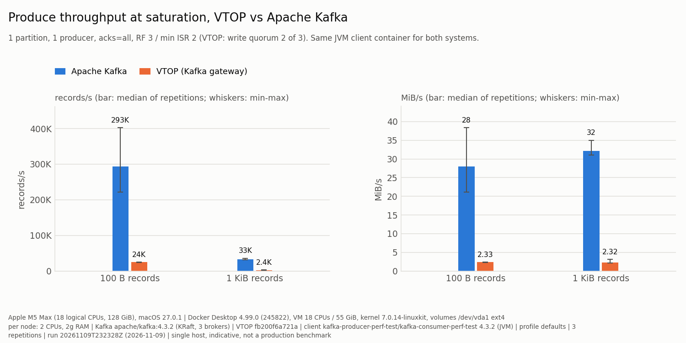
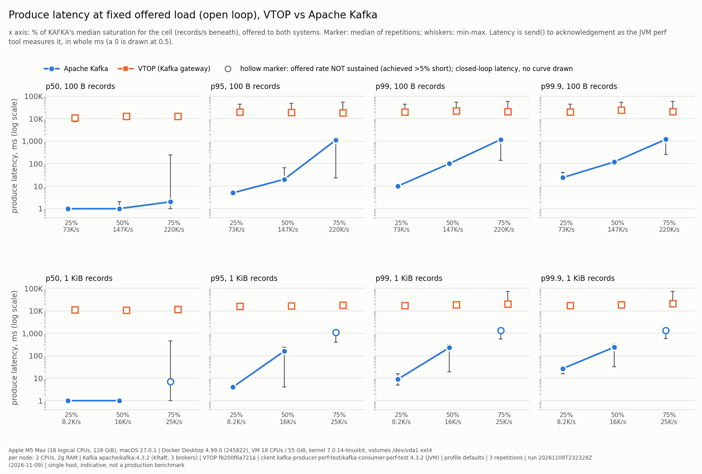
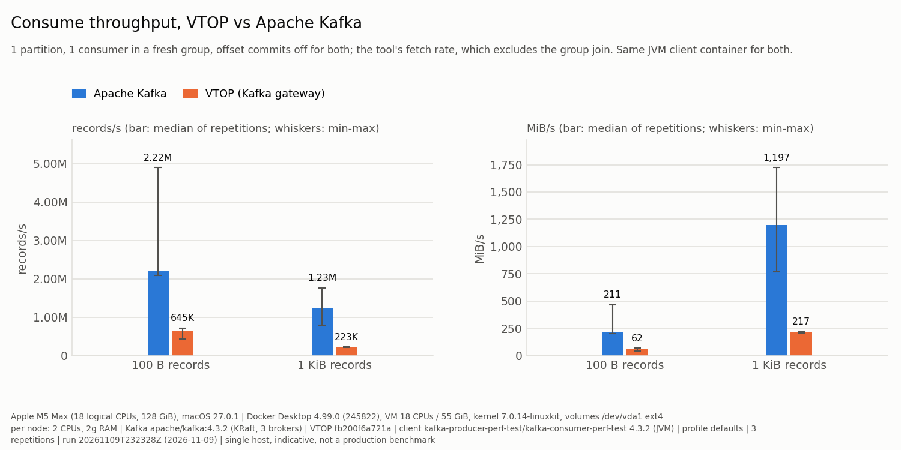

# VTOP vs Apache Kafka: measured

<!-- Generated by benchmarks/kafka_compare/report.py from the committed CSV. Do not edit by hand: change the generator or re-run the benchmark. -->

> **Single host, Apple M5 Max (Mac17,6), Docker Desktop 4.99.0 (245822); indicative, not a production benchmark.** Both clusters ran as Linux containers in the same Docker Desktop VM, one at a time, with identical per-node limits. Treat the numbers as a relative reading on a laptop, not as capacity figures for either system.

Phase 1 of [#595](https://github.com/allamiro/vtop-engine/issues/595) ([#596](https://github.com/allamiro/vtop-engine/issues/596) throughput and latency, [#600](https://github.com/allamiro/vtop-engine/issues/600) charts). Raw data: [`results.csv`](../../benchmarks/kafka_compare/results/20261109T232328Z/results.csv) and [`environment.json`](../../benchmarks/kafka_compare/results/20261109T232328Z/environment.json), run `20261109T232328Z`. Every number on this page and in the images is generated from that CSV by `benchmarks/kafka_compare/report.py`.

## Method

- **Same machine, same limits (rule 1).** Three Kafka brokers (KRaft, combined broker+controller) and three VTOP nodes, each a container with 2 CPUs and 2g of memory, no swap, data on named volumes on the Docker VM's disk (`/dev/vda1 ext4`). One system runs at a time; each cell starts from empty volumes.
- **Same client (rule 2).** `kafka-producer-perf-test/kafka-consumer-perf-test 4.3.2 (JVM)` from `apache/kafka:4.3.2@sha256:852a0d49fc4e656b022e7f23785411802c9a088c78a7c5e39f33969de9c227a7`, in its own container (4 CPUs, 4g), pointed at each cluster in turn. Producer properties set: `acks=all compression.type=none`; everything else is the client's default for both (its own config dump for each system is in `environment.json` under `observed.producer_config`).
- **Same replication contract (rule 3).** Kafka: RF=3, `min.insync.replicas=2`, `acks=all`. VTOP: one range replicated to three nodes, acknowledged at a write quorum of 2 of 3 (`Durability::Quorum`), `acks=all` from the client.
- **Profile `defaults` (rule 4).** Each system as shipped. This is **not** durability parity: Kafka acknowledges once the in-sync replicas have the batch in their page cache (`flush.messages` unset), while a VTOP quorum acknowledgement means two replicas have **fsynced** the append. The `fsync-parity` profile is phase 2.
- **Open-loop latency (rule 6).** Latency comes from fixed offered rates (`--throughput`) at 25%, 50%, 75% of **Kafka's** median saturation for the cell, offered to both systems. A run more than 5% short of its offered rate is flagged *not sustained*: the tool's throttle then becomes a closed loop and its latency understates the real one, so the chart draws such points hollow and joins no line through them.
- **Repetition (rule 7).** 3 repetitions per measurement; the first 20% of each run's records are warm-up (`--warmup-records`) and excluded, after an unrecorded warm-up run per cell. Tables show the median with the min-max across repetitions.
- **Correctness first.** Before any timing, each fresh cluster took 10,000 records of the cell's size with `acks=all` and handed every one back, byte-exact and in order, through the same client; a cluster that failed would have been refused.

## Produce throughput at saturation

| record size | system | records/s | MiB/s |
|---|---|---|---|
| 100 B | Apache Kafka | 293,112 (221,750-402,145) | 27.95 (21.15-38.35) |
| 100 B | VTOP (Kafka gateway) | 24,419 (24,181-25,107) | 2.33 (2.31-2.39) |
| 1 KiB | Apache Kafka | 32,965 (31,829-35,871) | 32.19 (31.08-35.03) |
| 1 KiB | VTOP (Kafka gateway) | 2,374 (2,243-3,164) | 2.32 (2.19-3.09) |

- 100 B records: **Kafka** saturates at 12.0x the other's median records/s.
- 1 KiB records: **Kafka** saturates at 13.9x the other's median records/s.

## Produce latency at fixed offered load

| record size | load | offered records/s | system | achieved records/s | sustained | p50 ms | p99 ms | p99.9 ms |
|---|---|---|---|---|---|---|---|---|
| 100 B | 25% | 73,277 | Apache Kafka | 73,240 | yes | 1 (1-1) | 10 (8-13) | 24 (21-40) |
| 100 B | 25% | 73,277 | VTOP (Kafka gateway) | 21,744 | **no** | 10,933 (7,439-11,326) | 19,914 (17,052-45,098) | 20,092 (18,172-45,213) |
| 100 B | 50% | 146,555 | Apache Kafka | 146,384 | yes | 1 (1-2) | 100 (97-105) | 120 (115-124) |
| 100 B | 50% | 146,555 | VTOP (Kafka gateway) | 21,829 | **no** | 12,742 (10,705-13,923) | 22,555 (19,705-53,136) | 24,007 (19,870-53,198) |
| 100 B | 75% | 219,833 | Apache Kafka | 219,696 | yes | 2 (1-242) | 1,178 (140-1,297) | 1,194 (259-1,362) |
| 100 B | 75% | 219,833 | VTOP (Kafka gateway) | 22,974 | **no** | 12,849 (10,849-13,739) | 20,582 (20,582-57,874) | 21,172 (20,729-58,551) |
| 1 KiB | 25% | 8,241 | Apache Kafka | 8,236 | yes | 1 (1-1) | 9 (5-16) | 27 (16-32) |
| 1 KiB | 25% | 8,241 | VTOP (Kafka gateway) | 2,320 | **no** | 11,101 (10,762-12,320) | 16,906 (15,923-17,405) | 16,924 (16,000-17,603) |
| 1 KiB | 50% | 16,482 | Apache Kafka | 16,474 | yes | 1 (1-1) | 227 (19-320) | 240 (32-332) |
| 1 KiB | 50% | 16,482 | VTOP (Kafka gateway) | 2,518 | **no** | 10,871 (10,687-12,096) | 18,587 (17,487-18,781) | 18,752 (17,535-19,674) |
| 1 KiB | 75% | 24,723 | Apache Kafka | 24,702 | **no** | 7 (1-452) | 1,311 (549-1,630) | 1,334 (566-1,641) |
| 1 KiB | 75% | 24,723 | VTOP (Kafka gateway) | 2,331 | **no** | 11,371 (11,076-12,900) | 20,509 (17,848-71,495) | 20,782 (17,876-72,501) |

- 100 B records, Apache Kafka: sustained 3 of 3 offered rates in every repetition (25%, 50%, 75%).
- 100 B records, VTOP (Kafka gateway): sustained 0 of 3 offered rates in every repetition.
- 100 B records: VTOP's fastest saturation repetition (25,107 records/s) is below the lowest offered rate (73,277 records/s), so none of its fixed-rate runs could be open-loop; see *Reading the results*.
- 1 KiB records, Apache Kafka: sustained 2 of 3 offered rates in every repetition (25%, 50%).
- 1 KiB records, VTOP (Kafka gateway): sustained 0 of 3 offered rates in every repetition.
- 1 KiB records: VTOP's fastest saturation repetition (3,164 records/s) is below the lowest offered rate (8,241 records/s), so none of its fixed-rate runs could be open-loop; see *Reading the results*.

## Consume throughput

`kafka-consumer-perf-test` reading the first records of the partition with a fresh group each repetition, offset commits off for both. The rates are the tool's `fetch.*` columns, which exclude the group join (Kafka's `group.initial.rebalance.delay.ms` alone is 3 s).

| record size | system | records/s | MiB/s |
|---|---|---|---|
| 100 B | Apache Kafka | 2,217,313 (2,083,350-4,894,003) | 211.46 (198.68-466.73) |
| 100 B | VTOP (Kafka gateway) | 645,180 (422,488-718,412) | 61.53 (40.29-68.51) |
| 1 KiB | Apache Kafka | 1,226,060 (787,768-1,764,489) | 1,197.32 (769.30-1,723.13) |
| 1 KiB | VTOP (Kafka gateway) | 222,626 (210,489-223,922) | 217.41 (205.56-218.67) |

## Reading the results

Where Kafka is faster, the reasons known from the code and the configuration are these. None of them was
isolated by a separate measurement in this phase; they are the explanation the code supports, not a proof.

1. **What an acknowledgement costs.** Under `defaults`, a Kafka `acks=all` acknowledgement waits for the
   in-sync replicas to have the batch in their logs (page cache); nothing is fsynced. A VTOP quorum
   acknowledgement waits until a majority of the three replicas, the leader counted, has made the append
   *durable* (fsync), and the leader has advanced the committed high-water mark. Every produce request pays
   for fsyncs and a replication round trip before it is answered. This is the largest single difference, and
   it is a difference in the guarantee as much as in speed; the `fsync-parity` profile (phase 2) prices the
   same guarantee on Kafka.
2. **No group commit on the gateway path.** `vtop-node data` appends each produce request as its own durability
   barrier: the broker's group-commit mode (one fsync and replication round shared by many concurrent
   requests) exists in `vtop-broker` but is not wired into the node. The client caps a request at
   `batch.size` (16 KiB by default) whatever the record size, so a ceiling set per request shows up as a
   roughly constant MiB/s across record sizes and a record rate that falls as records grow, which is the shape
   of VTOP's two cells here.
3. **Translation in the gateway.** Every Kafka record batch is decoded, validated (CRC, attributes) and
   re-appended through the native broker, which frames it again for the replica plane; Kafka validates the
   batch and appends it with offsets assigned in place, without taking its records apart. The cost is CPU and
   copies, not round trips.
4. **Fetch path.** Kafka serves a fetch from stored batches with a zero-copy file transfer; the gateway reads
   records through the native broker and re-encodes them as a Kafka record batch.

A separate, unrecorded probe during development showed the VTOP nodes far below their CPU limit while
saturated, which fits (1) and (2): the produce path is bound by durability round trips, not CPU. Per-node CPU
and bytes written are not in this run's CSV; recording them is #596's resource metric (phase 2).

**On the latency chart:** where VTOP's saturation is below the lowest offered rate (25% of Kafka's), no VTOP
fixed-rate run can be sustained, and the perf tool's throttle degenerates into a closed loop against a full
producer buffer. Those VTOP latencies are queueing in the client (seconds), not VTOP's service latency at that
load; they are drawn hollow and must not be read as "VTOP's p99 at 25% load". A fair open-loop VTOP latency
curve needs offered rates below VTOP's own saturation, which the issue's Kafka-relative rule does not produce
here; adding VTOP-relative rates is a phase-2 item.

Nothing here measures what VTOP adds over Kafka on this path (fenced epochs, the verified commit rule, the
evidence chain; see [COMPARISON.md](../COMPARISON.md)), and nothing here is a failover, archive or crash
measurement (#597, #598, #599).

## Gateway gaps met (rule 10)

| gap | met by | exact error | what was done |
|---|---|---|---|
| CreateTopics | kafka-topics.sh --create | `UnsupportedVersionException: The node does not support CREATE_TOPICS` | The VTOP topic is the range in the node config; Kafka's is created by run.py with kafka-topics.sh. |
| DescribeConfigs | kafka-topics.sh --describe | `UnsupportedVersionException: The node does not support DESCRIBE_CONFIGS` | Not needed by the perf tools; the topic layout is recorded from the node config instead. |
| OffsetCommit (no metadata plane) | kafka-consumer-perf-test.sh with auto-commit on | `Offset commit failed on partition bench-0 at offset 150447: The message format version on the broker does not support the request (gateway: "kafka OffsetCommit refused: this gateway has no durable offset store")` | enable.auto.commit=false for BOTH systems; reads are measured, commits are not. |
| Compressed batches | producer with compression.type=zstd | `UnsupportedCompressionTypeException: batch 0: record batch is compressed (codec 4), which this gateway does not decompress` | compression.type=none for both systems; compression is out of phase 1. |
| Gateway on followers | vtop-node with a `kafka` block on a follower | `the node refuses a kafka block on any role but leader or standalone (the gateway is served by a leader or standalone only)` | The gateway runs on the range's leader only; one partition means one gateway. |

## Known gaps in this phase

- **Matrix size.** Record sizes 100 B and 1 KiB only; 1 partition, 1 producer, no compression, profile
  `defaults` only. #596's full matrix (10 KiB, 6 partitions, 4 producers, zstd, `fsync-parity`) is not run.
- **One gateway, one partition.** The gateway runs on the range's leader only; a multi-partition VTOP topic
  needs one leader per partition and is not exercised here.
- **No metadata plane.** VTOP runs as a static leader with two followers (live-chaos scenario 17's shape), so
  there is no lease, no failover and no durable consumer-offset store; Kafka runs its full KRaft quorum. Neither
  matters to a steady-state produce/fetch measurement, but the two clusters are not doing identical background
  work.
- **Latency resolution.** The JVM perf tool reports percentiles in whole milliseconds, from a sample of the
  run's records; sub-millisecond differences are invisible.
- **End-to-end latency, CPU and write amplification** (#596 metrics 3 and 4) are not measured yet.
- **No CI drift check yet.** The images are deterministic for a given matplotlib version, but CI does not yet
  regenerate and compare them (#600 acceptance).

## Environment

| | |
|---|---|
| `host_cpu` | `Apple M5 Max` |
| `host_model` | `Mac17,6` |
| `host_logical_cpus` | `18` |
| `host_memory_bytes` | `137438953472` |
| `host_os` | `macOS 27.0.1` |
| `docker_platform` | `Docker Desktop 4.99.0 (245822)` |
| `docker_server_version` | `29.9.3` |
| `docker_vm_cpus` | `18` |
| `docker_vm_memory_bytes` | `59389968384` |
| `docker_vm_kernel` | `7.0.14-linuxkit` |
| `docker_vm_arch` | `aarch64` |
| `docker_storage_driver` | `overlayfs` |
| `volume_filesystem` | `/dev/vda1 ext4` |
| `kafka_image` | `apache/kafka:4.3.2@sha256:852a0d49fc4e656b022e7f23785411802c9a088c78a7c5e39f33969de9c227a7` |
| `vtop_commit` | `fb200f6a721ad7d15b4dd4798f396222f32a3a7a` |
| `vtop_image` | `vtop-bench:fb200f6a721a` |
| `client` | `kafka-producer-perf-test/kafka-consumer-perf-test 4.3.2 (JVM)` |
| `client_java` | `openjdk version "21.0.12.1" 2026-08-18 LTS` |
| `profile` | `defaults` |
| run | `20261109T232328Z`, started 2026-11-09T23:23:30+00:00, finished 2026-11-10T01:02:20+00:00 |
| charts | matplotlib 3.10.3 |

9 unrelated containers were running on the same Docker host when the run started (`environment.json`, `other_containers_at_start_count`). Both systems shared the VM with them, one system at a time; they are noise neither system chose, and part of why these are laptop numbers.
