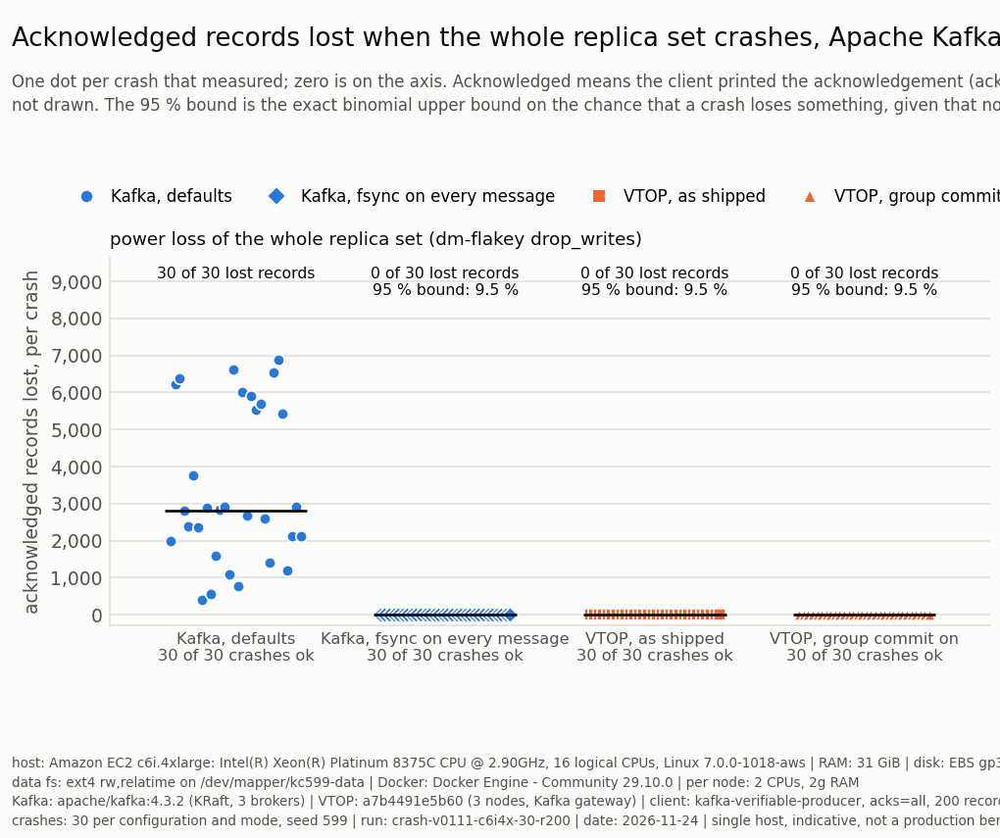
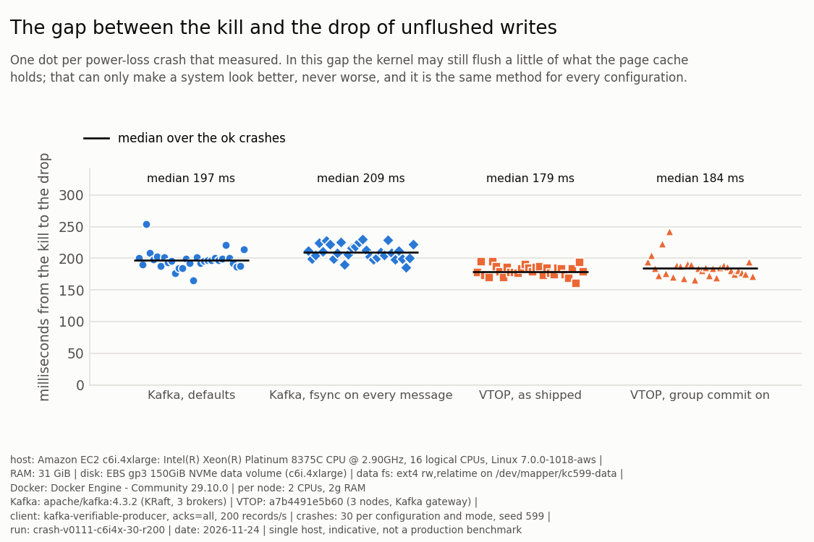

<!-- Generated by benchmarks/kafka_compare/crash_report.py from ../../benchmarks/kafka_compare/results/crash-v0111-c6i4x-30-r200/crash.csv. Do not edit by hand: change the generator or re-run the benchmark. -->

# Whole-replica-set crash: acknowledged records after power loss, VTOP vs Apache Kafka

> **Single host, Amazon EC2 c6i.4xlarge, Docker Engine - Community; indicative, not a production benchmark.** Each crash brings up a fresh three-node cluster, kills all three nodes at once and reads back what the producer had been told was safe.

[#599](https://github.com/allamiro/vtop-engine/issues/599), part of [#595](https://github.com/allamiro/vtop-engine/issues/595); charts per [#600](https://github.com/allamiro/vtop-engine/issues/600). Raw data: [`crash.csv`](../../benchmarks/kafka_compare/results/crash-v0111-c6i4x-30-r200/crash.csv) and [`environment.json`](../../benchmarks/kafka_compare/results/crash-v0111-c6i4x-30-r200/environment.json), run `crash-v0111-c6i4x-30-r200`. Every number below is generated from those files by `benchmarks/kafka_compare/crash_report.py`.

## What was measured

30 crashes per configuration and mode, a producer at 200 records/s, crash times drawn from one seed (599) in a window of 25 to 55 seconds after the producer starts, so every configuration sees the same schedule. Configurations:

- `kafka-defaults`: Kafka as shipped: no flush.messages, an acknowledgement is replication
- `kafka-fsync-parity`: log.flush.interval.messages=1 on every broker and flush.messages=1 on the topic
- `vtop-shipped`: node configuration as shipped (no group_commit section): acknowledged after a quorum (2 of 3) has fsynced; answers both Kafka profiles
- `vtop-group-commit-on`: the shipped leader plus group_commit.enabled: true (concurrent produce requests share one fsync and one replication round)

Crash modes:

- `flakey-drop`: SIGKILL of all three nodes at once, then every write the page cache had not flushed is dropped (dm-flakey drop_writes): power loss of the whole replica set

Definitions:

- **Acknowledged:** the client printed `producer_send_success` for the record, with `acks=all`, before the cluster
  was killed. The client is stopped right after the cluster, so nothing is acknowledged after the crash.
- **Lost:** an acknowledged record that a read of the whole partition, after the cluster is back and a sentinel
  record has been acknowledged, does not find. A record that was written but never acknowledged is neither a loss
  nor a duplicate.
- **Duplicate, reordered, offset mismatch:** an extra copy of a record id in that read; a record read after one with
  a larger id; an acknowledged record that is present but not at the offset it was acknowledged at.
- **Sentinel needed:** the read before the sentinel and the read after it differ, that is, records acknowledged
  before the crash were not served until a new write was committed (a restarted leader serves what is
  cluster-committed). It says when the answer arrived, not that anything was lost.
- **Refused:** the crash's canary did not behave (the fsynced canary must be whole after the crash; the unsynced
  one must be absent or short in a power-loss crash and whole after a process kill). The method did not do what it
  claims, so the row says nothing about the system; it is kept, with its reason, and never counted as ok.
- **Failed:** the crash could not be measured to the end, for example because the cluster did not serve after the
  restart (the row then says `needed_manual_repair`). Kept, with its reason, and never counted as ok.

## Loss: acknowledged records that were not there afterwards

Counted over the ok crashes only. "95 % bound" is the exact one-sided upper bound on the chance that a crash loses something, given that none of the ok crashes did; it is printed only for a cell that lost nothing.

| configuration | mode | ok crashes | acknowledged | lost | crashes that lost records | median lost in those | worst crash | 95 % bound |
|---|---|---|---|---|---|---|---|---|
| Kafka, defaults | flakey-drop | 30 of 30 | 242,114 | **102,663** | 30 of 30 | 2,821 | 6,895 | - |
| Kafka, fsync on every message | flakey-drop | 30 of 30 | 241,211 | **0** | 0 of 30 | - | 0 | 9.5 % |
| VTOP, as shipped | flakey-drop | 30 of 30 | 240,703 | **0** | 0 of 30 | - | 0 | 9.5 % |
| VTOP, group commit on | flakey-drop | 30 of 30 | 240,709 | **0** | 0 of 30 | - | 0 | 9.5 % |

- `kafka-defaults` under flakey-drop: acknowledged records were lost in 30 of 30 crashes (102,663 records in all, 6,895 in the worst crash).
- `kafka-fsync-parity` under flakey-drop: no acknowledged record was lost in 30 crashes. Zero of 30 bounds the chance that a crash loses something only to 9.5 % at 95 % confidence (exact binomial), so this is evidence for the guarantee, not proof of it.
- `vtop-shipped` under flakey-drop: no acknowledged record was lost in 30 crashes. Zero of 30 bounds the chance that a crash loses something only to 9.5 % at 95 % confidence (exact binomial), so this is evidence for the guarantee, not proof of it.
- `vtop-group-commit-on` under flakey-drop: no acknowledged record was lost in 30 crashes. Zero of 30 bounds the chance that a crash loses something only to 9.5 % at 95 % confidence (exact binomial), so this is evidence for the guarantee, not proof of it.



## Everything else the read-back checks

| configuration | mode | duplicates | reordered | offset mismatch | unexpected values | sentinel needed | refused | failed | needed manual repair |
|---|---|---|---|---|---|---|---|---|---|
| Kafka, defaults | flakey-drop | 0 | 0 | 0 | 0 | 0 of 30 | 0 | 0 | 0 |
| Kafka, fsync on every message | flakey-drop | 0 | 0 | 0 | 0 | 0 of 30 | 0 | 0 | 0 |
| VTOP, as shipped | flakey-drop | 0 | 0 | 0 | 0 | 30 of 30 | 0 | 0 | 0 |
| VTOP, group commit on | flakey-drop | 0 | 0 | 0 | 0 | 30 of 30 | 0 | 0 | 0 |

## The gap between the kill and the drop

`kill_to_drop_ms`: the time from the kill to the moment unflushed writes were dropped. In it the kernel may flush a little more, which can only make a system look better.

| configuration | median (min - max) | crashes |
|---|---|---|
| Kafka, defaults | 197 ms (164 ms - 254 ms) | 30 |
| Kafka, fsync on every message | 209 ms (186 ms - 230 ms) | 30 |
| VTOP, as shipped | 179 ms (160 ms - 194 ms) | 30 |
| VTOP, group commit on | 184 ms (166 ms - 243 ms) | 30 |



## Every crash

One row per crash, in the order the harness ran them. `missing before sentinel` is what the first read lacked; `lost` is what the second read, after the sentinel, still lacked.

| configuration | mode | crash | status | acknowledged | missing before sentinel | lost | oldest lost, s before the kill | duplicates | reordered | sentinel needed | kill to drop, ms | recovery, s |
|---|---|---|---|---|---|---|---|---|---|---|---|---|
| kafka-defaults | flakey-drop | 1 | ok | 9,092 | 1,996 | 1,996 | 10.0 | 0 | 0 | no | 200 | 26.5 |
| kafka-defaults | flakey-drop | 2 | ok | 6,225 | 6,225 | 6,225 | 30.6 | 0 | 0 | no | 190 | 24.0 |
| kafka-defaults | flakey-drop | 3 | ok | 6,388 | 6,388 | 6,388 | 31.4 | 0 | 0 | no | 254 | 23.9 |
| kafka-defaults | flakey-drop | 4 | ok | 9,791 | 2,796 | 2,796 | 14.0 | 0 | 0 | no | 208 | 26.6 |
| kafka-defaults | flakey-drop | 5 | ok | 9,461 | 2,396 | 2,396 | 12.0 | 0 | 0 | no | 198 | 26.6 |
| kafka-defaults | flakey-drop | 6 | ok | 10,806 | 3,763 | 3,763 | 18.8 | 0 | 0 | no | 203 | 26.5 |
| kafka-defaults | flakey-drop | 7 | ok | 8,431 | 2,349 | 2,349 | 11.7 | 0 | 0 | no | 188 | 26.4 |
| kafka-defaults | flakey-drop | 8 | ok | 7,439 | 387 | 387 | 1.9 | 0 | 0 | no | 201 | 26.4 |
| kafka-defaults | flakey-drop | 9 | ok | 9,962 | 2,894 | 2,894 | 14.5 | 0 | 0 | no | 194 | 26.5 |
| kafka-defaults | flakey-drop | 10 | ok | 7,611 | 570 | 570 | 2.9 | 0 | 0 | no | 196 | 26.4 |
| kafka-defaults | flakey-drop | 11 | ok | 8,542 | 1,604 | 1,604 | 8.0 | 0 | 0 | no | 177 | 26.5 |
| kafka-defaults | flakey-drop | 12 | ok | 9,857 | 2,846 | 2,846 | 14.2 | 0 | 0 | no | 184 | 26.4 |
| kafka-defaults | flakey-drop | 13 | ok | 9,949 | 2,926 | 2,926 | 14.6 | 0 | 0 | no | 185 | 26.4 |
| kafka-defaults | flakey-drop | 14 | ok | 8,089 | 1,082 | 1,082 | 5.4 | 0 | 0 | no | 199 | 26.5 |
| kafka-defaults | flakey-drop | 15 | ok | 6,628 | 6,628 | 6,628 | 32.7 | 0 | 0 | no | 192 | 23.8 |
| kafka-defaults | flakey-drop | 16 | ok | 7,772 | 768 | 768 | 3.8 | 0 | 0 | no | 164 | 26.4 |
| kafka-defaults | flakey-drop | 17 | ok | 6,023 | 6,023 | 6,023 | 29.7 | 0 | 0 | no | 202 | 23.9 |
| kafka-defaults | flakey-drop | 18 | ok | 9,654 | 2,675 | 2,675 | 13.4 | 0 | 0 | no | 192 | 26.5 |
| kafka-defaults | flakey-drop | 19 | ok | 5,902 | 5,902 | 5,902 | 29.1 | 0 | 0 | no | 195 | 24.0 |
| kafka-defaults | flakey-drop | 20 | ok | 5,528 | 5,528 | 5,528 | 27.1 | 0 | 0 | no | 197 | 24.0 |
| kafka-defaults | flakey-drop | 21 | ok | 5,699 | 5,699 | 5,699 | 28.0 | 0 | 0 | no | 197 | 23.9 |
| kafka-defaults | flakey-drop | 22 | ok | 9,544 | 2,591 | 2,591 | 12.9 | 0 | 0 | no | 200 | 26.6 |
| kafka-defaults | flakey-drop | 23 | ok | 8,483 | 1,397 | 1,397 | 7.0 | 0 | 0 | no | 197 | 26.4 |
| kafka-defaults | flakey-drop | 24 | ok | 6,545 | 6,545 | 6,545 | 32.2 | 0 | 0 | no | 200 | 23.9 |
| kafka-defaults | flakey-drop | 25 | ok | 6,895 | 6,895 | 6,895 | 34.0 | 0 | 0 | no | 221 | 23.9 |
| kafka-defaults | flakey-drop | 26 | ok | 5,441 | 5,441 | 5,441 | 26.8 | 0 | 0 | no | 200 | 24.1 |
| kafka-defaults | flakey-drop | 27 | ok | 8,236 | 1,204 | 1,204 | 6.0 | 0 | 0 | no | 193 | 26.6 |
| kafka-defaults | flakey-drop | 28 | ok | 9,153 | 2,128 | 2,128 | 10.6 | 0 | 0 | no | 187 | 26.3 |
| kafka-defaults | flakey-drop | 29 | ok | 9,860 | 2,905 | 2,905 | 14.5 | 0 | 0 | no | 188 | 26.5 |
| kafka-defaults | flakey-drop | 30 | ok | 9,108 | 2,112 | 2,112 | 10.6 | 0 | 0 | no | 214 | 26.4 |
| kafka-fsync-parity | flakey-drop | 1 | ok | 9,064 | 0 | 0 | - | 0 | 0 | no | 212 | 26.6 |
| kafka-fsync-parity | flakey-drop | 2 | ok | 6,194 | 0 | 0 | - | 0 | 0 | no | 200 | 26.5 |
| kafka-fsync-parity | flakey-drop | 3 | ok | 6,358 | 0 | 0 | - | 0 | 0 | no | 205 | 26.6 |
| kafka-fsync-parity | flakey-drop | 4 | ok | 9,760 | 0 | 0 | - | 0 | 0 | no | 224 | 26.7 |
| kafka-fsync-parity | flakey-drop | 5 | ok | 9,432 | 0 | 0 | - | 0 | 0 | no | 210 | 26.6 |
| kafka-fsync-parity | flakey-drop | 6 | ok | 10,774 | 0 | 0 | - | 0 | 0 | no | 227 | 26.6 |
| kafka-fsync-parity | flakey-drop | 7 | ok | 8,397 | 0 | 0 | - | 0 | 0 | no | 222 | 26.5 |
| kafka-fsync-parity | flakey-drop | 8 | ok | 7,412 | 0 | 0 | - | 0 | 0 | no | 199 | 26.5 |
| kafka-fsync-parity | flakey-drop | 9 | ok | 9,930 | 0 | 0 | - | 0 | 0 | no | 208 | 26.7 |
| kafka-fsync-parity | flakey-drop | 10 | ok | 7,582 | 0 | 0 | - | 0 | 0 | no | 225 | 26.5 |
| kafka-fsync-parity | flakey-drop | 11 | ok | 8,521 | 0 | 0 | - | 0 | 0 | no | 190 | 26.6 |
| kafka-fsync-parity | flakey-drop | 12 | ok | 9,816 | 0 | 0 | - | 0 | 0 | no | 206 | 26.5 |
| kafka-fsync-parity | flakey-drop | 13 | ok | 9,922 | 0 | 0 | - | 0 | 0 | no | 216 | 26.6 |
| kafka-fsync-parity | flakey-drop | 14 | ok | 8,065 | 0 | 0 | - | 0 | 0 | no | 219 | 26.7 |
| kafka-fsync-parity | flakey-drop | 15 | ok | 6,593 | 0 | 0 | - | 0 | 0 | no | 226 | 26.5 |
| kafka-fsync-parity | flakey-drop | 16 | ok | 7,737 | 0 | 0 | - | 0 | 0 | no | 230 | 26.6 |
| kafka-fsync-parity | flakey-drop | 17 | ok | 5,998 | 0 | 0 | - | 0 | 0 | no | 213 | 26.5 |
| kafka-fsync-parity | flakey-drop | 18 | ok | 9,620 | 0 | 0 | - | 0 | 0 | no | 202 | 26.6 |
| kafka-fsync-parity | flakey-drop | 19 | ok | 5,882 | 0 | 0 | - | 0 | 0 | no | 198 | 26.6 |
| kafka-fsync-parity | flakey-drop | 20 | ok | 5,499 | 0 | 0 | - | 0 | 0 | no | 202 | 26.5 |
| kafka-fsync-parity | flakey-drop | 21 | ok | 5,668 | 0 | 0 | - | 0 | 0 | no | 210 | 26.6 |
| kafka-fsync-parity | flakey-drop | 22 | ok | 9,519 | 0 | 0 | - | 0 | 0 | no | 205 | 26.7 |
| kafka-fsync-parity | flakey-drop | 23 | ok | 8,446 | 0 | 0 | - | 0 | 0 | no | 229 | 26.4 |
| kafka-fsync-parity | flakey-drop | 24 | ok | 6,510 | 0 | 0 | - | 0 | 0 | no | 208 | 26.6 |
| kafka-fsync-parity | flakey-drop | 25 | ok | 6,860 | 0 | 0 | - | 0 | 0 | no | 198 | 26.7 |
| kafka-fsync-parity | flakey-drop | 26 | ok | 5,410 | 0 | 0 | - | 0 | 0 | no | 212 | 26.5 |
| kafka-fsync-parity | flakey-drop | 27 | ok | 8,206 | 0 | 0 | - | 0 | 0 | no | 199 | 26.7 |
| kafka-fsync-parity | flakey-drop | 28 | ok | 9,128 | 0 | 0 | - | 0 | 0 | no | 186 | 26.7 |
| kafka-fsync-parity | flakey-drop | 29 | ok | 9,833 | 0 | 0 | - | 0 | 0 | no | 200 | 26.7 |
| kafka-fsync-parity | flakey-drop | 30 | ok | 9,075 | 0 | 0 | - | 0 | 0 | no | 222 | 26.6 |
| vtop-shipped | flakey-drop | 1 | ok | 9,019 | 9,019 | 0 | - | 0 | 0 | yes | 177 | 9.7 |
| vtop-shipped | flakey-drop | 2 | ok | 6,179 | 6,179 | 0 | - | 0 | 0 | yes | 194 | 9.7 |
| vtop-shipped | flakey-drop | 3 | ok | 6,351 | 6,351 | 0 | - | 0 | 0 | yes | 174 | 9.7 |
| vtop-shipped | flakey-drop | 4 | ok | 9,738 | 9,738 | 0 | - | 0 | 0 | yes | 170 | 9.7 |
| vtop-shipped | flakey-drop | 5 | ok | 9,400 | 9,400 | 0 | - | 0 | 0 | yes | 194 | 9.7 |
| vtop-shipped | flakey-drop | 6 | ok | 10,762 | 10,762 | 0 | - | 0 | 0 | yes | 187 | 9.7 |
| vtop-shipped | flakey-drop | 7 | ok | 8,392 | 8,392 | 0 | - | 0 | 0 | yes | 178 | 9.9 |
| vtop-shipped | flakey-drop | 8 | ok | 7,382 | 7,382 | 0 | - | 0 | 0 | yes | 169 | 9.6 |
| vtop-shipped | flakey-drop | 9 | ok | 9,908 | 9,908 | 0 | - | 0 | 0 | yes | 185 | 9.7 |
| vtop-shipped | flakey-drop | 10 | ok | 7,565 | 7,565 | 0 | - | 0 | 0 | yes | 178 | 9.7 |
| vtop-shipped | flakey-drop | 11 | ok | 8,514 | 8,514 | 0 | - | 0 | 0 | yes | 177 | 9.7 |
| vtop-shipped | flakey-drop | 12 | ok | 9,817 | 9,817 | 0 | - | 0 | 0 | yes | 177 | 9.8 |
| vtop-shipped | flakey-drop | 13 | ok | 9,904 | 9,904 | 0 | - | 0 | 0 | yes | 184 | 9.7 |
| vtop-shipped | flakey-drop | 14 | ok | 8,042 | 8,042 | 0 | - | 0 | 0 | yes | 190 | 9.7 |
| vtop-shipped | flakey-drop | 15 | ok | 6,591 | 6,591 | 0 | - | 0 | 0 | yes | 184 | 9.8 |
| vtop-shipped | flakey-drop | 16 | ok | 7,726 | 7,726 | 0 | - | 0 | 0 | yes | 178 | 9.8 |
| vtop-shipped | flakey-drop | 17 | ok | 5,978 | 5,978 | 0 | - | 0 | 0 | yes | 186 | 9.7 |
| vtop-shipped | flakey-drop | 18 | ok | 9,604 | 9,604 | 0 | - | 0 | 0 | yes | 187 | 9.8 |
| vtop-shipped | flakey-drop | 19 | ok | 5,871 | 5,871 | 0 | - | 0 | 0 | yes | 173 | 9.7 |
| vtop-shipped | flakey-drop | 20 | ok | 5,480 | 5,480 | 0 | - | 0 | 0 | yes | 185 | 9.8 |
| vtop-shipped | flakey-drop | 21 | ok | 5,642 | 5,642 | 0 | - | 0 | 0 | yes | 177 | 9.8 |
| vtop-shipped | flakey-drop | 22 | ok | 9,495 | 9,495 | 0 | - | 0 | 0 | yes | 175 | 9.8 |
| vtop-shipped | flakey-drop | 23 | ok | 8,440 | 8,440 | 0 | - | 0 | 0 | yes | 185 | 9.8 |
| vtop-shipped | flakey-drop | 24 | ok | 6,495 | 6,495 | 0 | - | 0 | 0 | yes | 184 | 9.8 |
| vtop-shipped | flakey-drop | 25 | ok | 6,840 | 6,840 | 0 | - | 0 | 0 | yes | 175 | 9.8 |
| vtop-shipped | flakey-drop | 26 | ok | 5,390 | 5,390 | 0 | - | 0 | 0 | yes | 168 | 9.7 |
| vtop-shipped | flakey-drop | 27 | ok | 8,191 | 8,191 | 0 | - | 0 | 0 | yes | 183 | 9.7 |
| vtop-shipped | flakey-drop | 28 | ok | 9,097 | 9,097 | 0 | - | 0 | 0 | yes | 160 | 9.8 |
| vtop-shipped | flakey-drop | 29 | ok | 9,820 | 9,820 | 0 | - | 0 | 0 | yes | 194 | 9.8 |
| vtop-shipped | flakey-drop | 30 | ok | 9,070 | 9,070 | 0 | - | 0 | 0 | yes | 179 | 9.8 |
| vtop-group-commit-on | flakey-drop | 1 | ok | 9,053 | 9,053 | 0 | - | 0 | 0 | yes | 195 | 9.7 |
| vtop-group-commit-on | flakey-drop | 2 | ok | 6,180 | 6,180 | 0 | - | 0 | 0 | yes | 205 | 9.7 |
| vtop-group-commit-on | flakey-drop | 3 | ok | 6,355 | 6,355 | 0 | - | 0 | 0 | yes | 184 | 9.6 |
| vtop-group-commit-on | flakey-drop | 4 | ok | 9,743 | 9,743 | 0 | - | 0 | 0 | yes | 173 | 9.7 |
| vtop-group-commit-on | flakey-drop | 5 | ok | 9,408 | 9,408 | 0 | - | 0 | 0 | yes | 223 | 9.6 |
| vtop-group-commit-on | flakey-drop | 6 | ok | 10,736 | 10,736 | 0 | - | 0 | 0 | yes | 177 | 9.7 |
| vtop-group-commit-on | flakey-drop | 7 | ok | 8,388 | 8,388 | 0 | - | 0 | 0 | yes | 243 | 9.8 |
| vtop-group-commit-on | flakey-drop | 8 | ok | 7,411 | 7,411 | 0 | - | 0 | 0 | yes | 171 | 9.6 |
| vtop-group-commit-on | flakey-drop | 9 | ok | 9,894 | 9,894 | 0 | - | 0 | 0 | yes | 189 | 9.6 |
| vtop-group-commit-on | flakey-drop | 10 | ok | 7,569 | 7,569 | 0 | - | 0 | 0 | yes | 188 | 9.7 |
| vtop-group-commit-on | flakey-drop | 11 | ok | 8,508 | 8,508 | 0 | - | 0 | 0 | yes | 168 | 9.7 |
| vtop-group-commit-on | flakey-drop | 12 | ok | 9,798 | 9,798 | 0 | - | 0 | 0 | yes | 191 | 9.7 |
| vtop-group-commit-on | flakey-drop | 13 | ok | 9,901 | 9,901 | 0 | - | 0 | 0 | yes | 190 | 9.7 |
| vtop-group-commit-on | flakey-drop | 14 | ok | 8,044 | 8,044 | 0 | - | 0 | 0 | yes | 166 | 9.7 |
| vtop-group-commit-on | flakey-drop | 15 | ok | 6,570 | 6,570 | 0 | - | 0 | 0 | yes | 184 | 9.7 |
| vtop-group-commit-on | flakey-drop | 16 | ok | 7,732 | 7,732 | 0 | - | 0 | 0 | yes | 181 | 9.8 |
| vtop-group-commit-on | flakey-drop | 17 | ok | 5,979 | 5,979 | 0 | - | 0 | 0 | yes | 186 | 9.7 |
| vtop-group-commit-on | flakey-drop | 18 | ok | 9,597 | 9,597 | 0 | - | 0 | 0 | yes | 174 | 9.7 |
| vtop-group-commit-on | flakey-drop | 19 | ok | 5,862 | 5,862 | 0 | - | 0 | 0 | yes | 184 | 9.7 |
| vtop-group-commit-on | flakey-drop | 20 | ok | 5,489 | 5,489 | 0 | - | 0 | 0 | yes | 169 | 9.8 |
| vtop-group-commit-on | flakey-drop | 21 | ok | 5,650 | 5,650 | 0 | - | 0 | 0 | yes | 186 | 9.7 |
| vtop-group-commit-on | flakey-drop | 22 | ok | 9,502 | 9,502 | 0 | - | 0 | 0 | yes | 189 | 9.8 |
| vtop-group-commit-on | flakey-drop | 23 | ok | 8,445 | 8,445 | 0 | - | 0 | 0 | yes | 186 | 9.7 |
| vtop-group-commit-on | flakey-drop | 24 | ok | 6,498 | 6,498 | 0 | - | 0 | 0 | yes | 181 | 9.6 |
| vtop-group-commit-on | flakey-drop | 25 | ok | 6,852 | 6,852 | 0 | - | 0 | 0 | yes | 176 | 9.8 |
| vtop-group-commit-on | flakey-drop | 26 | ok | 5,389 | 5,389 | 0 | - | 0 | 0 | yes | 181 | 9.8 |
| vtop-group-commit-on | flakey-drop | 27 | ok | 8,184 | 8,184 | 0 | - | 0 | 0 | yes | 178 | 9.8 |
| vtop-group-commit-on | flakey-drop | 28 | ok | 9,086 | 9,086 | 0 | - | 0 | 0 | yes | 175 | 9.8 |
| vtop-group-commit-on | flakey-drop | 29 | ok | 9,820 | 9,820 | 0 | - | 0 | 0 | yes | 195 | 9.8 |
| vtop-group-commit-on | flakey-drop | 30 | ok | 9,066 | 9,066 | 0 | - | 0 | 0 | yes | 172 | 9.7 |

## Limits

The harness records this about its own method: page-cache loss of one host for all three replicas at once; not a drive whose volatile cache lies about flushes, not a torn block, not independent crashes; the kernel can flush a little more between the kill and the drop (kill_to_drop_ms).

- **Few crashes.** 30 per configuration and mode. A configuration that loses nothing in 30 crashes is bounded to 9.5 % at 95 % confidence, not proven safe; the bound is printed beside every cell that lost nothing.
- **One host.** All three replicas of both systems share one machine, one kernel, one filesystem and one
  failure domain, on purpose: the crash takes all three at once. This is the loss of one host's page cache, not a
  rack, a zone or independent failures.
- **A simulation of power loss.** `flakey-drop` kills the processes and then drops every write the page cache had not
  flushed (dm-flakey `drop_writes`), which is a kernel panic or power loss with a disk that honours flushes. It does
  not model a drive whose volatile write cache lies about flushes, a torn write inside a block, or a hardware
  write-back cache. It is not the `echo b > /proc/sysrq-trigger` of a virtual machine that #599 preferred, which
  needs a second machine for the client.
- **Small records.** The client is `kafka-verifiable-producer.sh`, whose value prefix must be an integer and which
  has no record-size flag, so a record is a few bytes of text. The loss window of a page cache depends on time, not
  on bytes.
- **VTOP without its metadata plane.** VTOP runs as a static range leader with two followers, so there is no lease
  and no election after the restart; Kafka runs its full KRaft quorum.

## Environment

```
host: Amazon EC2 c6i.4xlarge: Intel(R) Xeon(R) Platinum 8375C CPU @ 2.90GHz, 16 logical CPUs, Linux 7.0.0-1018-aws | RAM: 31 GiB | disk: EBS gp3 150GiB NVMe data volume (c6i.4xlarge) | data fs: ext4 rw,relatime on /dev/mapper/kc599-data | Docker: Docker Engine - Community 29.10.0 | per node: 2 CPUs, 2g RAM
Kafka: apache/kafka:4.3.2 (KRaft, 3 brokers) | VTOP: a7b4491e5b60 (3 nodes, Kafka gateway) | client: kafka-verifiable-producer, acks=all, 200 records/s | crashes: 30 per configuration and mode, seed 599 | run: crash-v0111-c6i4x-30-r200 | date: 2026-11-24 | single host, indicative, not a production benchmark
```
