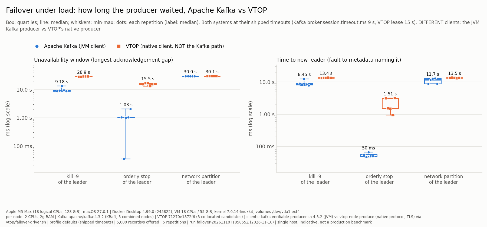
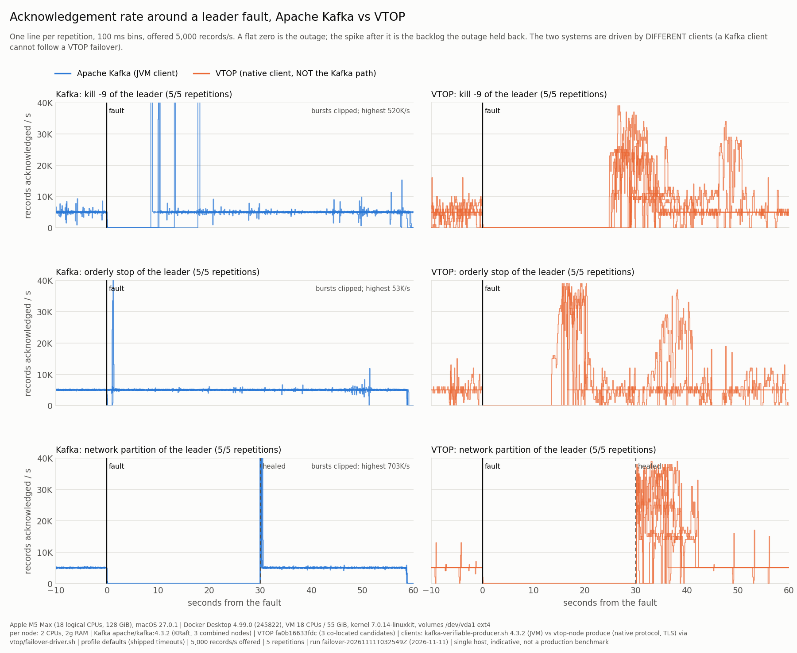

# Failover under load: VTOP vs Apache Kafka, measured

<!-- Generated by benchmarks/kafka_compare/report.py from the committed CSVs. Do not edit by hand: change the generator or re-run the benchmark. -->

> **Single host, Apple M5 Max (Mac17,6), Docker Desktop 4.99.0 (245822); indicative, not a production benchmark.** Both clusters ran as Linux containers in the same Docker Desktop VM, one at a time, with identical per-node limits.

[#597](https://github.com/allamiro/vtop-engine/issues/597), part of [#595](https://github.com/allamiro/vtop-engine/issues/595); charts per [#600](https://github.com/allamiro/vtop-engine/issues/600). Raw data: [`failover.csv`](../../benchmarks/kafka_compare/results/failover-20261110T185855Z/failover.csv), [`timeline.csv`](../../benchmarks/kafka_compare/results/failover-20261110T185855Z/timeline.csv) and [`environment.json`](../../benchmarks/kafka_compare/results/failover-20261110T185855Z/environment.json), run `failover-20261110T185855Z`. Every number below is generated from those files by `benchmarks/kafka_compare/report.py`.

## First finding: a Kafka client cannot follow a VTOP failover

The only VTOP topology that fails over by itself is the one the Helm chart renders for a replicated range: every node a **candidate**, the role following the metadata lease (#284). A candidate refuses the Kafka gateway at startup, as a co-located node and as a data node alike:

```
error: `kafka` is configured on a Candidate node: the gateway is served by a leader or standalone only — it holds one broker, and a candidate's changes with the lease (#225)
```

The gateway runs only on a `leader` or `standalone` node. A leased `leader` with followers can carry it (live-chaos scenario 20), but followers run no lease agent and never take the range themselves (`crates/vtop-node/src/lease_watcher.rs`): failing over that shape means restarting a follower with a rewritten leader config, which is what scenario 09 does by hand. So there is no promoted node for a Kafka client's metadata refresh to find, and no failover through the Kafka wire protocol to measure. The phase-1 static leader could not fail over at all (no lease, plaintext replica plane).

**What was measured instead, labelled everywhere:** VTOP's failover through its **native** client (`vtop-node produce`, driven by `vtop/failover-driver.sh`, which looks the leader up in the range lease and resumes from the acknowledged floor), against Kafka's failover through its own JVM client. The clusters are the fair part of the comparison (three nodes each, identical limits, both voters of their metadata quorum and replicas of the partition); the clients are not the same program, so the numbers compare two client+cluster paths, not two clusters behind one client.

## Correctness: acknowledged records lost and duplicated

After every repetition the whole partition was read back: Kafka with `kafka-console-consumer.sh` from offset 0, every acknowledged value compared as text with what was sent; VTOP with `vtop-node verify`, which checks every visible record byte-exact against the producer's sequence, in order (a duplicate or a gap fails it).

| system | fault | repetitions read back | acknowledged records lost | duplicates | read-back failures |
|---|---|---|---|---|---|
| Apache Kafka (JVM client) | kill -9 of the leader | 5 of 5 | **0** | **0** | 0 |
| Apache Kafka (JVM client) | orderly stop of the leader | 5 of 5 | **0** | **0** | 0 |
| Apache Kafka (JVM client) | network partition of the leader | 5 of 5 | **0** | **0** | 0 |
| VTOP (native client, NOT the Kafka path) | kill -9 of the leader | 5 of 5 | **0** | **0** | 0 |
| VTOP (native client, NOT the Kafka path) | orderly stop of the leader | 5 of 5 | **0** | **0** | 0 |
| VTOP (native client, NOT the Kafka path) | network partition of the leader | 5 of 5 | **0** | **0** | 0 |

Every repetition that reached its read-back found every acknowledged record, once, byte-exact, on both systems.

## Headline

Median (min - max) over the repetitions that ran, each system at its shipped timeouts.

| fault | system | unavailability window (longest ack gap after the fault) | time to new leader | p99 latency, 30 s after | p99 latency, 30 s before | client retries (each client's own count, not comparable) | acked lost | duplicates |
|---|---|---|---|---|---|---|---|---|
| kill -9 of the leader | Kafka | 9.18 s (8.91 s - 13.5 s) | 8.45 s (7.89 s - 12.5 s) | 8.88 s (8.61 s - 13.2 s) | 8 ms (6 ms - 8 ms) | 4 (2 - 4) | 0 (0 - 0) | 0 (0 - 0) |
| kill -9 of the leader | VTOP | 28.9 s (28.6 s - 29.0 s) | 13.4 s (13.2 s - 13.6 s) | 28.7 s (28.3 s - 28.8 s) | 8 ms (8 ms - 9 ms) | 256 (231 - 258) | 0 (0 - 0) | 0 (0 - 0) |
| orderly stop of the leader | Kafka | 1.03 s (35 ms - 2.06 s) | 50 ms (47 ms - 66 ms) | 750 ms (7 ms - 1.78 s) | 7 ms (7 ms - 9 ms) | 2 (2 - 2) | 0 (0 - 0) | 0 (0 - 0) |
| orderly stop of the leader | VTOP | 15.5 s (13.3 s - 16.9 s) | 1.51 s (937 ms - 3.13 s) | 15.3 s (13.0 s - 16.7 s) | 8 ms (8 ms - 8 ms) | 111 (108 - 145) | 0 (0 - 0) | 0 (0 - 0) |
| network partition of the leader | Kafka | 30.0 s (30.0 s - 30.0 s) | 11.7 s (8.84 s - 12.8 s) | 29.7 s (29.7 s - 29.8 s) | 8 ms (7 ms - 9 ms) | 5 (5 - 5) | 0 (0 - 0) | 0 (0 - 0) |
| network partition of the leader | VTOP | 30.1 s (30.1 s - 30.1 s) | 13.5 s (12.9 s - 13.6 s) | 29.9 s (29.9 s - 29.9 s) | 8 ms (8 ms - 9 ms) | 13 (7 - 29) | 0 (0 - 0) | 0 (0 - 0) |

The unavailability window is the longest gap between acknowledgements after the fault, so a repetition with no outage still reports one: its longest ordinary gap. In Kafka stop_leader repetition 2 (35 ms, starting 615 ms after the fault, against a 30 ms steady-state longest gap) the gap is within twice the steady-state one: the producer saw no outage, and that value is jitter, not a failover time. It is still counted in the median and range above.

**VTOP latency in this run is understated by up to 19.8 ms.** Its producer (`vtop-node produce --rate`, batches of 100) sent each batch when the batch's FIRST record was due, so the batch's other records left up to 19.8 ms before their scheduled send time, and a latency measured from the schedule is short by up to that much. Against VTOP's 30 s-before p99 (at most 9 ms here) that is not a small error, so that column is not comparable with Kafka's; against its 30 s-after p99 (at least 13.0 s here) it is. The unavailability window and the time to new leader do not use the schedule. The producer now waits until a batch's last record is due; a VTOP p99 before that is comparable needs a re-run.





## Per repetition

| system | fault | rep | status | leader | leader was metadata leader | unavailable | gap starts | steady max gap | to new leader | new leader | p99 after | sent errors | retries | re-routes | error classes | verify |
|---|---|---|---|---|---|---|---|---|---|---|---|---|---|---|---|---|
| Kafka | kill9_leader | 1 | ok | 2 | false | 8.95 s | 4 ms | 27 ms | 8.98 s | 3 | 8.66 s | 0 | 4 | - | code:NETWORK_EXCEPTION 2; connect_failures 13; retries 4 | passed |
| Kafka | kill9_leader | 2 | ok | 1 | false | 9.18 s | 11 ms | 29 ms | 8.19 s | 2 | 8.88 s | 0 | 4 | - | code:NETWORK_EXCEPTION 2; connect_failures 13; retries 4 | passed |
| Kafka | kill9_leader | 3 | ok | 2 | true | 13.5 s | 10 ms | 30 ms | 12.5 s | 3 | 13.2 s | 0 | 4 | - | code:NETWORK_EXCEPTION 2; connect_failures 16; retries 4 | passed |
| Kafka | kill9_leader | 4 | ok | 2 | false | 9.44 s | 4 ms | 46 ms | 8.45 s | 3 | 9.14 s | 0 | 4 | - | code:NETWORK_EXCEPTION 2; connect_failures 13; retries 4 | passed |
| Kafka | kill9_leader | 5 | ok | 2 | false | 8.91 s | 13 ms | 37 ms | 7.89 s | 3 | 8.61 s | 0 | 2 | - | code:NETWORK_EXCEPTION 1; connect_failures 12; retries 2 | passed |
| Kafka | stop_leader | 1 | ok | 1 | false | 1.03 s | 44 ms | 25 ms | 56 ms | 2 | 764 ms | 0 | 2 | - | code:NOT_LEADER_OR_FOLLOWER 1; retries 2 | passed |
| Kafka | stop_leader | 2 | ok | 2 | false | 35 ms | 615 ms | 30 ms | 47 ms | 3 | 7 ms | 0 | 2 | - | code:NOT_LEADER_OR_FOLLOWER 1; retries 2 | passed |
| Kafka | stop_leader | 3 | ok | 3 | true | 1.03 s | 46 ms | 28 ms | 66 ms | 1 | 739 ms | 0 | 2 | - | code:NOT_LEADER_OR_FOLLOWER 1; retries 2 | passed |
| Kafka | stop_leader | 4 | ok | 3 | false | 1.03 s | 42 ms | 26 ms | 50 ms | 1 | 750 ms | 0 | 2 | - | code:NOT_LEADER_OR_FOLLOWER 1; retries 2 | passed |
| Kafka | stop_leader | 5 | ok | 2 | false | 2.06 s | 36 ms | 31 ms | 50 ms | 3 | 1.78 s | 0 | 2 | - | code:NOT_LEADER_OR_FOLLOWER 1; retries 2 | passed |
| Kafka | partition_leader | 1 | ok | 1 | false | 30.0 s | 8 ms | 32 ms | 8.84 s | 2 | 29.7 s | 0 | 5 | - | code:REQUEST_TIMED_OUT 5; retries 5 | passed |
| Kafka | partition_leader | 2 | ok | 2 | true | 30.0 s | 10 ms | 35 ms | 11.7 s | 3 | 29.8 s | 0 | 5 | - | code:REQUEST_TIMED_OUT 5; retries 5 | passed |
| Kafka | partition_leader | 3 | ok | 1 | true | 30.0 s | 9 ms | 36 ms | 12.8 s | 2 | 29.7 s | 0 | 5 | - | code:REQUEST_TIMED_OUT 5; retries 5 | passed |
| Kafka | partition_leader | 4 | ok | 3 | true | 30.0 s | 9 ms | 25 ms | 12.8 s | 1 | 29.7 s | 0 | 5 | - | code:REQUEST_TIMED_OUT 5; retries 5 | passed |
| Kafka | partition_leader | 5 | ok | 3 | false | 30.0 s | 10 ms | 37 ms | 8.87 s | 1 | 29.7 s | 0 | 5 | - | code:REQUEST_TIMED_OUT 5; retries 5 | passed |
| VTOP | kill9_leader | 1 | ok | 1 | true | 28.6 s | 12 ms | 43 ms | 13.2 s | 3 | 28.3 s | 231 | 231 | 1 | connection lost 1; name not resolvable 98; node not serving (handshake closed) 132 | passed |
| VTOP | kill9_leader | 2 | ok | 3 | false | 28.8 s | 9 ms | 36 ms | 13.4 s | 1 | 28.5 s | 254 | 254 | 1 | connection lost 1; name not resolvable 113; node not serving (handshake closed) 140 | passed |
| VTOP | kill9_leader | 3 | ok | 3 | false | 28.9 s | -2 ms | 33 ms | 13.4 s | 1 | 28.7 s | 256 | 256 | 1 | connection lost 1; name not resolvable 112; node not serving (handshake closed) 143 | passed |
| VTOP | kill9_leader | 4 | ok | 3 | false | 29.0 s | 12 ms | 35 ms | 13.6 s | 1 | 28.8 s | 258 | 258 | 1 | connection lost 1; name not resolvable 113; node not serving (handshake closed) 144 | passed |
| VTOP | kill9_leader | 5 | ok | 3 | false | 29.0 s | -0 ms | 39 ms | 13.5 s | 1 | 28.7 s | 258 | 258 | 1 | connection lost 1; name not resolvable 114; node not serving (handshake closed) 143 | passed |
| VTOP | stop_leader | 1 | ok | 1 | true | 15.5 s | 12 ms | 35 ms | 3.08 s | 3 | 15.3 s | 110 | 110 | 1 | connection lost 1; node not serving (handshake closed) 109 | passed |
| VTOP | stop_leader | 2 | ok | 3 | false | 16.9 s | 14 ms | 45 ms | 1.51 s | 2 | 16.7 s | 143 | 143 | 1 | connection lost 1; node not serving (handshake closed) 142 | passed |
| VTOP | stop_leader | 3 | ok | 3 | false | 16.9 s | -1 ms | 36 ms | 1.50 s | 1 | 16.7 s | 145 | 145 | 1 | connection lost 1; node not serving (handshake closed) 144 | passed |
| VTOP | stop_leader | 4 | ok | 2 | false | 13.3 s | -6 ms | 42 ms | 937 ms | 1 | 13.0 s | 111 | 111 | 1 | connection lost 1; node not serving (handshake closed) 110 | passed |
| VTOP | stop_leader | 5 | ok | 1 | true | 15.5 s | 11 ms | 32 ms | 3.13 s | 3 | 15.3 s | 108 | 108 | 1 | connection lost 1; node not serving (handshake closed) 107 | passed |
| VTOP | partition_leader | 1 | ok | 3 | false | 30.1 s | 11 ms | 35 ms | 13.5 s | 2 | 29.9 s | 13 | 13 | 1 | node not serving (handshake closed) 12; request timeout 1 | passed |
| VTOP | partition_leader | 2 | ok | 3 | false | 30.1 s | 6 ms | 32 ms | 13.6 s | 1 | 29.9 s | 29 | 29 | 1 | node not serving (handshake closed) 12; produce rejected 16; request timeout 1 | passed |
| VTOP | partition_leader | 3 | ok | 3 | false | 30.1 s | 19 ms | 46 ms | 13.5 s | 1 | 29.9 s | 13 | 13 | 1 | node not serving (handshake closed) 12; request timeout 1 | passed |
| VTOP | partition_leader | 4 | ok | 1 | true | 30.1 s | 13 ms | 41 ms | 12.9 s | 3 | 29.9 s | 7 | 7 | 1 | node not serving (handshake closed) 6; request timeout 1 | passed |
| VTOP | partition_leader | 5 | ok | 3 | false | 30.1 s | 14 ms | 34 ms | 13.4 s | 1 | 29.9 s | 11 | 11 | 1 | node not serving (handshake closed) 10; request timeout 1 | passed |

## Method

- **Clusters (rule 1).** Kafka: three combined broker+controller nodes in KRaft mode
  (`compose.kafka.yml`), the topic created with one partition, RF=3, `min.insync.replicas=2`. VTOP: three
  co-located nodes, each a metadata Raft voter and a candidate replica of one range
  (`compose.vtop-ha.yml`, `vtop/ha-node-*.yaml`), quorum acknowledgement (2 of 3), TLS on every plane
  (promotion is refused on a plaintext replica plane); Kafka's listeners are PLAINTEXT, as `compose.kafka.yml`
  ships them, so the VTOP side also pays TLS handshakes on every reconnect. Every node 2 CPUs, 2g, no
  swap, a named volume on `/dev/vda1 ext4`. Each repetition starts from empty volumes, one system at a time.
- **Load.** 5,000 records/s offered for 475,000 records, `acks=all`, one partition, one producer. The
  rate is well under both systems' saturation (phase 1: about 24K records/s for VTOP at 100 B through the
  gateway; its native client reached about 16K records/s closed-loop in batches of 100 while this
  benchmark was built), so neither cluster recovers from a full queue. Kafka:
  `kafka-verifiable-producer.sh --throughput 5000 --acks -1`, bootstrapped at all three brokers, idempotent
  and every timeout at the client's default; its records are the decimal sequence numbers (1-6 bytes, no
  key). VTOP: `vtop-node produce --rate 5000` in batches of 100 records (8-byte key, 8-byte value),
  one producer identity for the run, `--request-timeout-ms 30000` and a 100 ms back-off (the JVM client's
  `request.timeout.ms` and `retry.backoff.ms` defaults). The driver looks the leader up in the range lease
  only when a produce ends, the way the JVM client refreshes metadata on an error; both schedules are anchored
  for the whole run, so what an outage held back is sent as a backlog afterwards.
- **Timeline.** 5 s warm-up, 30 s "before" window, the fault, 60 s "after". Faults, on the
  partition's leader (Kafka: the broker all three name as leader, ISR full; VTOP: the lease holder):
  `kill9_leader` = `docker kill --signal KILL`; `stop_leader` = `docker stop -t 30` (SIGTERM: Kafka's
  controlled shutdown, VTOP's orderly shutdown that releases the lease); `partition_leader` =
  `docker network disconnect`, reconnected after 30 s. A killed or stopped node stays down for the rest
  of the repetition.
- **Measurements.** *Unavailability window*: the longest gap between consecutive acknowledgements that ends
  after the fault (for a crash, the last ack before the fault to the first after; it also catches an outage
  that starts after the signal, as an orderly stop's does). *Steady max gap*: the longest such gap in the 30 s
  before the fault, for scale. *Time to new leader*: fault to the first observation naming another leader:
  Kafka, any broker's Metadata answer (`metadata_probe.py`, each broker every 100 ms); VTOP, the range lease
  read every 100 ms. *Latency*: acknowledgement time minus the record's intended send time on the fixed-rate
  schedule (no coordinated omission), p99 of the records due in the 30 s after the fault vs the 30 s before.
  *Retries*: Kafka, the producer's logged retried requests; VTOP, produce attempts after the first.
  Timestamps are the Docker VM's clock (producer, observers); the fault is stamped on the host and moved onto
  that clock by a per-repetition `docker exec date` probe, whose half-width is recorded
  (`clock_uncertainty_ms`).
- **Repetition (rule 7).** 5 repetitions per (system, fault), Kafka and VTOP alternating; median and
  min-max reported, every repetition listed. A repetition that failed is a row, not a retry.

## Timeouts that decide these numbers (rule 5)

| system | setting | value | source |
|---|---|---|---|
| Kafka broker | `broker.session.timeout.ms` | `9000` | `kafka-configs --describe --all`, broker 1 |
| Kafka broker | `replica.lag.time.max.ms` | `30000` | `kafka-configs --describe --all`, broker 1 |
| Kafka broker | `unclean.leader.election.enable` | `false` | `kafka-configs --describe --all`, broker 1 |
| Kafka client | `request.timeout.ms` | `30000` | the producer's own config dump |
| Kafka client | `delivery.timeout.ms` | `120000` | the producer's own config dump |
| Kafka client | `retry.backoff.ms` | `100` | the producer's own config dump |
| Kafka client | `metadata.max.age.ms` | `300000` | the producer's own config dump |
| Kafka client | `enable.idempotence` | `true` | the producer's own config dump |
| Kafka client | `acks` | `-1` | the producer's own config dump |
| Kafka client | `linger.ms` | `5` | the producer's own config dump |
| Kafka client | `metadata.recovery.strategy` | `rebootstrap` | the producer's own config dump |
| VTOP lease | `lease_duration_ms` | `15000` | binary defaults (crates/vtop-node/src/config.rs), no override in vtop/ha-node-*.yaml |
| VTOP lease | `poll_interval_ms` | `2000` | binary defaults (crates/vtop-node/src/config.rs), no override in vtop/ha-node-*.yaml |
| VTOP lease | `renew_interval_ms` | `5000` | binary defaults (crates/vtop-node/src/config.rs), no override in vtop/ha-node-*.yaml |
| VTOP metadata Raft | `election_timeout_max_ms` | `600` | binary defaults |
| VTOP metadata Raft | `election_timeout_min_ms` | `300` | binary defaults |
| VTOP metadata Raft | `heartbeat_interval_ms` | `60` | binary defaults |
| VTOP native driver | `backoff_ms` | `100` | vtop/failover-driver.sh, set to the JVM client's request.timeout.ms and retry.backoff.ms defaults |
| VTOP native driver | `lease_observer_poll_ms` | `100` | vtop/failover-driver.sh `LEASE_POLL_SECONDS`: the lease observer's poll, which feeds only the time to new leader, never the producer |
| VTOP native driver | `request_timeout_ms` | `30000` | vtop/failover-driver.sh, set to the JVM client's request.timeout.ms and retry.backoff.ms defaults |
| both observers | poll interval | `100 ms` | `metadata_probe.py`, `failover-driver.sh` |

No `matched-timeouts` profile was run: these are the shipped defaults, and the failover times follow from them more than from either mechanism.

## Reading the results

- **Crash (`kill -9`).** Both systems wait out a timeout before anything else can happen. Kafka's controller
  fences the dead broker after `broker.session.timeout.ms` (9 s) and elects a leader from the ISR; the client
  finds it on its next metadata refresh. VTOP's survivors cannot take the range until the dead holder's lease
  expires (15 s), then the winner fences the replicas at a new epoch and establishes the committed boundary
  from a quorum before serving. The node logs of every VTOP crash repetition (`logs/vtop-kill9_leader-*/`)
  show three steps after the fault, in order: (1) the lease lapses and a survivor is granted it (the time-to-
  leader column; the dead holder's last renewal sets how much of the 15 s remains); (2) the first promotion
  attempt is refused with `too few replicas could confirm the committed boundary ... answered=1 required=2`,
  because the other survivor has not yet adopted the new epoch from its own lease poll (2 s), and the retry
  succeeds (`verified promotion`); (3) **`range lease held` is followed about 10 s later by
  `data_node_role_changed role=leader`**: on taking the range, a candidate waits up to 10 s for a replica
  stream to EVERY peer before it serves (`crates/vtop-node/src/data_node.rs`, the wait before
  `LocalBroker::with_replication` in the candidate's leader build), and after a crash one peer is the dead
  node, so the full 10 s always elapses although a quorum (itself plus the live follower) is already
  there. Step 3 is a third or more of every VTOP crash window here and is not a safety requirement;
  waiting for a quorum of streams instead of all of them would remove it. Kafka has no counterpart: its
  window is the 9 s session timeout plus the election and the client's metadata refresh. Part of the
  remaining difference is 9 s vs 15 s, i.e. configuration; a matched-timeouts profile would separate the two.
- **Orderly stop.** Kafka's controlled shutdown moves leadership before the broker exits. VTOP releases its
  lease on SIGTERM (#280; the node logs `range lease released for shutdown`), so a survivor acquires it
  within its next lease poll instead of waiting out the expiry, which is why its time to new leader is short.
  The same two steps as after a crash then follow (a refused first promotion attempt, then the ~10 s wait for
  a replica stream to the node that has just stopped), so the producer's window is much longer than the
  leader handover itself.
- **Partition.** The isolated leader cannot be told it is deposed. Kafka's controller fences it after the
  session timeout and elects another leader, but the JVM producer holds its in-flight request to the isolated
  broker until `request.timeout.ms` (30 s) before it refreshes metadata; VTOP's isolated holder cannot renew its
  lease, and the native driver also waits out its 30 s request timeout. In both, the client's request timeout,
  not the cluster's election, sets the window.
- **What VTOP's promotion adds** (verified boundary, fenced epochs, the transition record in metadata) costs
  little time next to the lease expiry; it is why no acknowledged record may be lost, and the read-back table
  above is the evidence for this run. Issue #611 describes a suspected path where a promotion could truncate a
  quorum-acknowledged record; this benchmark's read-backs did not hit it, which is not evidence that it cannot
  happen (#611 needs its deterministic test).
- **The clients differ.** The JVM producer buffers records while it has no leader and sends them as soon as
  metadata names one; the native driver re-reads the lease only after its produce ends (connection lost,
  refused, or a 30 s request timeout). Part of every VTOP window is that client's behaviour, not the cluster's.

- **Produce refused by a serving leader.** In partition_leader repetition 2 (16 attempts), a VTOP leader answered produce attempts with a refusal rather than an acknowledgement. The read-back of it passed: 0 acknowledged records lost, 0 duplicated. The driver log of each such repetition (`logs/vtop-<fault>-<rep>/driver.log`) has the exact lines.

## Not measured here

- **The Kafka client path on VTOP** (see the first finding). No VTOP number on this page is a Kafka client's.
- **#597's other faults:** `kill -9` of the metadata leader alone (F2) and of a follower (F5). In both
  co-located clusters the partition leader is often also the metadata leader; the per-repetition table says
  when it was.
- **`matched-timeouts` profile** and the idempotent producer turned off (#597 metric 5 asks for both).
- **Ten kills per cell** (#595 rule 7 for failover): this run has the repetitions its matrix records.
- **Evidence left behind** (#597 metric 7): VTOP's transition record is not read back here.
- **Laptop, one host.** Docker Desktop's VM; network partitions are `docker network disconnect`, not a
  packet-loss link.

## Environment

| | |
|---|---|
| `host_cpu` | `Apple M5 Max` |
| `host_model` | `Mac17,6` |
| `host_logical_cpus` | `18` |
| `host_memory_bytes` | `137438953472` |
| `host_os` | `macOS 27.0.1` |
| `docker_platform` | `Docker Desktop 4.99.0 (245822)` |
| `docker_server_version` | `29.9.3` |
| `docker_vm_cpus` | `18` |
| `docker_vm_memory_bytes` | `59389968384` |
| `docker_vm_kernel` | `7.0.14-linuxkit` |
| `docker_vm_arch` | `aarch64` |
| `docker_storage_driver` | `overlayfs` |
| `volume_filesystem` | `/dev/vda1 ext4` |
| `kafka_image` | `apache/kafka:4.3.2@sha256:852a0d49fc4e656b022e7f23785411802c9a088c78a7c5e39f33969de9c227a7` |
| `vtop_commit` | `71270e1872f6d6d4d2e7c0c905a8135646a685f3` |
| `harness_commit` | `f2827ba67711101db77d563952aa8b5240c8fb66` |
| `vtop_image` | `vtop-bench:71270e1872f6` |
| `client_kafka` | `kafka-verifiable-producer.sh 4.3.2 (JVM)` |
| `client_vtop` | `vtop-node produce (native protocol, TLS) via vtop/failover-driver.sh` |
| `client_java` | `openjdk version "21.0.12.1" 2026-08-18 LTS` |
| `observer_image` | `python:3.13-slim@sha256:bf44cdfcb76cd3b41e879bc058fc37ec5872002ccfde7fcb765e218cde0cd79c` |
| `profile` | `defaults` |
| run | `failover-20261110T185855Z`, started 2026-11-10T18:58:57+00:00, finished 2026-11-10T20:08:53+00:00 |
| charts | matplotlib 3.10.3 |

9 unrelated containers were running on the same Docker host when the run started (`environment.json`, `other_containers_at_start_count`). Both systems shared the VM with them, one system at a time; they are noise neither system chose, and part of why these are laptop numbers.
