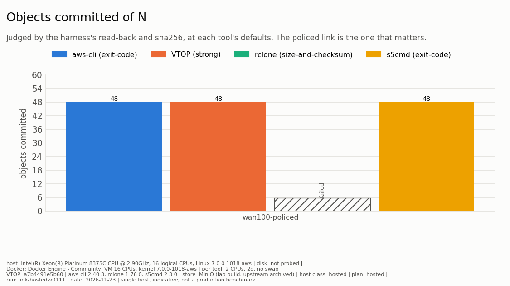

<!-- Generated by benchmarks/compare_common/report.py from ../../benchmarks/link_compare/results/link-hosted-v0111/link.csv. Do not edit; regenerate. -->
# Upload over a long, lossy and policed link: VTOP, aws-cli, rclone and s5cmd

The same seeded, incompressible files, from the same local volume, to the same lab MinIO, through the same netem middlebox (#477), by each tool in turn, in an order rotated per repetition (#747). Links: 100 ms and 10 Mbit/s with one BDP of buffer (`wan100`), the same with 1% bursty loss (`wan100-loss1`), and a 10 Mbit/s token-bucket policer with no queue (`wan100-policed`). Objects committed of N is the harness's own read-back of every object by sha256, never a tool's exit code. Goodput is committed payload over the tool's whole run, against the iperf3 calibration that brackets it (the policed link: its token rate). VTOP's goodput includes its own read-back verification; the other tools do none, and VTOP's upload-only goodput is a separate CSV column (`vtop_upload_goodput_fraction`), never drawn in its place.

Run `link-hosted-v0111`, host class `hosted`, plan `hosted`. Data: [link.csv](../../benchmarks/link_compare/results/link-hosted-v0111/link.csv), [environment.json](../../benchmarks/link_compare/results/link-hosted-v0111/environment.json).

Not run in this plan, so not drawn: Goodput at each tool's documented defaults, Goodput at equal total connections, Bytes on the wire per payload byte, CPU-seconds per GiB committed, The neighbour's goodput beside each tool, Defaults beside the best of each tool's grid.

## Where VTOP is behind, level and ahead

Generated from the scoreboard below; "level" is within 5% of the best other system.

- VTOP is behind on no metric.
- VTOP is level on: objects committed, wan100-policed (48 against aws-cli's 48).
- VTOP is ahead on no metric.

## Scoreboard

Each system in its primary profile: aws-cli `exit-code`, VTOP `strong`, rclone `size-and-checksum`, s5cmd `exit-code`.

| metric | cell | best | best value | VTOP | VTOP / best | VTOP is |
|---|---|---|---|---|---|---|
| objects committed | wan100-policed | aws-cli | 48 | 48 | 1.00 | level |

## Objects committed of N

Judged by the harness's read-back and sha256, at each tool's defaults. The policed link is the one that matters.



**objects committed** (median, min-max of the repetitions)

| cell | aws-cli | VTOP | rclone | s5cmd |
|---|---|---|---|---|
| wan100-policed | 48 | 48 | failed | 48 |

## Rows that are not ok

| system | profile | cell | rep | status | note |
|---|---|---|---|---|---|
| rclone | size-and-checksum | committed | 1 | failed | rclone exited timeout (34 of 48 files committed): |

## Reading this

Not ranked: VTOP's verification read-back (its cost is inside VTOP's end-to-end goodput and wire bytes; the other tools do not read back), and tuned results, which appear only beside the defaults with the grid size named. A run whose two calibrations disagree by more than 10% was refused, and a hosted runner's row counts only where the recorded bottleneck was the link.

## Environment

```
host: Intel(R) Xeon(R) Platinum 8375C CPU @ 2.90GHz, 16 logical CPUs, Linux 7.0.0-1018-aws | disk: not probed | Docker: Docker Engine - Community, VM 16 CPUs, kernel 7.0.0-1018-aws | per tool: 2 CPUs, 2g, no swap
VTOP: a7b4491e5b60 | aws-cli 2.40.3, rclone 1.76.0, s5cmd 2.3.0 | store: MinIO (lab build, upstream archived) | host class: hosted | plan: hosted | run: link-hosted-v0111 | date: 2026-11-23 | single host, indicative, not a production benchmark
```
