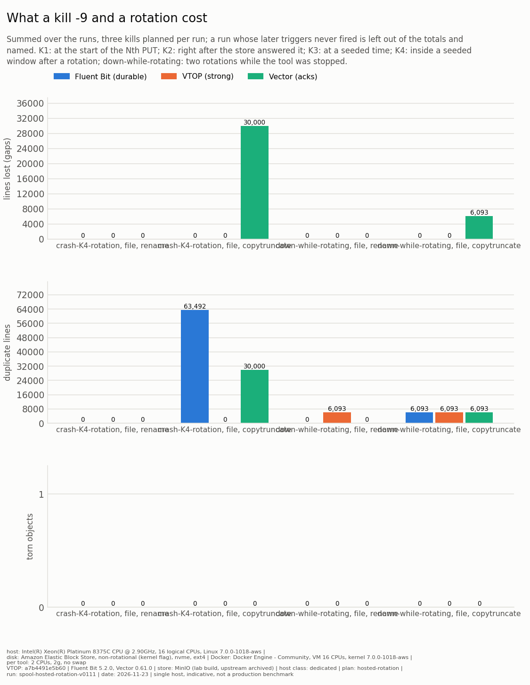

<!-- Generated by benchmarks/compare_common/report.py from ../../benchmarks/spool_compare/results/spool-hosted-rotation-v0111/spool.csv. Do not edit; regenerate. -->
# Files and a syslog spool to object storage: VTOP, Vector and Fluent Bit

A generator appends RFC 5424 lines, each with a unique seeded id, to size-rotated files (rename or copytruncate; rotated files are kept); each tool reads the same directory read-only in 2 CPUs and 2 GiB and writes to the same lab MinIO, one object per about 32 MiB or 60 s, gzip (#748). Every gap and duplicate is counted by an independent checker against the seeded ids after the tool has run to quiescence with no further fault. Fluent Bit's tail offsets may trail or lead delivery by its own documentation: a gap there is a measured consequence of its documented cursor, shown beside the settings that decide it (`storage.type`, `db.sync`), not a statement about speed.

Run `spool-hosted-rotation-v0111`, host class `dedicated`, plan `hosted-rotation`. Data: [spool.csv](../../benchmarks/spool_compare/results/spool-hosted-rotation-v0111/spool.csv), [environment.json](../../benchmarks/spool_compare/results/spool-hosted-rotation-v0111/environment.json).

Not run in this plan, so not drawn: Drain throughput, What draining costs, Time from a line's write to its object being visible.

## Where VTOP is behind, level and ahead

Generated from the scoreboard below; "level" is within 5% of the best other system.

- VTOP is behind on: duplicate lines, down-while-rotating, file, rename (6,093 against Fluent Bit's 0).
- VTOP is level on: lines lost (gaps), crash-K4-rotation, file, rename (0 against Fluent Bit's 0); lines lost (gaps), crash-K4-rotation, file, copytruncate (0 against Fluent Bit's 0); lines lost (gaps), down-while-rotating, file, rename (0 against Fluent Bit's 0); lines lost (gaps), down-while-rotating, file, copytruncate (0 against Fluent Bit's 0); duplicate lines, crash-K4-rotation, file, rename (0 against Fluent Bit's 0); duplicate lines, down-while-rotating, file, copytruncate (6,093 against Fluent Bit's 6,093); torn objects, crash-K4-rotation, file, rename (0 against Fluent Bit's 0); torn objects, crash-K4-rotation, file, copytruncate (0 against Fluent Bit's 0); torn objects, down-while-rotating, file, rename (0 against Fluent Bit's 0); torn objects, down-while-rotating, file, copytruncate (0 against Fluent Bit's 0).
- VTOP is ahead on: duplicate lines, crash-K4-rotation, file, copytruncate (0).

## Scoreboard

Each system in its primary profile: Fluent Bit `durable`, VTOP `strong`, Vector `acks`. Other profiles (Vector `disk-buffer`) are in the tables as secondary columns and in the CSV, and are not charted or ranked.

| metric | cell | best | best value | VTOP | VTOP / best | VTOP is |
|---|---|---|---|---|---|---|
| lines lost (gaps) | crash-K4-rotation, file, rename | Fluent Bit | 0 | 0 |  | level |
| lines lost (gaps) | crash-K4-rotation, file, copytruncate | Fluent Bit | 0 | 0 |  | level |
| lines lost (gaps) | down-while-rotating, file, rename | Fluent Bit | 0 | 0 |  | level |
| lines lost (gaps) | down-while-rotating, file, copytruncate | Fluent Bit | 0 | 0 |  | level |
| duplicate lines | crash-K4-rotation, file, rename | Fluent Bit | 0 | 0 |  | level |
| duplicate lines | crash-K4-rotation, file, copytruncate | VTOP | 0 | 0 |  | ahead |
| duplicate lines | down-while-rotating, file, rename | Fluent Bit | 0 | 6,093 |  | behind |
| duplicate lines | down-while-rotating, file, copytruncate | Fluent Bit | 6,093 | 6,093 | 1.00 | level |
| torn objects | crash-K4-rotation, file, rename | Fluent Bit | 0 | 0 |  | level |
| torn objects | crash-K4-rotation, file, copytruncate | Fluent Bit | 0 | 0 |  | level |
| torn objects | down-while-rotating, file, rename | Fluent Bit | 0 | 0 |  | level |
| torn objects | down-while-rotating, file, copytruncate | Fluent Bit | 0 | 0 |  | level |

## What a kill -9 and a rotation cost

Summed over the runs, three kills planned per run; a run whose later triggers never fired is left out of the totals and named. K1: at the start of the Nth PUT; K2: right after the store answered it; K3: at a seeded time; K4: inside a seeded window after a rotation; down-while-rotating: two rotations while the tool was stopped.



**lines lost (gaps)** (sum over the repetitions)

| cell | Fluent Bit | VTOP | Vector | Vector disk-buffer (secondary) |
|---|---|---|---|---|
| crash-K4-rotation, file, rename | 0 | 0 | 0 | 25,250 |
| crash-K4-rotation, file, copytruncate | 0 | 0 | 30,000 | 39,074 |
| down-while-rotating, file, rename | 0 | 0 | 0 | 0 |
| down-while-rotating, file, copytruncate | 0 | 0 | 6,093 | 6,093 |

**duplicate lines** (sum over the repetitions)

| cell | Fluent Bit | VTOP | Vector | Vector disk-buffer (secondary) |
|---|---|---|---|---|
| crash-K4-rotation, file, rename | 0 | 0 | 0 | 2,407 |
| crash-K4-rotation, file, copytruncate | 63,492 | 0 | 30,000 | 26,150 |
| down-while-rotating, file, rename | 0 | 6,093 | 0 | 0 |
| down-while-rotating, file, copytruncate | 6,093 | 6,093 | 6,093 | 6,093 |

**torn objects** (sum over the repetitions)

| cell | Fluent Bit | VTOP | Vector | Vector disk-buffer (secondary) |
|---|---|---|---|---|
| crash-K4-rotation, file, rename | 0 | 0 | 0 | 0 |
| crash-K4-rotation, file, copytruncate | 0 | 0 | 0 | 0 |
| down-while-rotating, file, rename | 0 | 0 | 0 | 0 |
| down-while-rotating, file, copytruncate | 0 | 0 | 0 | 0 |

## Reading this

Not ranked: compression ratio, inotify against polling (a configuration choice, recorded in each tool's configuration file), and verification (classified as in #744 (e); no fault is injected here). Vector's `disk-buffer` profile is in the CSV and the tables, never a second bar of Vector's colour. A K1 or K2 run whose tool went idle before every planned kill fired keeps its observed counts in the CSV and is left out of the crash totals (the table names it), so no total mixes complete and incomplete kill schedules. Power-cut survival of each tool's own state is not measured here (#748: wave 3).

## Deviations recorded by the run (rule 15)

- VTOP stores each line as read (newline-framed syslog, gzip); Vector and Fluent Bit wrap each line in a JSON object (their documented JSON output). The checker reads the id token in either form; object sizes and MiB/s are of SOURCE bytes, so the wrapping does not change them (rule 15).
- Fluent Bit's S3 output has no byte-and-age pair identical to the others': \`total\_file\_size 32M\` and \`upload\_timeout 60s\` are the closest documented settings.
- Every tool reads the active file and its rotated names (\`app.log\*\`): a backlog is written across rotated files before the tool starts. Rotated names are \`app.log.\<k\>\`, k never reused, never deleted.
- Time to store-visible uses the generator's write time and MinIO's LastModified (milliseconds), both on the Docker VM's clock.

## Environment

```
host: Intel(R) Xeon(R) Platinum 8375C CPU @ 2.90GHz, 16 logical CPUs, Linux 7.0.0-1018-aws | disk: Amazon Elastic Block Store, non-rotational (kernel flag), nvme, ext4 | Docker: Docker Engine - Community, VM 16 CPUs, kernel 7.0.0-1018-aws | per tool: 2 CPUs, 2g, no swap
VTOP: a7b4491e5b60 | Fluent Bit 5.2.0, Vector 0.61.0 | store: MinIO (lab build, upstream archived) | host class: dedicated | plan: hosted-rotation | run: spool-hosted-rotation-v0111 | date: 2026-11-23 | single host, indicative, not a production benchmark
```
