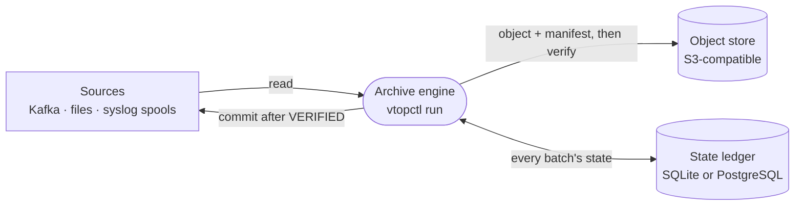

# Architecture

A deployment has three parts you run or provide, and one optional part.

## The archive engine

`vtopctl run` is one process. It discovers sources, batches records, writes
and verifies objects, and commits source positions. Its loop is single
threaded: batches are compressed, uploaded and verified several at a time
(`batching.max_concurrent_batches`, default 8), but source commits happen one
at a time, each after its own batch's verification.

One engine owns one ledger. A second engine on the same host using the same
ledger or work directory is refused at startup; several engines sharing one
PostgreSQL ledger across hosts is not supported yet.

Configured in [`config.yaml`](../configure/basics.md); deployed as in
[Deploy](../deploy/index.md).

## The state ledger

A table of batches: each batch's state, source range, object and manifest
URIs, checksums, owner and timestamps. Recovery reads it at startup to finish
or replay what was in flight, and the coverage audit reads it to prove the
archive has no holes.

- **SQLite:** a local file. The simplest choice for one engine on one host.
- **PostgreSQL:** survives the loss of the engine's host. Needs a build with
  `--features postgres`, a separate migration identity, and TLS with
  `sslmode=verify-full` for a remote database.

Committed rows can be pruned; the pruned rows are written to digest files
first, so the audit can still account for them. See
[`engine` keys](../configure/reference.md#engine) and
[Backup and recovery](../operate/backup-and-recovery.md).

## The object store

Any S3-compatible store through the native S3 client (`s3_native`, the
default), a local directory (`localfs`), or an external client (`awscli`,
`s3cmd`, `minio`). Each batch becomes an object plus a manifest, laid out by
tenant, source, format and time. With `upload.require_object_versioning`,
the engine requires a versioned bucket and pins each manifest's version.

Configured under [`upload`](../configure/reference.md#upload).

## The cluster plane (optional)

`vtop-node` is VTOP's own replicated log, built alongside the engine and not
needed by it:

- a **metadata Raft group** (three or five voters) holding topics, ranges,
  leases and node registrations;
- **data nodes** holding ranges as sealed segments, replicated to a quorum,
  with the range led by whoever holds its metadata lease;
- **promotion** of a new leader from a quorum of fenced replicas when the
  holder fails;
- a **Kafka gateway** so Kafka clients can produce and fetch;
- a **cold tier** that copies sealed segments to object storage and records
  the evidence in metadata.

See [Native cluster plane](../deploy/cluster-plane.md) to run it, and the
[native broker architecture](../NATIVE_BROKER_ARCHITECTURE.md) for its design.

## In depth

- [Architecture](../ARCHITECTURE.md): crate layout, the engine runtime flow,
  crash recovery, partitioning.
- [Protocol](../VTOP_PROTOCOL_DRAFT.md): the normative rules.
