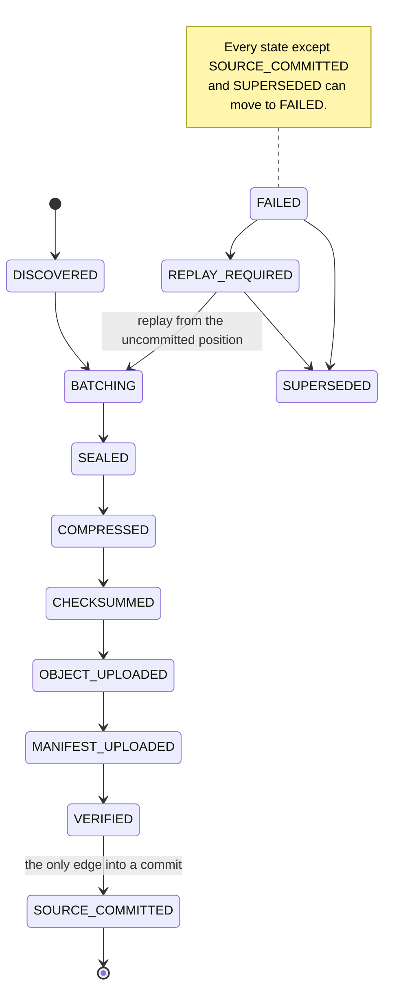

# How it works

The engine moves data in **batches**, and every batch walks the same states.
The state ledger records each step, which is what makes a crash recoverable.

## The batch lifecycle

1. **Batching.** Records from one source unit (a Kafka topic-partition, one
   file, one spool file) accumulate until the batch reaches a record count, a
   size or an age, and is **sealed**.
2. **Compress and checksum.** The sealed batch is compressed (gzip, zstd or
   none) and its checksum computed (SHA-256, BLAKE3 or none).
3. **Upload.** The object is written first, then its **manifest**: a JSON
   document binding the object to its source range, checksum, format and
   compression.
4. **Verify.** The engine checks the stored copy: through the store's own
   checksum where it kept one, or by reading the object back and hashing it.
5. **Commit.** Only a `VERIFIED` batch may advance the source position. The
   state machine refuses a commit from any other state.

`SUPERSEDED` retires a failed batch whose range the source has since committed
past, so recovery stops revisiting it. It is not a commit.

## What happens when something fails

| Crash or failure point | What the engine does next |
|---|---|
| Before the object is uploaded | Reads the range again from the source. |
| After upload, before verification | Reads the range again from the source. |
| Verification fails | Marks the batch `FAILED`; the source position does not move, so the range is read again. |
| After verification, before the commit | Retries the source commit. |
| After the commit | Nothing: the batch is complete. |

A replayed range is written under a new object key, so it can be stored
twice: a duplicate, never a gap.

## Where the pieces are set and watched

- Batch size and age, compression, checksum: the
  [`config.yaml` reference](../configure/reference.md#batching), and per
  stream in [Streams](../configure/streams.md).
- How verification is done for each stream:
  [Effective settings](../configure/print-effective.md).
- The metrics for each step, and the ones to alert on:
  [Metrics and alerts](../operate/monitoring.md).

## In depth

- [The archive path](../reference/archive-path.md): sources, formats, the
  manifest, upload backends, replay and metrics.
- [Protocol §12 to §17](../VTOP_PROTOCOL_DRAFT.md#12-state-machine): the state
  machine, the commit and replay rules, verification semantics.
