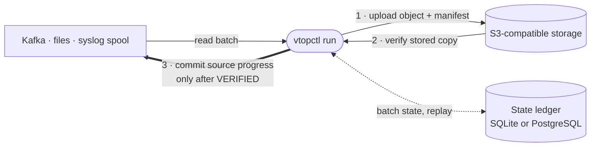

# Getting started

VTOP has two parts. Most deployments need only the first.

| Part | Binary | What it does |
|---|---|---|
| **Archive engine** | `vtopctl run` | Reads Kafka, files and syslog spools, writes verified objects to S3-compatible storage, and records every batch in a state ledger (SQLite or PostgreSQL). |
| **Cluster plane** (optional) | `vtop-node` | A native replicated log: metadata Raft, range replication, lease-driven promotion, and a Kafka wire-compatible gateway. See [Cluster plane](../deploy/cluster-plane.md). |

## How a batch is archived



1. The engine reads records from a source and seals them into a batch.
2. It compresses the batch, computes its checksum, and uploads the object and
   a manifest that binds the source range, the object and the checksum.
3. It verifies the stored copy. Only then does it commit the source position.

A crash at any step leaves the batch either replayable from the source or
waiting for its commit to be retried. The full lifecycle, the manifest and the
upload backends are on the [archive path](../reference/archive-path.md) page.

## Try it

The fastest way to watch this happen is the [Docker lab](quickstart.md): Kafka,
MinIO, seeded telemetry and the engine on one machine.

```bash
git clone https://github.com/allamiro/vtop-engine.git
cd vtop-engine
docker compose up -d
docker compose logs -f vtop-engine
```

## Next

- [Install](../install/index.md) the binaries, the container image or the chart.
- [Deploy](../deploy/index.md) a single engine, then read
  [Configure](../configure/index.md).
